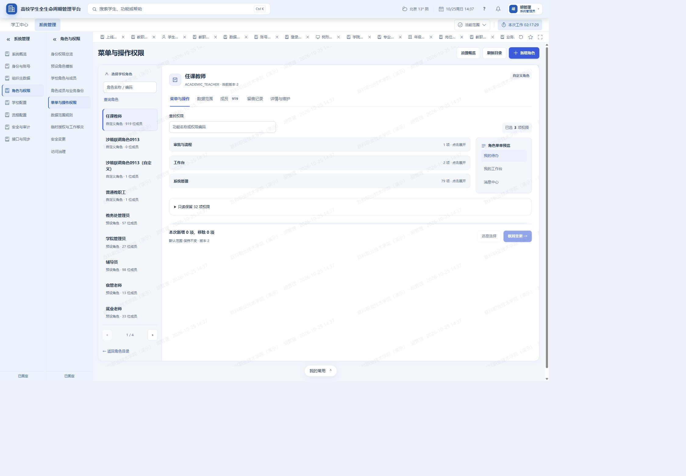
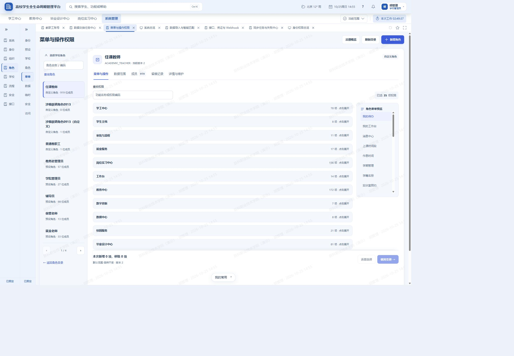

# 文档 6：系统管理中心——真实页面审计与改造设计

> 修订日期：2026-10-25；本次续审已完成重新进入 52 个系统入口、四大模块 16 个关联页面及关键详情核对。本文替换此前仅按菜单和代码规模推导的方案。
> 本轮交付：真实页面审计、功能去向及可实施的产品设计；没有实施业务代码、角色模板、菜单或数据库结构改造。设计建议不等于已开发或已验收。
> 已确认的用户要求：系统管理逐页检查，结合学工、教务、毕业设计、岗位实习；学校保留受控调整本校角色与人员分工的能力；不改变现有业务记录。


> **连续施工入口：先读第十一章11.1—11.3及11.7，再读当前卡引用的设计段落。第11.3节是唯一施工队列。当前整改13/13卡完成，D6-01至D6-13已完成本轮本地验收；未验证的外部环境见最终回执；审计完成不等于整改完成。** 本文不授予自动改数据、删旧页面、提交或部署的权限。

## 一、结论：保留共用管理能力，收拢重复入口，先修事实与职责

系统管理的主要问题不是“功能太多”，而是学校日常管理、实施工具、技术诊断混排；部分页面虽然改成中文，却把重要信息变成了“业务操作”“相关业务对象”“人员信息待同步”，仍不能帮助学校办事。已有的角色工作区、导入任务、组织树、流程版本和业务关系能力应复用，不能为了少几个菜单而删掉。

**建议保留 9 个学校日常工作区，另设按现有实施权限显示的“实施与交付”。** 这是本轮基于真实页面得出的信息架构，不要求每个角色都看见全部入口，也不以删除页面数量考核改造。

与旧方案相比，纠正以下决定：

1. **学期不是已证实的两个重复写入口。** 当前教务页负责学期定义，明确引导至系统管理统一激活；不能直接删除系统管理激活能力。先保留现有权威链，解决各域接入说明、时间显示和入口命名。
2. **国家标准库不能整体收归厂商。** 实际页面提供专业目录、简介与教学标准检索。学校仍需查阅和引用；全局采集、版本维护才属于平台。
3. **安全变更不能变成一张日志表。** 已有变更状态、版本和恢复能力，必须保留办理入口；审计页面展示其结果。
4. **数据质量和业务关系不能只向学校推送一条通知。** 学校需要辨认问题、找到责任人、跳转业务维护、查看处理结果；平台承接技术检测与故障修复。
5. **学校角色不能全部改成只读固定岗位。** 保留来源模板、本校派生角色、受控编辑、成员与范围；模板升级不自动覆盖本校配置。
6. **上线后不能把实施历史和后续变更一起关闭。** 首次初始化封板后只读；已安装版本、验收证据长期可查，新增变更另起项目，日常导入继续使用。
7. **不新增一套管理员角色来掩盖现有问题。** 本轮设计复用现有学校管理员、系统管理员、安全审计员及业务身份，权限仍读已发布模板。原方案拟新增“安全管理员”“实施人员”和合并最高权限的决定撤回为未实施提议。

## 二、本轮真实证据与范围

### 2.1 环境与操作边界

| 项目 | 实际结果 |
|---|---|
| 代码 | 当前工作区主分支，基准提交 `ff7786877`；存在其他任务改动，未重置、暂存、提交或覆盖这些改动 |
| 实际入口 | `http://127.0.0.1:5173`，对应当前工程前端；后端为本工程 `check-sandbox-runtime.py serve 8000` |
| 数据库 | 日常保留型沙箱 `student_lifecycle_runtime_20260902`、学校 `sandbox-school`；只读检查确认 503 张表，迁移版本 `20261005_aa_task_source_handoff` 与代码一致 |
| 登录 | 使用既有 `admin2` 正常表单登录；学校管理员身份检查主要页面，随后正常切换系统管理员身份补查，没有使用平台超级管理员或伪造登录 |
| 凭据恢复例外 | 用户明确要求忘记密码后重置。仅恢复本地沙箱 `admin2`：先保存受限恢复记录，更新密码和凭据版本，同事务记审计，清理旧会话；未变更角色、账号状态或其他账号。新密码不写入本文、截图或源码 |
| 页面覆盖 | 52 个系统管理菜单入口均实际进入；另核对旧角色路由、旧导入跳转。业务表单页实际显示权限拒绝，不算功能通过 |
| 关联覆盖 | 学工、教务、毕业设计、岗位实习共 16 个关联页面状态，见第五节；不是四大模块全部业务验收 |
| 操作 | 菜单点击、列表查询、分页签切换、查看详情、打开并取消临时授权表单、正常身份切换和刷新。未导入、导出敏感文件、授予权限、审批、启停模块、激活配置、重试任务或执行扫描 |
| 证据 | 本文表格直接链接本轮截图；同名 `.txt` 为对应页面可访问性文本，包含地址、状态和控件。加载中、误触发离开提示的截图保留为过程证据，不计入完成页面 |
| 尺寸 | 主体检查为电脑宽度，另补实际 1440 像素宽度与窄屏抽查；窄屏实测宽度为 375、390、431 像素，431 是请求 430 后浏览器缩放取整的实际值，不冒充精确 430；没有微信真机验收 |

本轮读取页面会产生正常登录、身份切换、拒绝访问及查询相关的安全记录。这些不是业务单据变更。部分页面展示历史演示样例，其存在、计数和状态均只作为本次界面观察；不证明这些历史样例完成过正式学校验收。

### 2.2 已复现的重点问题

“优先”表示需要先于页面合并解决；“高风险入口”表示其展示与设计需要复核，不等于本轮已经验证可以越权写入。

| 编号 | 优先级 | 真实页面事实及影响 | 具体改造要求 |
|---|---|---|---|
| 问题01 | 优先 | 系统管理员工作台展示 4 条成绩审批，点击“包装设计 成绩审核”后明确拒绝办理。待办展示与当前身份不一致。[工作台](附件/系统管理真实页面审计-20261025/69-system-admin-workbench.png)／[拒绝结果](附件/系统管理真实页面审计-20261025/70-system-admin-business-denied.png) | 待办、统计及快捷入口统一按当前身份筛选；属于本人其他已有身份的事项独立标注“切换为某身份办理”，不能先当作当前身份任务再报无权限 |
| 问题02 | 优先 | 已成功登录的 `admin2`，账号列表和详情仍显示“从未登录”“尚未登录过系统”；登录日志有成功事件但账号列为空。[账号详情](附件/系统管理真实页面审计-20261025/72-account-detail.png)／[登录日志](附件/系统管理真实页面审计-20261025/45-login-logs.png) | 对齐登录事件、账号标识和最近登录字段；无法取得记录显示“暂未取得”，不推断从未登录；详情能回查同一账号的登录日志；2026-10-25：D6-02本地整改与独立验证完成，历史缺失保留，回执见11.7 |
| 问题03 | 优先 | 本轮中午登录与密码恢复在日志里显示为凌晨时间；总览大量动作变成“业务操作”，审计对象变成“相关业务对象”。[总览](附件/系统管理真实页面审计-20261025/01-system-overview.png)／[操作日志](附件/系统管理真实页面审计-20261025/44-operation-logs.png) | 接口返回带时区时间，前端按学校时区显示；动作、业务来源和脱敏对象有统一中文映射。未知项展示“未识别的历史操作”并保留受限诊断入口，不能伪装成已准确解释；2026-10-25：D6-02本地整改与独立验证完成，历史缺失保留，回执见11.7 |
| 问题04 | 优先 | 同一实施项目显示已验收、完成度 42%；开局页版本 0，已安装页版本 1；验收页摘要写 0 项检查却列三条通过，且无可展示证据。[向导](附件/系统管理真实页面审计-20261025/03-wizard.png)／[安装](附件/系统管理真实页面审计-20261025/07-installed.png)／[验收](附件/系统管理真实页面审计-20261025/09-acceptance.png) | 使用同一项目与版本汇总；把当前检查和历史封板摘要分开；缺少证据显示“历史证据不完整”，不能以已有标签推出当前可上线 |
| 问题05 | 优先 | 已验收向导仍呈现大量保存按钮；从未改值也弹“放弃内容并离开”。[离开提示](附件/系统管理真实页面审计-20261025/04-presets-navigation-blocked.png) | 已封板项目默认只读，变更进入独立项目；脏状态仅比较用户真实编辑与加载基线，异步填入服务器值不能触发离开警告 |
| 问题06 | 优先 | 系统“岗位管理”说明列是数字编号；任职页人员列为编号，旧归属列表姓名缺失；账号归属显示英文类型前缀。[任职](附件/系统管理真实页面审计-20261025/22-staff-affiliation.png)／[账号](附件/系统管理真实页面审计-20261025/10-staff-accounts.png) | 批量解析本校姓名、工号、组织路径和任职来源；组织岗位、系统角色、业务指导关系分开展示，不用一个“岗位”词包办三种概念 |
| 问题07 | 优先 | 业务关系页列出辅导员、授课、实习等关系缺口，操作仅“重新校验”，同时暴露模型路径、关系码。[关系页](附件/系统管理真实页面审计-20261025/23-business-relations.png) | 改为“人员与业务关系问题”：问题类型、影响范围、来源模块、负责人、最近检查、去处理。模型路径等默认折叠至实施人员区；进入本域正式维护页，不在此改业务终态 |
| 问题08 | 优先 | “合规与业务表单”学校入口显示无权限，却同时显示“尚无定义”和可输入的来源评估表单。[实测](附件/系统管理真实页面审计-20261025/38-business-forms.png) | 权限失败与空数据互斥。现学校页面调用平台表单接口，不能通过增加平台权限消错；平台维护表单引擎，学校只在有实际消费者的业务中心选用获授权版本 |
| 问题09 | 优先 | 流程页提供手填编码、人工推进及默认“强制通过”；消息页能关闭业务待办；后台任务已完成仍展示重试、取消。[流程](附件/系统管理真实页面审计-20261025/41-workflow-governance-ready.png)／[消息](附件/系统管理真实页面审计-20261025/42-communications.png)／[任务](附件/系统管理真实页面审计-20261025/43-jobs.png) | 先选择真实单据或任务并展示状态、责任人、异常原因；合法动作由服务端给出。系统配置权不等于业务审批权；按原业务恢复流程办理，不提供通用“强制通过”快捷操作 |
| 问题10 | 优先 | 学期页标记学工、实习、毕设未接入；教务当前学期页明确只读，并引导统一治理；两页生效时间显示也不一致。[系统学期](附件/系统管理真实页面审计-20261025/39-academic-calendar.png)／[教务当前学期](附件/系统管理真实页面审计-20261025/59-academic-current-term.png) | 保留定义与激活的现有职责，核对激活记录和时间来源；逐业务检查消费范围，不把未接入状态当成实际所有功能均不受学期影响，更不能强迫所有批次随全校学期切换 |
| 问题11 | 优先 | 临时授权要求手填工号、角色编码及日期文本，没有可见的具体对象范围选择。[表单](附件/系统管理真实页面审计-20261025/31a-delegation-form.png) | 受控人员搜索、中文角色选择、范围说明、日期组件、原因及影响确认；代理业务分工回到对应业务中心，禁止“代班”等同授予一个全校角色 |
| 问题12 | 较高 | 模块页混列教务旧入口、工作台、系统管理与四大业务中心；文件页平台上限 50、学校配额 100，多个不同项都叫“其他业务模块”。[模块](附件/系统管理真实页面审计-20261025/36-module-entitlements.png)／[文件](附件/系统管理真实页面审计-20261025/49-file-storage.png) | 区分商业授权、校内使用状态、准备条件及基础依赖。容量展示实际可用上限与限制来源；精确命名业务归属。是否存在后端越界写入，本轮未测试 |
| 问题13 | 较高 | 数据质量显示满分、无责任人域为 0，但各责任人均“信息待同步”；闭环问题仍显示通用处理按钮。[实测](附件/系统管理真实页面审计-20261025/37-master-data.png) | 检查时间、覆盖域、责任人解析和未检查状态同时展示；满分不能替代检查覆盖率。已闭环默认只读，重新处理须走已有合法状态动作 |
| 问题14 | 较高 | 消息治理页面大段事件代码；对接页显示权限码；安全策略显示函数名；字典存在“尚未接入业务页面”。[消息](附件/系统管理真实页面审计-20261025/42-communications.png)／[策略](附件/系统管理真实页面审计-20261025/16-login-policy.png)／[字典](附件/系统管理真实页面审计-20261025/35-dictionaries.png) | 显示业务名称、影响页面和下一步；无消费者的预留字典退出日常编辑区。技术信息保留但默认折叠，不能用泛称丢失含义 |
| 问题15 | 较高 | 角色卡片、权限总览、权限配置、独立旧角色路由重复；旧路由打开后高亮落在学工。毕设导师分配子视图也丢失原准备分组。[旧角色页](附件/系统管理真实页面审计-20261025/79-legacy-role-route.png)／[导师分配](附件/系统管理真实页面审计-20261025/64-graduation-assignment.png) | 一个正式工作区管理同一角色，保留可定位的内部分页签、筛选和返回地址；统一导航契约及深链接归属，迁完消费者后再确认退役旧入口 |
| 问题16 | 较高 | 教职工关键词筛选后刷新恢复全量 1299 条，筛选丢失。[详情前筛选](附件/系统管理真实页面审计-20261025/72-account-detail.png)／[刷新](附件/系统管理真实页面审计-20261025/73-account-refresh.png) | 查询、页码、分页签写入可恢复页面状态，按学校及当前身份隔离；回到列表保留位置，切身份清除不再适用的范围 |
| 问题17 | 一般 | 窄屏主要按钮能换行，但统计和说明占用较多首屏；任务表横向滚动，右侧“下一步”不在初始视野，“我的常用”浮层可能遮住筛选。[390像素](附件/系统管理真实页面审计-20261025/78-css390.png) | 保留桌面表格；窄屏将任务名、状态和主操作固定可见，其他列横向滚动，显示滚动提示；浮层避开表单。此为抽查，不是全部手机页面验收 |
| 问题18 | 优先 | 同一“任课教师”第2版、919名成员：系统管理员看到“已选3项”、只读保留32项，菜单预览仅3入口；学校管理员看到35项和包含教务的完整菜单。两次之间没有保存角色。[受限经办身份](附件/系统管理真实页面审计-20261025/续审/R29.jpg)／[学校管理员](附件/系统管理真实页面审计-20261025/续审/R29a.jpg) | 分别展示角色总权限、当前经办人可编辑权限、不可编辑但保留权限；预览必须说明是完整角色菜单还是当前可编辑部分。保留项不因经办身份变化而被当作移除；原审计只验证展示差异，未证明保存会丢权限。2026-10-25整改：D6-01本地闭环完成，展示与隔离保存/拒绝证据见11.7；没有修改日常角色 |
| 问题19 | 较高 | 自动业务身份页确有授课和实习指导关系，却把来源称为“其他业务模块”，用教学班、实习对象的内部编号串替代对象名称；缺少按模块、批次、人员定位的查询入口。[实测](附件/系统管理真实页面审计-20261025/续审/R28a.jpg) | 复用真实关系，补课程/教学班、实习批次/学生、来源页面与受控跳转；按人和模块查询，批次由业务域限定。不能另建“自动业务身份”真值表或从角色推导负责学生 |
| 问题20 | 较高 | 正式角色授权首屏要求手输数字用户编号；列表中“已撤销”授权仍列“复核、转交、回收”。[实测](附件/系统管理真实页面审计-20261025/续审/R28.jpg) | 用本校人员远程搜索并回显姓名、工号、组织；状态与合法动作共用服务端结果。已撤销默认查看历史，若业务允许重新授予须走新的授权记录，不能复用旧记录假装仍生效。未执行这些按钮，不据此宣称后端可越权 |
| 问题21 | 优先 | 实施匹配页的历史关系显示“对象未记录→目标未记录”“来源行未记录”，同时标为“业务关系已安装”并提供“安全回滚”。本页仍从第一步跳到第五步，未解释历史记录缺少哪些步骤。[实测](附件/系统管理真实页面审计-20261025/续审/R06.jpg) | 该条归为“历史安装记录·对象证据不完整”，回滚必须先取得准确对象、原值、当前版本和影响；资料不足则只读并提示人工核对。保留原事实，不补造候选明细，不从四域现有关系倒推一个回滚目标 |
| 问题22 | 较高 | 操作日志已有多种动作及结果，但模块、动作、结果下拉框均只有“全部”；登录日志结果也只有“全部”。审计缺口显示“必要信息”，拒绝事件在证据页又成“结果待确认”。[日志](附件/系统管理真实页面审计-20261025/续审/R44.jpg)／[证据](附件/系统管理真实页面审计-20261025/续审/R47.jpg) | 筛选项来自统一目录并支持历史未知项；错误、无权、缺失字典分别说明。缺口列出具体缺什么、来源渠道和影响；同一拒绝事件在日志和证据页结果一致，不把未知映射为成功或待确认；2026-10-25：D6-02本地整改与独立验证完成，历史缺失保留，回执见11.7 |
| 问题23 | 较高 | 既有导入任务可同时显示“已完成、总行数2、有效1、错误1”；列表动作仍为“继续办理”。学校难判断有效行是否实际写入、是否需要修正剩余行。[任务列表](附件/系统管理真实页面审计-20261025/续审/R14a.jpg) | 将执行状态、预检数量与逐行执行结果分开；只有执行回执确认后才显示“成功几行”。详情解释错误、跳过及是否写入；只能按现有导入规则处理剩余行。不能从有效1行直接推断成功1行，不能为了文案一致重放整批 |

本轮出现的“1 条高危操作审计证据不完整”包含本次本机维护式密码恢复产生的记录，不将其冒充全部为原有系统缺陷；恢复操作没有网络请求编号。应让维护审计与普通页面请求审计分渠道解释，保留真实来源，不能补造历史字段。


### 2.3 本次续审：重新看页面后的结论与证据口径

本次从已登录的系统管理总览继续，先用系统管理员逐页查看，再通过正常身份切换进入该账号已经拥有的学校管理员身份，补看流程模板及四大模块。**没有新增角色、修改权限、重置密码、写入业务单据、修改配置或重启服务。** 正常身份切换和被拒绝的查询会产生安全日志，不能声称数据库完全没有任何追加记录。

- 第三节52行和第五节16行都补了“续审”截图及文本，编号与原表行号一致。流程模板在系统管理员目录中不可见，切为既有学校管理员后正常打开；业务表单的权限拒绝仍记为问题，不能记为功能验收通过。
- 旧17项问题保留，新增问题18—23。旧截图仍代表原采集时点；本次截图不覆盖旧附件。相同页的加载态或模糊截图已补拍，不使用空白页证明功能可用。
- 本次重点补查账号详情、固定角色授权与自动业务身份、同角色跨经办身份预览、历史匹配记录，以及任务中心的完成结果。没有保存表单或触发恢复动作。
- 四大模块继续核对共享对象的来源及维护入口。实际可见的同一虚构学生“联通学生甲”在毕设由王老师指导、在实习由王可欣指导；这是两种独立业务关系，不按同名“导师”强行统一。
- 电脑页面先在实测1800像素宽度核对，再校准到实测1440像素；窄屏实测375、390、431像素。浏览器请求430后实际为431，保留这个偏差，不冒充精确430。任务表在窄屏右侧主操作仍处于屏外，“我的常用”覆盖筛选附近。[1440](附件/系统管理真实页面审计-20261025/续审/R69.jpg)／[375](附件/系统管理真实页面审计-20261025/续审/R70.jpg)／[390](附件/系统管理真实页面审计-20261025/续审/R71.jpg)／[431列表](附件/系统管理真实页面审计-20261025/续审/R72a.jpg)。这不是全部页面手机验收。

本次没有把上一轮的数据库表数、迁移版本当作重新核验结果；第2.1节保留其核验时点。当前运行页面与角色展示是本次直接观察。附件中账号、学生、企业均来自本机演示沙箱，不对外上传或发布。

<details>
<summary>查看关键实测截图：同一角色的权限展示差异</summary>

系统管理员查看任课教师第2版：可编辑部分显示3项，另有32项只读保留，右侧预览只有3个入口。



学校管理员查看同一角色第2版：显示35项，预览包含教务入口。本次没有保存角色。



</details>

## 三、52 个现有入口逐页审计与去向

每行均有本轮页面截图。表中的“可读”仅表示页面确实返回并展示，不代表保存、导出、审批或权限边界全部通过。页面文件与请求链另见第七节。

| 序号 | 现有入口 | 实际观察 | 改造去向及保留能力 | 本轮证据 |
|---|---|---|---|---|
| 01 | 系统总览 | 有模块摘要、管理快捷入口和待处理事项；动作泛称、时间与本地不一致 | 保留为管理概览，修正事实口径及可办理范围 | [页面](附件/系统管理真实页面审计-20261025/01-system-overview.png) / [文本](附件/系统管理真实页面审计-20261025/01-system-overview.txt) ；续审 [截图](附件/系统管理真实页面审计-20261025/续审/R01.jpg) / [文本](附件/系统管理真实页面审计-20261025/续审/R01.txt) |
| 02 | 实施总览 | 已验收封板但还有待预览；检查表显示英文状态、角色码 | 并入实施与交付项目首页，分当前检查与历史证据 | [页面](附件/系统管理真实页面审计-20261025/02-implementation-overview.png) / [文本](附件/系统管理真实页面审计-20261025/02-implementation-overview.txt) ；续审 [截图](附件/系统管理真实页面审计-20261025/续审/R02.jpg) / [文本](附件/系统管理真实页面审计-20261025/续审/R02.txt) |
| 03 | 首次开局向导 | 已验收、42%、安装版本0；12类问答仍有保存；未编辑离开也警告 | 进入实施项目；封板只读，修改通过新变更项目 | [页面](附件/系统管理真实页面审计-20261025/03-wizard.png) / [文本](附件/系统管理真实页面审计-20261025/03-wizard.txt) ；续审 [截图](附件/系统管理真实页面审计-20261025/续审/R03.jpg) / [文本](附件/系统管理真实页面审计-20261025/续审/R03.txt) |
| 04 | 预设方案 | 显示五类开局包，属于方案选择，不是日常办理 | 保留学校查看当前方案；全局模板维护归平台 | [页面](附件/系统管理真实页面审计-20261025/04-presets.png) / [文本](附件/系统管理真实页面审计-20261025/04-presets.txt) ；续审 [截图](附件/系统管理真实页面审计-20261025/续审/R04.jpg) / [文本](附件/系统管理真实页面审计-20261025/续审/R04.txt) |
| 05 | 职业教育国家标准库 | 实际有2098项检索结果和查看章节，含英文提取状态 | 学校检索归教务专业/培养方案资料；全局采集维护归平台 | [页面](附件/系统管理真实页面审计-20261025/05-standards-ready.png) / [文本](附件/系统管理真实页面审计-20261025/05-standards-ready.txt) ；续审 [截图](附件/系统管理真实页面审计-20261025/续审/R05.jpg) / [文本](附件/系统管理真实页面审计-20261025/续审/R05.txt) |
| 06 | 数据导入与智能匹配 | 同时显示第一步上传和第五步关系候选；历史对象未记录，仍有回滚输入 | 并入实施数据准备，补步骤状态、来源和回滚影响，不替代日常开户 | [页面](附件/系统管理真实页面审计-20261025/06-data-mapping.png) / [文本](附件/系统管理真实页面审计-20261025/06-data-mapping.txt) ；续审 [截图](附件/系统管理真实页面审计-20261025/续审/R06.jpg) / [文本](附件/系统管理真实页面审计-20261025/续审/R06.txt) |
| 07 | 已安装配置 | 实际有1个安装版本，可读时间、方案和快照摘要 | 实施项目内长期保留安装历史，不因上线而隐藏 | [页面](附件/系统管理真实页面审计-20261025/07-installed.png) / [文本](附件/系统管理真实页面审计-20261025/07-installed.txt) ；续审 [截图](附件/系统管理真实页面审计-20261025/续审/R07.jpg) / [文本](附件/系统管理真实页面审计-20261025/续审/R07.txt) |
| 08 | 变更与升级 | 有现有版本和“从此版本开始变更”操作 | 并入实施变更；区分学校配置变更与厂商软件发布 | [页面](附件/系统管理真实页面审计-20261025/08-changes.png) / [文本](附件/系统管理真实页面审计-20261025/08-changes.txt) ；续审 [截图](附件/系统管理真实页面审计-20261025/续审/R08.jpg) / [文本](附件/系统管理真实页面审计-20261025/续审/R08.txt) |
| 09 | 上线检查与验收 | 已验收摘要0项检查，却有三条通过且证据未展示 | 保留验收办理与历史；缺证据明确标记，不补造通过 | [页面](附件/系统管理真实页面审计-20261025/09-acceptance.png) / [文本](附件/系统管理真实页面审计-20261025/09-acceptance.txt) ；续审 [截图](附件/系统管理真实页面审计-20261025/续审/R09.jpg) / [文本](附件/系统管理真实页面审计-20261025/续审/R09.txt) |
| 10 | 教职工账号 | 列表、筛选和详情可读；归属含类型码，最近登录口径错误 | 账号管理·教职工，详情整合登录、角色、范围和关系 | [页面](附件/系统管理真实页面审计-20261025/10-staff-accounts.png) / [文本](附件/系统管理真实页面审计-20261025/10-staff-accounts.txt) ；续审 [截图](附件/系统管理真实页面审计-20261025/续审/R10.jpg) / [文本](附件/系统管理真实页面审计-20261025/续审/R10.txt) |
| 11 | 学生账号 | 区分学籍与账号状态；约两万账号，班级选项很长 | 账号管理·学生；保留状态区分、服务端分页及级联搜索 | [页面](附件/系统管理真实页面审计-20261025/11-student-accounts.png) / [文本](附件/系统管理真实页面审计-20261025/11-student-accounts.txt) ；续审 [截图](附件/系统管理真实页面审计-20261025/续审/R11.jpg) / [文本](附件/系统管理真实页面审计-20261025/续审/R11.txt) |
| 12 | 教职工导入 | 真实五步导入界面，明确文件扫描、预检和回执边界 | 数据任务·师生开户·教职工；保留原五步能力 | [页面](附件/系统管理真实页面审计-20261025/12-teacher-import.png) / [文本](附件/系统管理真实页面审计-20261025/12-teacher-import.txt) ；续审 [截图](附件/系统管理真实页面审计-20261025/续审/R12.jpg) / [文本](附件/系统管理真实页面审计-20261025/续审/R12.txt) |
| 13 | 学生导入与账号开通 | 真实五步开户界面，说明主档复用和身份冲突 | 数据任务·师生开户·学生；不以业务名单导入替代开户 | [页面](附件/系统管理真实页面审计-20261025/13-student-import.png) / [文本](附件/系统管理真实页面审计-20261025/13-student-import.txt) ；续审 [截图](附件/系统管理真实页面审计-20261025/续审/R13.jpg) / [文本](附件/系统管理真实页面审计-20261025/续审/R13.txt) |
| 14 | 数据交换任务中心 | 15个本人任务，支持模块/全校视图；已完成仍叫继续办理 | 数据任务·任务记录；复用详情，按状态给准确下一步 | [页面](附件/系统管理真实页面审计-20261025/74-data-exchange-sysadmin.png) / [文本](附件/系统管理真实页面审计-20261025/74-data-exchange-sysadmin.txt) ；续审 [截图](附件/系统管理真实页面审计-20261025/续审/R14a.jpg) / [文本](附件/系统管理真实页面审计-20261025/续审/R14a.txt) |
| 15 | 账号异常排查 | 有教职工、学生、身份绑定、手机号四类；部分类型码裸露，列表缺处理入口 | 账号管理的异常专题，行级进入账号详情和核验 | [页面](附件/系统管理真实页面审计-20261025/15-account-exceptions.png) / [文本](附件/系统管理真实页面审计-20261025/15-account-exceptions.txt) ；续审 [截图](附件/系统管理真实页面审计-20261025/续审/R15.jpg) / [文本](附件/系统管理真实页面审计-20261025/续审/R15.txt) |
| 16 | 登录与安全策略 | 可看五项策略、来源、允许范围，直接显示配置键和函数 | 安全与审计·登录策略；技术细节折叠、中文解释影响 | [页面](附件/系统管理真实页面审计-20261025/16-login-policy.png) / [文本](附件/系统管理真实页面审计-20261025/16-login-policy.txt) ；续审 [截图](附件/系统管理真实页面审计-20261025/续审/R16.jpg) / [文本](附件/系统管理真实页面审计-20261025/续审/R16.txt) |
| 17 | 树形定位工作台 | 已有左树右表、搜索、下级分页与新增学院 | 组织与任职的主工作区，不重造组织树 | [页面](附件/系统管理真实页面审计-20261025/17-org-workspace.png) / [文本](附件/系统管理真实页面审计-20261025/17-org-workspace.txt) ；续审 [截图](附件/系统管理真实页面审计-20261025/续审/R17.jpg) / [文本](附件/系统管理真实页面审计-20261025/续审/R17.txt) |
| 18 | 学院与部门 | 同一组织页按学院切片，10项 | 保留组织树内快捷切片，不另建维护链 | [页面](附件/系统管理真实页面审计-20261025/18-org-college.png) / [文本](附件/系统管理真实页面审计-20261025/18-org-college.txt) ；续审 [截图](附件/系统管理真实页面审计-20261025/续审/R18.jpg) / [文本](附件/系统管理真实页面审计-20261025/续审/R18.txt) |
| 19 | 专业管理 | 同一组织树展示34项专业，与院系班级关联 | 组织树内专业切片，教务引用同一来源 | [页面](附件/系统管理真实页面审计-20261025/19-org-major.png) / [文本](附件/系统管理真实页面审计-20261025/19-org-major.txt) ；续审 [截图](附件/系统管理真实页面审计-20261025/续审/R19.jpg) / [文本](附件/系统管理真实页面审计-20261025/续审/R19.txt) |
| 20 | 年级与班级 | 同一组织页展示387个班级并分页 | 组织树内行政班切片，与教学班明确分开 | [页面](附件/系统管理真实页面审计-20261025/20-org-class.png) / [文本](附件/系统管理真实页面审计-20261025/20-org-class.txt) ；续审 [截图](附件/系统管理真实页面审计-20261025/续审/R20.jpg) / [文本](附件/系统管理真实页面审计-20261025/续审/R20.txt) |
| 21 | 岗位管理 | 长表列辅导员/班主任关系，说明为人员数字编号 | 并入人员任职与来源查询；不当作角色定义页 | [页面](附件/系统管理真实页面审计-20261025/21-org-position.png) / [文本](附件/系统管理真实页面审计-20261025/21-org-position.txt) ；续审 [截图](附件/系统管理真实页面审计-20261025/续审/R21.jpg) / [文本](附件/系统管理真实页面审计-20261025/续审/R21.txt) |
| 22 | 教职工任职归属查询 | 正式任职与旧归属对账并列；姓名显示为编号或缺失 | 人员任职页补姓名与来源；保留历史对账但默认收起 | [页面](附件/系统管理真实页面审计-20261025/22-staff-affiliation.png) / [文本](附件/系统管理真实页面审计-20261025/22-staff-affiliation.txt) ；续审 [截图](附件/系统管理真实页面审计-20261025/续审/R22.jpg) / [文本](附件/系统管理真实页面审计-20261025/续审/R22.txt) |
| 23 | 业务关系中心 | 六类关系，能识别四域缺口；大量技术路径，只有重新校验 | 数据任务·关系问题；转原业务入口处理，技术登记归实施 | [页面](附件/系统管理真实页面审计-20261025/23-business-relations.png) / [文本](附件/系统管理真实页面审计-20261025/23-business-relations.txt) ；续审 [截图](附件/系统管理真实页面审计-20261025/续审/R23.jpg) / [文本](附件/系统管理真实页面审计-20261025/续审/R23.txt) |
| 24 | 变更版本 | 组织预案有校验、详情、激活、退回、排期 | 组织与任职·组织变更；保留生效前影响和历史恢复 | [页面](附件/系统管理真实页面审计-20261025/24-org-version.png) / [文本](附件/系统管理真实页面审计-20261025/24-org-version.txt) ；续审 [截图](附件/系统管理真实页面审计-20261025/续审/R24.jpg) / [文本](附件/系统管理真实页面审计-20261025/续审/R24.txt) |
| 25 | 身份权限总览 | 657项权限目录和多个治理入口；部分分组泛称 | 角色与权限的核对摘要/权限目录，不再独立重复主工作区 | [页面](附件/系统管理真实页面审计-20261025/25-iam-overview.png) / [文本](附件/系统管理真实页面审计-20261025/25-iam-overview.txt) ；续审 [截图](附件/系统管理真实页面审计-20261025/续审/R25.jpg) / [文本](附件/系统管理真实页面审计-20261025/续审/R25.txt) |
| 26 | 预设角色模板 | 已发布模板可读、来源固定，有影响核对和按来源创建 | 角色与权限·模板；不整体迁平台，不覆盖本校派生角色 | [页面](附件/系统管理真实页面审计-20261025/82-template-settled.png) / [文本](附件/系统管理真实页面审计-20261025/82-template-settled.txt) ；续审 [截图](附件/系统管理真实页面审计-20261025/续审/R26.jpg) / [文本](附件/系统管理真实页面审计-20261025/续审/R26.txt) |
| 27 | 学校角色与成员 | 29个角色，支持自定义、权限、成员及维护 | 角色与权限默认入口；保留受控编辑并压缩卡片 | [页面](附件/系统管理真实页面审计-20261025/27-iam-roles.png) / [文本](附件/系统管理真实页面审计-20261025/27-iam-roles.txt) ；续审 [截图](附件/系统管理真实页面审计-20261025/续审/R27.jpg) / [文本](附件/系统管理真实页面审计-20261025/续审/R27.txt) |
| 28 | 角色成员与业务身份 | 22257条授权，可分页；2万余历史来源与复核项混入首屏风险 | 成员授权与复核并入角色工作区；按来源和风险分组 | [页面](附件/系统管理真实页面审计-20261025/28-role-assignment.png) / [文本](附件/系统管理真实页面审计-20261025/28-role-assignment.txt) ；续审 [截图](附件/系统管理真实页面审计-20261025/续审/R28.jpg) / [文本](附件/系统管理真实页面审计-20261025/续审/R28.txt) |
| 29 | 菜单与操作权限 | 已有角色选择、菜单/范围/成员/留痕步骤和菜单预览 | 保留为选中角色的工作区，修正命名与状态恢复 | [页面](附件/系统管理真实页面审计-20261025/29-permissions.png) / [文本](附件/系统管理真实页面审计-20261025/29-permissions.txt) ；续审 [截图](附件/系统管理真实页面审计-20261025/续审/R29.jpg) / [文本](附件/系统管理真实页面审计-20261025/续审/R29.txt) |
| 30 | 数据范围规则 | 3条规则、角色引用、受限预览；本人范围显示大量历史匹配人数 | 默认从角色维护；独立规则进入高级范围，准确解释人数口径 | [页面](附件/系统管理真实页面审计-20261025/30-data-scopes.png) / [文本](附件/系统管理真实页面审计-20261025/30-data-scopes.txt) ；续审 [截图](附件/系统管理真实页面审计-20261025/续审/R30.jpg) / [文本](附件/系统管理真实页面审计-20261025/续审/R30.txt) |
| 31 | 临时授权与工作移交 | 空列表可正常展示；创建表单要求手填角色编码和日期 | 权限工作区·临时授权；用受控选人与角色/期限选择 | [页面](附件/系统管理真实页面审计-20261025/31a-delegation-form.png) / [文本](附件/系统管理真实页面审计-20261025/31a-delegation-form.txt) ；续审 [截图](附件/系统管理真实页面审计-20261025/续审/R31.jpg) / [文本](附件/系统管理真实页面审计-20261025/续审/R31.txt) |
| 32 | 安全变更 | 有已生效变更、历史版本及详情/恢复入口 | 保留权限变更办理；日志只读关联结果 | [页面](附件/系统管理真实页面审计-20261025/32-security-changes.png) / [文本](附件/系统管理真实页面审计-20261025/32-security-changes.txt) ；续审 [截图](附件/系统管理真实页面审计-20261025/续审/R32.jpg) / [文本](附件/系统管理真实页面审计-20261025/续审/R32.txt) |
| 33 | 访问治理 | 有解释、职责分离、紧急访问、复核；泛称和人员同步缺口 | 权限工作区·权限核对及高级治理，保留职责控制 | [页面](附件/系统管理真实页面审计-20261025/84-duty-separation.png) / [文本](附件/系统管理真实页面审计-20261025/84-duty-separation.txt) ；续审 [截图](附件/系统管理真实页面审计-20261025/续审/R33.jpg) / [文本](附件/系统管理真实页面审计-20261025/续审/R33.txt) |
| 34 | 学校信息与品牌 | 平台核定字段只读，学校可改项有实时预览 | 学校设置·学校信息；复用现有预览与保存边界 | [页面](附件/系统管理真实页面审计-20261025/34-school-config.png) / [文本](附件/系统管理真实页面审计-20261025/34-school-config.txt) ；续审 [截图](附件/系统管理真实页面审计-20261025/续审/R34.jpg) / [文本](附件/系统管理真实页面审计-20261025/续审/R34.txt) |
| 35 | 数据字典 | 12类字典，部分平台统一；明确存在未接入业务的预留项 | 学校设置只展示有效消费者；未接入项移实施资料 | [页面](附件/系统管理真实页面审计-20261025/35-dictionaries.png) / [文本](附件/系统管理真实页面审计-20261025/35-dictionaries.txt) ；续审 [截图](附件/系统管理真实页面审计-20261025/续审/R35.jpg) / [文本](附件/系统管理真实页面审计-20261025/续审/R35.txt) |
| 36 | 模块授权与业务开关 | 把四域、旧教务、系统管理、工作台等混列为开关 | 学校设置·模块使用；商业授权、校内开关及基础依赖分清 | [页面](附件/系统管理真实页面审计-20261025/36-module-entitlements.png) / [文本](附件/系统管理真实页面审计-20261025/36-module-entitlements.txt) ；续审 [截图](附件/系统管理真实页面审计-20261025/续审/R36.jpg) / [文本](附件/系统管理真实页面审计-20261025/续审/R36.txt) |
| 37 | 主数据责任与数据质量 | 分数100、无缺责任人域，却显示责任人信息待同步；有闭环问题 | 数据任务·数据问题；补检查范围/时间及可辨认责任人 | [页面](附件/系统管理真实页面审计-20261025/37-master-data.png) / [文本](附件/系统管理真实页面审计-20261025/37-master-data.txt) ；续审 [截图](附件/系统管理真实页面审计-20261025/续审/R37.jpg) / [文本](附件/系统管理真实页面审计-20261025/续审/R37.txt) |
| 38 | 合规与业务表单 | 学校身份无权限；仍显示空定义和内部来源码评估表 | 平台表单引擎从学校移出；学校业务只使用授权表单版本 | [页面](附件/系统管理真实页面审计-20261025/38-business-forms.png) / [文本](附件/系统管理真实页面审计-20261025/38-business-forms.txt) ；续审 [截图](附件/系统管理真实页面审计-20261025/续审/R38.jpg) / [文本](附件/系统管理真实页面审计-20261025/续审/R38.txt) |
| 39 | 学年学期与业务日历 | 全校当前学期、激活和结期；显示其他三域未接入 | 学校设置·公共学期；保留单一激活来源并核对消费者 | [页面](附件/系统管理真实页面审计-20261025/39-academic-calendar.png) / [文本](附件/系统管理真实页面审计-20261025/39-academic-calendar.txt) ；续审 [截图](附件/系统管理真实页面审计-20261025/续审/R39.jpg) / [文本](附件/系统管理真实页面审计-20261025/续审/R39.txt) |
| 40 | 流程模板与运行 | 可读请假模板及两节点详情，列表业务归属与时间表述不准确 | 流程管理·模板版本；保留新旧版本与在途边界 | [页面](附件/系统管理真实页面审计-20261025/40a-workflow-detail.png) / [文本](附件/系统管理真实页面审计-20261025/40a-workflow-detail.txt) ；续审 [截图](附件/系统管理真实页面审计-20261025/续审/R40.jpg) / [文本](附件/系统管理真实页面审计-20261025/续审/R40.txt) |
| 41 | 流程安全与运行治理 | 有节点策略和人工推进，可选强制通过；本轮未执行 | 流程管理·运行异常；按真实单据和原业务权限恢复 | [页面](附件/系统管理真实页面审计-20261025/41-workflow-governance-ready.png) / [文本](附件/系统管理真实页面审计-20261025/41-workflow-governance-ready.txt) ；续审 [截图](附件/系统管理真实页面审计-20261025/续审/R41.jpg) / [文本](附件/系统管理真实页面审计-20261025/续审/R41.txt) |
| 42 | 统一消息、待办与通知治理 | 7906积压、4584逾期和大段事件码；提供关闭待办 | 通知设置与任务异常拆分；业务关闭归原业务，技术投递归平台 | [页面](附件/系统管理真实页面审计-20261025/42-communications.png) / [文本](附件/系统管理真实页面审计-20261025/42-communications.txt) ；续审 [截图](附件/系统管理真实页面审计-20261025/续审/R42.jpg) / [文本](附件/系统管理真实页面审计-20261025/续审/R42.txt) |
| 43 | 批处理与后台任务 | 统一列多个来源；已完成仍有重试/取消，状态重复/未知 | 学校保留办理任务视图；技术运行归平台，动作按状态裁定 | [页面](附件/系统管理真实页面审计-20261025/43-jobs.png) / [文本](附件/系统管理真实页面审计-20261025/43-jobs.txt) ；续审 [截图](附件/系统管理真实页面审计-20261025/续审/R43.jpg) / [文本](附件/系统管理真实页面审计-20261025/续审/R43.txt) |
| 44 | 操作与权限审计 | 可分页查询；中文动作优于总览，但对象泛称、时间偏差 | 安全与审计·操作记录；共用语义与详情追溯 | [页面](附件/系统管理真实页面审计-20261025/44-operation-logs.png) / [文本](附件/系统管理真实页面审计-20261025/44-operation-logs.txt) ；续审 [截图](附件/系统管理真实页面审计-20261025/续审/R44.jpg) / [文本](附件/系统管理真实页面审计-20261025/续审/R44.txt) |
| 45 | 登录与安全审计 | 成功/失败事件存在，账号栏为空，设备原始字符串很长 | 同一日志中心登录页签，补账号关联与简明设备信息 | [页面](附件/系统管理真实页面审计-20261025/45-login-logs.png) / [文本](附件/系统管理真实页面审计-20261025/45-login-logs.txt) ；续审 [截图](附件/系统管理真实页面审计-20261025/续审/R45.jpg) / [文本](附件/系统管理真实页面审计-20261025/续审/R45.txt) |
| 46 | 敏感与导入导出审计 | 有11条记录，动作可读，但对象泛称且没有详情操作 | 日志中心敏感页签；关联任务、用途和脱敏对象 | [页面](附件/系统管理真实页面审计-20261025/46-sensitive-audit.png) / [文本](附件/系统管理真实页面审计-20261025/46-sensitive-audit.txt) ；续审 [截图](附件/系统管理真实页面审计-20261025/续审/R46.jpg) / [文本](附件/系统管理真实页面审计-20261025/续审/R46.txt) |
| 47 | 安全审计证据与完整性 | 风险计数和证据查询存在；动作泛称，结果有待确认 | 学校保留审计问题与证据查询；底层校验维护归平台 | [页面](附件/系统管理真实页面审计-20261025/47-audit-evidence.png) / [文本](附件/系统管理真实页面审计-20261025/47-audit-evidence.txt) ；续审 [截图](附件/系统管理真实页面审计-20261025/续审/R47.jpg) / [文本](附件/系统管理真实页面审计-20261025/续审/R47.txt) |
| 48 | 完整性异常中心 | 当前筛选无异常，另有执行巡检按钮；本轮未执行 | 平台运行保障执行检测；学校展示自身文件异常结果和处理进度 | [页面](附件/系统管理真实页面审计-20261025/48-integrity.png) / [文本](附件/系统管理真实页面审计-20261025/48-integrity.txt) ；续审 [截图](附件/系统管理真实页面审计-20261025/续审/R48.jpg) / [文本](附件/系统管理真实页面审计-20261025/续审/R48.txt) |
| 49 | 文件存储治理 | 用量、学校配额、平台上限、清理/保留混排，多项叫其他模块 | 学校设置保留用量/限额；底层策略与清理归平台受控操作 | [页面](附件/系统管理真实页面审计-20261025/49-file-storage.png) / [文本](附件/系统管理真实页面审计-20261025/49-file-storage.txt) ；续审 [截图](附件/系统管理真实页面审计-20261025/续审/R49.jpg) / [文本](附件/系统管理真实页面审计-20261025/续审/R49.txt) |
| 50 | 接口、凭证与 Webhook | 当前无连接，明确连通与同步分开；技术权限码仍外露 | 第三方对接·连接，保持本校授权与脱敏凭据 | [页面](附件/系统管理真实页面审计-20261025/50-integrations.png) / [文本](附件/系统管理真实页面审计-20261025/50-integrations.txt) ；续审 [截图](附件/系统管理真实页面审计-20261025/续审/R50.jpg) / [文本](附件/系统管理真实页面审计-20261025/续审/R50.txt) |
| 51 | 同步任务与失败中心 | 当前无任务，有手工登记入口 | 并入第三方对接·同步记录，关联连接与合法动作 | [页面](附件/系统管理真实页面审计-20261025/51-sync-jobs.png) / [文本](附件/系统管理真实页面审计-20261025/51-sync-jobs.txt) ；续审 [截图](附件/系统管理真实页面审计-20261025/续审/R51.jpg) / [文本](附件/系统管理真实页面审计-20261025/续审/R51.txt) |
| 52 | 老系统数据迁移 | 加载后21域、18域已有数据、20005主档；初始短暂为0 | 实施与交付·历史迁移；保留学校签认/记录查询，加载不先显示假零 | [页面](附件/系统管理真实页面审计-20261025/52-migration-settled.png) / [文本](附件/系统管理真实页面审计-20261025/52-migration-settled.txt) ；续审 [截图](附件/系统管理真实页面审计-20261025/续审/R52.jpg) / [文本](附件/系统管理真实页面审计-20261025/续审/R52.txt) |

另核查两条注册路由：旧角色 `/admin/system/roles` 仍能显示学校角色编辑工作区且导航定位错误；旧导入 `/admin/system/identity-import` 实际跳转学生导入页。见[旧角色](附件/系统管理真实页面审计-20261025/79-legacy-role-route.png)、[旧导入承接](附件/系统管理真实页面审计-20261025/81-legacy-import-redirect.png)。本轮没有删除这两条路由。

## 四、目标菜单与具体页面设计

### 4.1 学校日常工作区

维持“系统管理”一级导航；保留全系统工作台，不把个人工作台再复制到系统总览。二级工作区按办理目标分组；三级入口只承载可独立办理的任务，页内状态、详情和角色步骤不再各占侧栏入口。

| 二级工作区 | 主入口与页内内容 | 使用者及边界 |
|---|---|---|
| 管理概览 | 待处理问题、最近变更、管理快捷入口；实施进度只显示摘要链接 | 学校管理岗位；只汇总其权限范围，不列无权办理的业务待办 |
| 账号管理 | 教职工、学生；账号详情内含登录安全、角色与范围、业务关系、审计；异常账号与手机号核验作为筛选/专题 | 本校账号管理权限；学生账号与学生主档分别展示 |
| 组织与任职 | 统一组织树，院系部门、专业、行政班切片；人员任职、组织变更 | 本校组织权限；教学班、辅导员主责、导师分配以业务中心为来源 |
| 角色与权限 | 本校角色、已发布模板、成员与范围、临时授权、权限变更、权限核对 | 现有授权配置岗位；学校自定义角色继续受控可改，不新增默认大权限 |
| 数据任务 | 师生开户导入、任务记录、数据与关系问题；迁移记录从实施空间关联进入 | 任务分本人/模块/全校范围，查看、确认、下载分别授权 |
| 学校设置 | 学校信息、有效参数、业务字典、模块使用、公共学期、通知设置、容量用量 | 仅学校可配置层；平台合同授权、全局标准、底层存储策略不可在此替代管理 |
| 流程管理 | 模板与版本、流程异常；按业务域分组并标明业务负责人 | 流程配置权限与具体业务审批权限独立 |
| 安全与审计 | 登录策略、操作记录、登录记录、敏感导出记录、审计问题 | 复用现有系统管理员和安全审计员的授权；不提供删改历史日志入口 |
| 第三方对接 | 本校连接、同步记录、对接异常；连接详情串起配置和任务 | 本校对接权限；凭据脱敏、修改留空不覆盖；不管理平台全局连接 |

“实施与交付”按现有实施权限另设工作区，包含开局、预设方案、安装版本、实施变更、历史迁移、验收记录。不是“已上线就全部消失”的临时菜单，也不要求在本轮新增角色码。

### 4.2 管理概览：从技术指标变成可处理事项

- 页面顶部显示学校、当前身份、数据读取时间；主区域是问题列表，字段为事项、影响模块、责任岗位、状态、更新时间、下一步。
- “账号异常”“导入失败”“关系缺口”“配置待确认”按本轮已有能力汇总；尚未扫描显示“未检查”，缺配置且非必需显示“未配置·按需”，不要生成假待办。
- 业务审批只在个人工作台及业务中心办理。系统管理员看到本人其他身份的事项时，明确提示切换身份，不把所有身份权限合并。
- 最近变更显示“重置账号密码”“修改角色权限”等准确动作、脱敏对象和本地时间；点击进入同一条审计详情。不能全部变成“业务操作”。
- 上线检查从日常总览降为实施摘要：显示最近检查时间、版本和历史性质；不让“历史无阻断”暗示当前学校已经可交付。

### 4.3 账号管理：以一个人为中心查明为什么能用、为什么不能用

- 教职工列表显示姓名/工号、主组织、角色数量与主要角色、账号状态、最近登录；学生列表显示姓名/学号、院系专业班级、学籍状态、账号状态，二者不能混作一个状态。
- 可搜索、按院系/角色/状态筛选，服务端分页。班级选择先按院系、年级缩小范围并支持搜索，不一次展开数百个班级选项。
- 详情固定五个页内标签：基本信息、登录与号码、角色与范围、业务关系、操作记录。手机号精确核验能力留在登录与号码中，不能挤占整个基础详情首屏。
- “角色与范围”说明角色是否启用、来源模板版本、授权期限、所属组织、对应业务关系；编码隐藏到实施人员区。
- “业务关系”按四大模块分组，仅列本人合法范围内的关系名称、来源、有效期和维护入口。不复制学生敏感业务明细。
- 账号停用、密码恢复、撤销凭据沿用现有正式能力、版本校验及审计；说明影响当前登录和待办交接，不删除历史。
- 账号异常用“需处理/待本人完成/正常停用”分组，避免把所有停用账号当错误。每行提供查看账号、联系本人或前往对应核验流程，不只有异常原因列表。

### 4.4 组织与任职：一个组织来源，业务关系有自己的维护位置

- 沿用已实现的左树右表。选择节点后显示名称、中文类型、编码、上级、人员/学生数、状态及下级；院系、专业、行政班为同一来源的快捷切片，不新建三套表。
- 人员任职必须显示姓名、工号、完整组织路径、岗位、主兼任、生效期及来源。“110”“235231”不能充当人员名称。
- “组织岗位”表示组织内承担的职务；“系统角色”表示可执行的功能；“导师/带班/授课关系”表示负责对象。界面明确三者不同，不因新增岗位自动授予业务权限。
- 组织调整继续使用现有草稿、校验、生效和历史版本能力；在生效前展示影响院系班级、人员任职及已登记的业务消费者，历史记录保留原快照。不能自动迁动已归档业务。
- 系统管理的任职查询与学工责任台账存在旧归属/正式关系两套展示。先做对账：列出同一班级的各来源、差异和维护入口；不在审计中批量覆盖或宣布哪个字段已全面退役。
- 教学班由教学任务形成，系统组织树只引用其归属或跳转，不把教学班当行政班维护。

### 4.5 角色与权限：保留自治，收拢办理链

- 入口默认是角色列表，采用紧凑表格：中文名称、类型、来源模板版本、成员数、范围摘要、状态、操作；已有卡片信息可以复用，不新增一套角色模型。
- 选择角色后，统一进入“菜单与操作 → 数据范围 → 成员 → 变更记录/维护”工作区。右侧保留菜单预览；已选数和本次增减差异清晰展示。发布模板只读，本校角色按既有权限受控编辑。
- 模板升级先比较本校差异、受影响成员与范围；不自动覆盖学校定制，不让“模板存在”“本校已绑定”“当前已生效”混成一个状态。
- 默认数据范围从角色详情维护；独立范围规则页并入“高级范围规则”，保留显式禁止、引用关系和受限影响预览。范围不等于访问人数；“本人范围”也不能用全校历史匹配人数暗示一个人能看全校。
- 人员授权列表支持按人、角色、有效期、来源和复核状态筛选；对历史导入缺来源标记“历史来源待核对”，不能把两万条学生身份都当成同等紧急问题。复核频率沿用学校现有制度，不在本轮设定新周期。
- 临时授权表单：选择本校人员、选择可授予的中文角色、显示可用范围及业务关系限制、选择期限、填写原因、核对影响；提交仍由后端按当前身份及授权上限裁定。
- 权限查询面向“某人以某身份对某对象能否执行某动作”。使用人员/业务对象搜索，结果分列模块授权、功能权限、组织范围、业务关系、状态条件及敏感限制。未输入目标对象只能给出部分结论，不能显示“全部可用”。查询本身不得建立关系或授权。
- 安全变更保留草稿、核对、现有复核、生效与恢复链；从角色编辑带入真实差异，避免再手填内部权限编码。变更办理与日志只读查询互相链接。
- 职责分离、紧急访问、定期复核保留为高级核对能力，不删除既有控制。显示真实角色、人员和工单；紧急授权期限、复核层级继续采用现有约束，不因为合并界面改变规则。

### 4.6 数据任务：导入开户、业务导入和质量问题分清

- 保留学生与教职工两种开户模板、扫描、预检、确认、回执五步；不把只有十几行的页面外壳当成可删功能的证据。
- 任务列表显示来源模块、任务名称、操作者、数量、进度、最后更新时间、状态和下一步。已完成任务叫“查看结果”，待确认叫“继续办理”，失败叫“查看原因”；不能所有任务都使用同一个动作。
- 任务详情保留已有文件状态、版本、错误明细、执行留痕；关联的初始凭据回执应直接定位到获授权的回执任务。过期明确说明并走正式恢复办法，不把文件编号当下载任务编号。
- “数据与关系问题”展示检查范围、时间、对象、问题描述、责任人和处理状态。姓名解析失败单列数据错误；不存在检查证据不显示 100 分。
- 选择问题后跳转原业务页处理，处理后回到原筛选位置。只读查看不得自动触发扫描或修复；重新检查是明确操作并留痕。
- 导入任务、业务批处理和技术运行任务共用可追踪标识，但保留不同职责：学校查看自己的办理进度；平台处理消费者宕机、扫描服务等技术故障。不要把学校的全部任务记录迁走。

### 4.7 学校设置：展示实际生效配置及其来源

- 左侧分类，右侧表单/列表；每项展示中文名称、当前值、生效来源、影响业务和允许范围。技术配置键与读取函数默认折叠为“实施人员使用”。
- 学校信息保留现有平台核定字段与学校可改字段的差别。水印和品牌预览复用现有实现；保存前显示变化项，失败保留输入。
- 业务字典只开放已明确接入消费者且允许学校调整的项。学校状态、套餐等平台字典只读；未接入项移入实施资料，不能让学校误以为保存会改变业务。
- 模块使用显示“平台授权”“学校使用状态”“准备条件”“实际可用结论”。四大模块为主要条目，迎新归学工内展示其能力关系；基础模块与旧入口不混成可随意开关的商品卡片。
- 复用现有校内开关能力，操作前列明受影响端和正在办理的业务；未知依赖先阻断并说明。不能通过关掉自己的系统管理或工作台把管理员锁在外面。具体依赖由现有授权/运行规则判定，不擅自改变商业套餐。
- 公共学期保留当前学校治理入口，教务负责定义与校历；激活页面显示当前、候选、影响消费者及未接入项。业务批次保持自己的时间范围和状态，不随全校切期自动结束。
- 通知设置只展示已支持的业务事件中文名、启用渠道、模板、参数说明和预览。渠道未购买、未配置、停用和投递失败分别显示。投递问题带来源单据、接收角色和平台排障入口，不暴露大段事件代码。
- 容量用量保留学校可读统计、有效限额与限制来源；底层分区、清理及完整性扫描归平台运行保障。文件保留期和法律保留沿用既有政策，调整仍需单独授权，不随本轮页面整理重设。

### 4.8 流程管理：配规则、看异常，不替业务审批

- 模板列表按学工、教务、毕设、实习分类，显示实际业务、负责人、使用版本、状态和在途数量。无法映射业务时显示“待确认归属”，不能把请假统称“其他业务模块”。
- 模板详情显示节点顺序、选人方式、角色、时限和适用范围；已发布版本只读，新版本只影响按原规则允许采用的新单据，在途单据继续绑定既有版本。
- 运行异常列表按单据显示卡在哪个节点、缺哪位责任人、已等待多久、业务负责人和下一步。缺关系时进入业务维护；服务故障转技术排障。
- 系统管理员没有业务审批权时，不能直接决定通过、驳回或作废。现有紧急恢复能力若需保留，必须经过已有受控流程、对象级权限与业务前置条件，不使用一个通用任务编号输入框代替。
- 业务待办完成由业务结果驱动；消息系统只负责投递和状态同步。关闭异常待办须证明来源业务已完成或原任务应撤销，不能把“关闭提醒”当业务办结。

### 4.9 安全与审计、第三方对接、实施交付

**安全与审计：** 一个日志入口，页内分操作、登录、敏感导出、审计问题。共用时间、人员、结果筛选；列表保留可辨认对象，详情展示前后变化、原因和相关办理记录。技术请求编号折叠，但不可丢弃。学校审计员继续只读；平台处理日志管线故障，学校仍能查询本校证据完整性及处理结果。

**第三方对接：** 连接列表与同步记录放在同一工作区；连接详情包含对接目标、范围、脱敏凭据、连通结果、最近同步和错误。连通成功不等于同步完成。空连接不自动算系统异常；不调用外部系统测试来填满审计结果。任务重试按实际状态、幂等及授权条件展示，学校连接与平台连接分开。

**实施与交付：** 单一项目工作区，页内分准备、配置、数据、安装、检查、历史；同一项目汇总与版本来源一致。已封板项目不直接编辑，保留历史证据及后续变更入口。国家标准的维护移平台，查阅能力放教务专业/培养方案相关页面；只有账号、组织、流程预设的安装内容才进入实施。复用现有运营平台承接表单配置版本、来源能力目录和配置校验；按学生对象的实际合规评估继续由学工、教务、毕业设计、岗位实习原入口按原权限办理，不新增平台跨校读取学生业务事实的权限（2026-10-26用户明确确认）。具体材料规则留所属业务模块，学校不填写内部模型或来源编码。


### 4.10 施工时直接采用的关键页面规格

下列规格补充4.2—4.9节，明确页面怎么组成、读什么、能按什么条件办；不新增审批节点或改变业务规则。全部目标状态均为待开发，截图均为改造前。

**甲、账号详情与关系排查。** 从教职工/学生列表点击姓名或“查看”，打开同一详情工作区；顶部固定姓名、脱敏账号、账号状态、主组织和当前经办身份。默认“基本信息”，摘要只放最近登录、角色数及关系问题数；手机号治理独立放“登录与号码”，需要时再展开。基本信息读取失败时保留详情标题和重试，不显示“从未登录”。现状见[账号详情](附件/系统管理真实页面审计-20261025/续审/R10a.jpg)。

| 页内区域 | 具体展示字段 | 主要操作与拒绝状态 |
|---|---|---|
| 登录与号码 | 最近成功登录时间、登录方式、账号锁定/待本人改密、脱敏号码及核验状态 | 查看同一账号登录记录；凭据恢复仍走现有核验。无法关联历史事件时显示“历史登录归属待核对” |
| 角色与范围 | 中文角色、类型、授权来源、起止时间、默认范围、具体组织范围、当前版本 | 有权时进入该人的成员授权；无权显示可申请的责任岗位，不放大权限 |
| 业务关系 | 模块、责任类型、业务对象、学期/批次、有效状态、维护来源、可见范围说明 | “查看关系”只读；“前往维护”只给有原业务权限的人，并带上人员和批次 |
| 操作记录 | 时间、实际经办身份、动作、对象、结果、原因、关联办理 | 查看详情；不把角色切换和密码恢复都写成“业务操作” |

账号为空、主档未绑定、关系未分配、账号已停用、来源读取失败分别显示；“账号可登录”不能推出“可以办理四大模块”。返回列表保留关键词、过滤条件与页码；切学校或身份后重新裁定范围并丢弃旧响应。

**乙、角色权限工作区。** 左侧继续复用角色目录，右侧固定角色名、版本和成员数；摘要显示“角色当前权限35项／本身份可编辑3项／只读保留32项”这类有口径的三段信息。菜单预览分“角色完整菜单”和“本次可编辑部分”，默认前者；完整读取越过经办人的可见上限时明确标为“当前仅可查看部分”，不伪造完整预览。详情可读和可编辑是两种权限，不能为补预览扩大经办人业务数据范围。[两身份对照](附件/系统管理真实页面审计-20261025/续审/R29a.jpg)。

保存只提交可编辑项的真实增减与既有版本；确认页说明保留项数量及不在本次调整范围。遇到版本冲突保留选择、重新读取后再核对；请求结果不确定时停住重复提交。未编辑时还原与确认按钮保持禁用。代码定位已核对计数只取编辑草稿、预览只取草稿菜单，见第7.4节；**没有据此声称后端已删除保留权限。**

**丙、成员授权与业务身份。** 默认先看授权台账，新增表单收进“新增授权”，避免首屏直接要求数字编号。选人采用已有候选人员查询能力：姓名/工号搜索，显示组织、在用状态与匹配原因；重名必须看工号和组织再选，稳定标识由系统传递。角色只能从当前经办人可授予目录选；期限、原因、范围及现有重复授权在同一核对区展示。学生与教职工仍分开校验，不自行调整授权期限。

固定授权表列姓名/工号、角色、来源、期限、状态、复核记录和可执行动作；已撤销记录只读，不能继续显示通用转交。自动业务身份表改为“真实业务关系”：模块、学期/批次、教师、责任类型、对象摘要、对象数、来源、查看入口。对象数是本条关系覆盖数，不能当实际可访问人数；只显示前几名时写清“另有多少个对象”，按需分页读取。授课关系展示课程和教学班，毕设/实习展示各自批次及学生。缺少名称不隐藏内部标识，但只在“实施人员使用”区展示并报解析问题。

**丁、关系与数据问题。** 一张问题列表承接关系检查和质量检测结果，按模块、问题类型、责任人、处理状态筛选；保留“这是未分配、已停用、历史对象失效还是检查失败”的差别。列表每行显示实际班级/课程/批次、影响范围、检查时间、处理责任和唯一主操作。详情按“发现依据—各来源当前值—业务办理入口—最近核对结果”排列；来源登记规则放实施区。只读进入不自动复扫，点“重新检查”才按现有权限调用检测。

对学工旧班级字段与正式责任台账不一致，展示双方当前值与生效期，由学工原办理流程核对。对已归档的实习对象，先展示批次状态，不能自动当活跃关系缺失。对宿管纯姓名关系，先通过本校人员候选核对稳定身份，不能批量同名替换。系统管理不直接为成绩、请假、周报、材料设置完成状态。

**戊、数据交换任务详情。** 列表用一行表达“业务用途＋执行状态＋逐行结果＋下一步”，详情固定四区：任务与范围、文件安全处理、逐行结果、回执及操作留痕。扫描中/预检中显示进度且不可确认；预检未通过显示可定位的行/列/原因，下载错误回执按现有权限；部分完成展示成功、错误、跳过各自数量及定义，不能用颜色替代数量；已完成的主操作为“查看结果”。任务版本、文件有效期与业务执行状态分别呈现。

凭据回执过期显示“回执已过期，不能下载”，仍保留任务历史；恢复走既有正式凭据恢复能力，不能重新导入同一批师生来拿密码。任务#6一类历史“有效1、错误1、已完成”记录原样保留，先回读执行回执；有效行数不等于已写入成功数。是否允许拆分重试由原导入规则决定。窄屏每条记录固定可见用途、状态、结果摘要和主操作，详细列按需展开；桌面继续使用表格，不增加另一套数据处理逻辑。

**己、审计与异常恢复详情。** 日志第一行只放关键词、日期范围、模块、结果；动作选择根据统一动作目录显示中文名，不要求学校输入编码。详情显示“谁以什么身份、在何时、对哪个对象、做了什么、结果如何”，随后是变更前后、原因、来源任务和证据状态。请求编号、设备原串和内部动作码默认折叠。历史缺字段明示“未记录”，不能改造时补造操作者或时间。

审计缺口要列“缺请求关联”“缺操作者归属”等具体项及影响。本机维护式记录无网络请求编号时按实际来源解释，不能为了消除红字生成假请求。任务、审批和文件异常各有自己的来源详情；页面有查看权限但无恢复权限时只显示解释与业务负责人，不能把“去处理”变成可写操作。界面必须继续可查历史，不把全部日志迁到平台后让学校失去查询。

**庚、公共设置与实施项目。** 系统参数、登录策略、字典和容量在同一“当前值—来源—影响—历史”的查看模式下呈现，但各自保留独立鉴权与保存。0若代表未设置或继承，必须翻译成对应中文，不让学校猜“0等于零容量还是不限制”。新旧设置有版本或继承链冲突时保留输入、重新读取再核对；禁止一键覆盖其他系统或模块。

实施页头统一从同一个项目与安装版本出口读摘要，页内分准备、安装、检查、历史；封板历史只读。重新检查形成新的检查记录，不覆盖封板摘要；旧匹配缺失对象时不展示可执行回滚。国家标准检索保留官方来源、版本与章节，技术提取状态改中文，学校查阅与全局维护分开。实施页“已验收”与毕设“材料规则缺口”可同时存在，但总览要说明前者是历史项目结论，不代表当前四大模块就绪。

**辛、流程与消息治理。** 流程异常页默认异常列表，编码录入收至实施人员区；选择具体业务单据后展示卡住节点、当前责任人、模板版本、等待时长、失败原因和现有合法处理方式。正文不预选强制通过。消息详情必须关联来源业务、接收角色、接收人、投递渠道及结果：投递重试只重投消息，业务审批回原单办理，关闭失效待办须核对来源结果。未接通短信或微信渠道与“投递失败”不是同一状态，不能用红色大段事件码冒充全校事故。

## 五、四大模块联动设计与实际依据

| 模块 | 实际检查页面 | 本轮观察 | 联动设计要求 | 证据 |
|---|---|---|---|---|
| 学工 | 班级管理 | 387个班级可读，展示真实辅导员/班主任姓名及班级画像入口 | 组织引用共用，带班关系在业务域核对，不从系统角色名推导 | [页面](附件/系统管理真实页面审计-20261025/53-affairs-classes.png) / [文本](附件/系统管理真实页面审计-20261025/53-affairs-classes.txt) ；续审 [截图](附件/系统管理真实页面审计-20261025/续审/R53.jpg) / [文本](附件/系统管理真实页面审计-20261025/续审/R53.txt) |
| 学工 | 辅导员责任台账 | 正式责任台账当前仅1条，与班级管理展示范围不同 | 正式关系与旧字段必须解释来源/覆盖，不能直接批量覆盖 | [页面](附件/系统管理真实页面审计-20261025/54-affairs-counselor.png) / [文本](附件/系统管理真实页面审计-20261025/54-affairs-counselor.txt) ；续审 [截图](附件/系统管理真实页面审计-20261025/续审/R54.jpg) / [文本](附件/系统管理真实页面审计-20261025/续审/R54.txt) |
| 学工 | 学生主档 | 20005条主档，学籍状态、核验状态和账号状态不是一回事 | 账号管理仅管登录；不得用停用账号代替学籍异动 | [页面](附件/系统管理真实页面审计-20261025/55-student-master.png) / [文本](附件/系统管理真实页面审计-20261025/55-student-master.txt) ；续审 [截图](附件/系统管理真实页面审计-20261025/续审/R55.jpg) / [文本](附件/系统管理真实页面审计-20261025/续审/R55.txt) |
| 学工 | 导入学生引导 | 实际分流到教务学籍建档和系统开户 | 保留两种业务目的及同一主档查重，不机械合并成一个上传按钮 | [页面](附件/系统管理真实页面审计-20261025/56-student-import-routing.png) / [文本](附件/系统管理真实页面审计-20261025/56-student-import-routing.txt) ；续审 [截图](附件/系统管理真实页面审计-20261025/续审/R56.jpg) / [文本](附件/系统管理真实页面审计-20261025/续审/R56.txt) |
| 教务 | 学籍导入导出 | 原始文件扫描/预检；5个本人教务任务可查 | 开户与学籍导入分离，复用公共任务中心的状态与回执 | [页面](附件/系统管理真实页面审计-20261025/57-academic-roster-import.png) / [文本](附件/系统管理真实页面审计-20261025/57-academic-roster-import.txt) ；续审 [截图](附件/系统管理真实页面审计-20261025/续审/R57.jpg) / [文本](附件/系统管理真实页面审计-20261025/续审/R57.txt) |
| 教务 | 学期管理 | 5个学期；明示统一治理后由学校激活 | 教务定义与系统激活已有分工，不按旧稿认定为两个同类写入口 | [页面](附件/系统管理真实页面审计-20261025/58-academic-terms.png) / [文本](附件/系统管理真实页面审计-20261025/58-academic-terms.txt) ；续审 [截图](附件/系统管理真实页面审计-20261025/续审/R58.jpg) / [文本](附件/系统管理真实页面审计-20261025/续审/R58.txt) |
| 教务 | 当前学期 | 明示教务侧只读，跳到学校学年学期与业务日历 | 共享当前结论，核对生效时间来源和未接入模块范围 | [页面](附件/系统管理真实页面审计-20261025/59-academic-current-term.png) / [文本](附件/系统管理真实页面审计-20261025/59-academic-current-term.txt) ；续审 [截图](附件/系统管理真实页面审计-20261025/续审/R59.jpg) / [文本](附件/系统管理真实页面审计-20261025/续审/R59.txt) |
| 教务 | 教学班管理 | 1799个教学班，显示任课教师、名单版本并跳教学任务 | 授课关系来源保持教学任务，系统管理不建立平行授课表 | [页面](附件/系统管理真实页面审计-20261025/60-academic-teaching-class.png) / [文本](附件/系统管理真实页面审计-20261025/60-academic-teaching-class.txt) ；续审 [截图](附件/系统管理真实页面审计-20261025/续审/R60.jpg) / [文本](附件/系统管理真实页面审计-20261025/续审/R60.txt) |
| 毕设 | 毕设总览 | 批次6402学生、开题待办和材料规则缺口可读 | 配置问题交给材料规则负责人；不能用系统模板状态代替业务就绪 | [页面](附件/系统管理真实页面审计-20261025/61-graduation-overview.png) / [文本](附件/系统管理真实页面审计-20261025/61-graduation-overview.txt) ；续审 [截图](附件/系统管理真实页面审计-20261025/续审/R61.jpg) / [文本](附件/系统管理真实页面审计-20261025/续审/R61.txt) |
| 毕设 | 批次与时间节点 | 历史归档与进行中批次并存，时间跨学期 | 批次归毕设维护，不随学校切期自动结束或重置 | [页面](附件/系统管理真实页面审计-20261025/62-graduation-batches.png) / [文本](附件/系统管理真实页面审计-20261025/62-graduation-batches.txt) ；续审 [截图](附件/系统管理真实页面审计-20261025/续审/R62.jpg) / [文本](附件/系统管理真实页面审计-20261025/续审/R62.txt) |
| 毕设 | 导师名单 | 导师资格、容量和类型独立，385条名单 | 系统账号/角色不等于导师资格；保留业务资格核验 | [页面](附件/系统管理真实页面审计-20261025/63-graduation-mentors.png) / [文本](附件/系统管理真实页面审计-20261025/63-graduation-mentors.txt) ；续审 [截图](附件/系统管理真实页面审计-20261025/续审/R63.jpg) / [文本](附件/系统管理真实页面审计-20261025/续审/R63.txt) |
| 毕设 | 导师分配 | 学生—导师记录与导师名单分开，批次内可读 | 本人指导范围来自此关系；分配子视图高亮需修复 | [页面](附件/系统管理真实页面审计-20261025/64-graduation-assignment.png) / [文本](附件/系统管理真实页面审计-20261025/64-graduation-assignment.txt) ；续审 [截图](附件/系统管理真实页面审计-20261025/续审/R64.jpg) / [文本](附件/系统管理真实页面审计-20261025/续审/R64.txt) |
| 实习 | 今日工作 | 有实习周期、风险、考勤待办及接收责任说明 | 业务队列保留在实习，系统管理仅汇总技术/关系异常 | [页面](附件/系统管理真实页面审计-20261025/65-internship-overview.png) / [文本](附件/系统管理真实页面审计-20261025/65-internship-overview.txt) ；续审 [截图](附件/系统管理真实页面审计-20261025/续审/R65.jpg) / [文本](附件/系统管理真实页面审计-20261025/续审/R65.txt) |
| 实习 | 批次管理 | 2个批次，实习周期与毕设周期不同 | 共用学生与组织，不共用一个覆盖四域的批次状态 | [页面](附件/系统管理真实页面审计-20261025/66-internship-batches.png) / [文本](附件/系统管理真实页面审计-20261025/66-internship-batches.txt) ；续审 [截图](附件/系统管理真实页面审计-20261025/续审/R66.jpg) / [文本](附件/系统管理真实页面审计-20261025/续审/R66.txt) |
| 实习 | 导师分配 | 6402名学生，实际显示指导教师和调整导师入口 | 实习导师与毕设导师分别维护，不能互相覆盖 | [页面](附件/系统管理真实页面审计-20261025/67-internship-mentor.png) / [文本](附件/系统管理真实页面审计-20261025/67-internship-mentor.txt) ；续审 [截图](附件/系统管理真实页面审计-20261025/续审/R67.jpg) / [文本](附件/系统管理真实页面审计-20261025/续审/R67.txt) |
| 实习 | 企业库 | 80家本校企业可查，企业合作与学生关联有独立业务页 | 企业协同身份和学校师生角色分域；企业端授权未在本轮登录验收 | [页面](附件/系统管理真实页面审计-20261025/68-internship-enterprises.png) / [文本](附件/系统管理真实页面审计-20261025/68-internship-enterprises.txt) ；续审 [截图](附件/系统管理真实页面审计-20261025/续审/R68.jpg) / [文本](附件/系统管理真实页面审计-20261025/续审/R68.txt) |

### 5.1 必须保留的维护来源

| 对象 | 维护来源与系统管理职责 | 其他模块的使用方式 |
|---|---|---|
| 师生登录账号 | 系统管理开户、停用、凭据恢复和角色关联 | 四大模块引用已有身份；不再各自创建第二个登录账号 |
| 学生主档与学籍 | 已有主档共用；教务负责正式学籍建档/异动，系统开户复用主档，学工负责获授权的业务信息办理 | 实习、毕设批次引用既有学生；名单导入不等于开户，历史业务记录不得被本轮合并覆盖 |
| 院系、专业、行政班 | 一个组织来源，系统管理维护组织与任职；教务页面引用/核对，业务需要的正式维护按原权限进入同一能力 | 教学班不是行政班；其他中心按组织读取，不维护平行组织表 |
| 辅导员、班主任 | 学工班级与责任台账是业务办理入口；系统管理提供任职来源和差异核对 | 改主责、代班、交接必须同步既有业务范围并保留历史；本轮不直接修复演示数据差异 |
| 任课教师—教学班 | 教务教学任务及正式教学班关系 | 系统管理仅解释关系，不用“任课教师角色”自动给出全校学生范围 |
| 毕设导师、评阅人、答辩组 | 毕设批次内资格、分配和分组 | 每种关系独立；有导师身份不能自动替代评阅/答辩职责 |
| 实习指导教师、企业人员 | 实习学生分配及企业合作关系 | 与毕设导师分配互不覆盖；企业权限不放入学校角色授权目录，不带出学工敏感信息 |
| 学期与业务批次 | 教务定义、学校统一激活；业务中心维护各自批次、截止时间和状态 | 切学期只影响已接入的默认查询与明确消费者，不自动改历史批次或业务终态 |
| 审批、消息和文件 | 公共底座提供模板、投递和存储，业务中心决定业务动作、接收关系与文件归属 | 系统管理看状态和原因，不代业务完成审批；平台运维不因迁入治理页而取得学校敏感明细权限 |

### 5.2 四个可交付的典型办理路径

1. **新教师到岗：** 系统管理导入账号 → 确认组织任职 → 分配获授权角色 → 分别在学工分班、教务安排教学任务、毕设/实习分配学生 → 账号详情汇总关系来源。任一环节缺关系只阻断该业务范围，不能用全校权限“修好”。
2. **学生已有学籍但不能登录：** 学工导入引导 → 核对既有主档 → 系统管理开户复用主档 → 返回账号详情核对绑定。不得重复导入一套学生来解决账号问题。
3. **教师调岗或离岗：** 先查看各域责任与未完成事项 → 由各域负责人办理交接 → 按授权回收账号/角色 → 保留原责任人与历史审计。系统管理提示待交接，不自动改成绩、评阅、周报等业务终态。
4. **页面有菜单却看不到学生：** 账号详情 → 当前身份 → 权限核对 → 查看哪个条件未满足 → 跳到对应业务关系页面。展示“有导师角色但未分配本批次学生”等结论，避免让学校反复新增角色。

这些路径是目标设计与后续验收要求。本轮只检查已有页面与关系展示，没有新建师生、分配导师或完成业务交接。


### 5.3 四大模块的对象、跳转及异常承接

下表是系统管理“业务关系”和“数据问题”应采用的承接方式。跳转只提供上下文，目标页重新鉴权；不得先授予角色再让跳转成功。未获授权的人只能看到排查结论与负责岗位，不能借系统管理读取学生敏感明细。

| 模块与观察依据 | 系统管理应展示的业务对象 | 进入原模块时带入什么 | 失败或历史状态怎样处理 | 返回时回读什么 |
|---|---|---|---|---|
| 学工：班级与责任台账，R53/R54 | 行政班、辅导员/班主任、主责/代班、生效期、正式与旧来源 | 已核定班级、人员、责任关系；可在班级管理与责任台账之间核对 | 缺责任显示待分配；已停用人员显示账号状态；两来源不一致显示差异，不能自动以某页覆盖另一页 | 当前有效责任、来源、期限、待核对差异；原班级历史记录保留 |
| 教务：教学班，R60 | 课程、教学班、教师、学期、教学任务、名单版本 | 正式教学任务和学期；行政班只作归属 | 没有教学任务则去创建/核对原教学任务；锁定名单按教务原纠错流程，不能在系统角色里“修名单” | 任课关系、名单版本、当前可读状态；不能因老师有角色就给全校教学班 |
| 毕设：导师名单与分配，R63/R64 | 毕设批次、导师资格/容量、学生指导、评阅或答辩职责 | 批次及对应导师/学生关系，保留页内“名单/分配”与返回条件 | 无资格去导师名单核验；已满员按现有容量规则拒绝；已归档批次只读；缺评阅职责不由指导职责代替 | 同一批次的具体关系与状态；任务书、开题、成绩和归档不被关系查询改写 |
| 岗位实习：批次、导师、企业，R66/R67/R68 | 实习批次、校内导师、企业导师及合作企业、学生关系 | 实习批次、学生和关系来源；企业人员进入企业协同授权能力 | 资格不合格、未落实岗位、缺指导关系分别提示；历史批次不强行恢复；企业暂停不自动抹掉旧评价 | 指导关系及资格/在岗状态分别回读；不以已分导师推断已上岗 |

以当前虚构学生“联通学生甲”为对照：R64显示毕设导师王老师，R67显示实习导师王可欣，且实习仍为资格合格、待上岗、岗位未落实。目标账号详情应并列显示这些结论，**不能把两类导师合并、不能把“资格合格”渲染成“已经上岗”。** 本次没有调整导师或办理上岗。

公共学期还须增加“本次切换影响”核对：教务定义、学校激活同一条当前结论；毕设、实习保留独立批次。系统页的激活时间与教务页当前生效时间不一致，必须先核实字段语义，是创建、激活还是最近记录，不能把任意时间统一加八小时就宣布修复。R39与R59为本次对照证据。

学生主档20005条、学生账号20007条是本次两个列表的观察计数，不能直接相减后认定存在两个错误账号；应先对齐软删除、主档绑定、账号类型和授权范围的定义，再按稳定身份逐项查差异。本次不据此批量合并、停用或删除数据。

### 5.4 四类故障的完整处理设计

1. **有菜单却看不到学生：** 在账号详情选择实际业务身份与当前批次 → 查看功能权限与关系核对结果 → 缺关系进入5.3节的原业务维护页 → 原模块负责人按已有规则办理 → 回原查询位置重新读取。功能权限通过但业务对象拒绝时，显示哪个条件未满足；不建议一律新增学校管理员角色。
2. **已导入但不能登录：** 从同一学生主档定位现有绑定账号 → 查看账号状态、身份冲突、凭据是否需要恢复 → 已有账号走正式恢复，未开户才进入开户预检 → 在任务中心看逐行结果与回执。学籍导入成功不会自动代表账号开通成功，回执过期不代表学生主档不存在。
3. **教师调岗后待办仍在：** 详情分别列学工带班、教务教学任务、毕设/实习未结束责任 → 各业务负责人办理各自交接 → 系统授权按既有回收规则处理 → 回读原任务接收方与历史经办人。系统管理只提供检查与跳转，不新增一个跨四域“一键完成交接”的业务流程。
4. **业务已结束但提醒仍积压：** 先打开原业务对象核对真实结果 → 确认是未办理、关系失效还是消息状态未同步 → 未办理仍回业务队列，消息故障交技术恢复 → 只有符合原业务状态和授权的动作可执行 → 结果关联同一业务对象及审计。重试不重复审批，关闭提醒不修改学生业务结果。

## 六、权限、平台与学校边界

- 当前角色仍是每次请求的裁定上下文，多角色不求并集。菜单、工作台、待办、查询、导出及敏感字段必须使用同一上下文。
- 本校角色编辑保留，平台模板只读；可授予项同时受学校能力与操作者当前权限限制。数据范围、业务关系、敏感权限和业务状态分别校验，不用页面合并放宽。
- 学校管理员和系统管理员的既有模板差异保留并在配置页解释；审计员独立查看。本轮没有给学校管理员新增三员合一权限，也没有预设必须新增安全管理员。
- 实施能力按现有明确授权使用。后续如果需要独立实施岗位，须先盘点现有平台支持会话与权限后另行确定，不能先添加一个跨校身份再补约束。
- 平台承接扫描、重试队列、容量底层、全局标准和模板维护，不因此获得学校业务审批权。涉及学校数据的支持仍需限定学校、原因、范围、期限和可查审计。
- “无权限”“没有记录”“未检查”“获取失败”“历史字段缺失”五种状态不能互换。无法访问的业务表单功能要修正入口与产品归属，不能让学校获得平台权限以消除错误。

## 七、实现范围与接口承接

本节是施工定位，不是本轮已修改。先修共享数据出口，再做入口收拢；不先拆后端大文件，不增加通用配置平台。

### 7.1 优先复用的现有能力

| 能力 | 现有实现依据 | 需要做的改动 |
|---|---|---|
| 系统导航 | `frontend/src/modules/system/systemManagementCatalog.js`、`system.routes.js`、总导航及共享契约 | 按第三节逐项迁移展示归属；契约生成、菜单搜索、高亮、页签、快捷入口及深链接同步；不手改生成物 |
| 账号与日志 | `frontend/src/modules/system/api/system.api.js`；后端 `system_bundle.py` | 修正登录记录关联、动作/对象映射、时区及分页筛选；总览和列表共用语义，不分别兜底成泛称 |
| 角色工作区 | `schoolIam.api.js`、现有学校角色页面和角色服务 | 整合角色列表与详情步骤，保留模板版本、范围、成员、变更与审计；不另建角色存储 |
| 导入任务 | `dataExchange.api.js` 的任务列表、详情、错误、确认及回执下载链 | 保留任务版本和下载独立授权；补准确主操作、回执关联和错误说明；学校与业务模块复用任务能力 |
| 学期 | `system.api.js` 现有学期查询及治理接口、教务学期页面 | 对齐同一当前结论与时间；保留教务定义/学校激活的当前分工，逐个核实消费者，不直接改数据 |
| 业务表单 | `businessForms.api.js` 当前调用 `/platform/business-forms` | 将平台定义管理从学校工作区移出；如果业务域需要选用表单，提供经租户授权筛选后的业务域读取能力，不能向学校暴露平台写接口 |
| 关系与质量 | 现有业务关系查询、责任人及质量问题能力 | 补姓名批量解析、实际来源、责任人与可进入的业务链接；不引入新的关系真值表 |
| 后台任务/消息 | 现有任务状态与业务服务、消息投递能力 | 服务端返回可执行动作和拒绝原因，已完成任务不默认展示重试/取消；业务待办状态由原业务结果决定 |

### 7.2 公共契约变化

1. **列表和详情补展示所需信息，不让前端猜业务事实。** 复用已有字段；缺少时增补稳定标识对应的中文名称、来源模块、状态说明、责任对象、可执行动作及失败原因。内部标识继续用于请求，但不直接当姓名显示。
2. **时间出口统一。** 数据库存储保持现状，接口经项目既有时间工具输出带时区时间；前端统一格式化。修正文案和序列化不需要数据库迁移，不批量改写历史时间。
3. **问题跳转是受控业务链接。** 链接携带必要对象及批次，返回页重新校验当前身份；不能因链接来自系统管理就绕过业务权限。历史对象不可定位时显示原因并提供人工核对方式。
4. **页面合并不合并接口授权。** 同页的成员管理、权限查看、角色配置、审计导出继续独立鉴权；无权部分显示必要解释，其他可读部分正常加载。
5. **不预先宣布需要新表。** 本轮未发现必须靠新表才能完成的菜单和文案改造；后续若补数据来源、交接或状态能力确实涉及持久化变更，再按模型与迁移流程单独设计和测试，不能塞入任意数据文本绕过迁移。

### 7.3 入口迁移与恢复

- 每个旧入口先确认直接消费者：导航、搜索、工作台、待办链接、帮助、业务返回地址、导入回执链接及测试。正式目标能承接原有查看/办理后，才列退役清单让用户确认。
- `/admin/system/roles` 的旧入口确有重复且高亮错误；优先迁移总览中的旧角色链接到统一角色工作区。确认后删除旧路由，不永久保留别名或第二入口。
- 页内标签仍可在地址中记录，以支持刷新、返回和分享；问题是重复菜单和错误归属，不是地址中出现参数本身。
- 页面/文案改造按功能批次独立提交，回退代码不能回滚业务数据。权限模板发布属于单独变更，保留原模板与成员快照；本轮不提交、不推送、不部署。


### 7.4 续审问题的具体实现落点

以下代码阅读只用于定位改造，不代替本轮页面证据，也未修改这些文件。

<details>
<summary>实施人员使用：共享出口与页面承接</summary>

| 改造对象 | 已核对的现有落点 | 改造约束及直接消费者 |
|---|---|---|
| 角色总权限与预览 | `components/workspace/RolePermissionPanel.vue`；`utils/workspaceContract`；`api/schoolIam.api.js`与`system.api.js` | 当前计数由编辑草稿选择项计算，预览使用草稿菜单；增加完整角色视图与受限编辑视图的明确口径。角色目录、确认弹窗、权限预览共用；只读保留项仍受后端保护 |
| 授权选人和状态动作 | `views/SystemRoleAssignmentView.vue`；既有`roleMemberCandidates`候选人员能力 | 不要求用户输入内部数字编号，不将候选人员能查询等同可授权；台账和行级动作共用真实状态。业务身份只读来源独立于固定角色授权 |
| 日志筛选与身份名称 | `views/SystemLogView.vue`、其上下文的筛选项与状态字典、`api/system.api.js` | 视图已从上下文读模块/动作/结果选项；现页面只返回“全部”，需追到上下文生成及接口适配，不能只给模板补几个静态选项。当前系统管理员未在该视图角色映射中完整覆盖，也不能继续兜底成“业务经办人” |
| 实施摘要与历史回滚 | `views/SystemImplementationWorkspaceView.vue`、`SystemImplementationView.vue`、`api/implementation.api.js` | 两类视图统一项目摘要；原始项目、安装链、冻结验收摘要明确区分。不改写历史42%或版本0来凑一致。缺对象历史安装记录只有资料核对，不推断回滚对象 |
| 任务完成结果 | `views/SystemDataExchangeView.vue`、`components/workspace/IdentityImportWorkspace.vue`、`api/dataExchange.api.js` | 任务状态、逐行执行结果、文件有效状态三层分开。改共享展示与动作选择后，系统开户、教务导入导出、回执详情都需核对；保留原事务及重复确认保护 |
| 关系名称与业务入口 | `views/SystemBusinessRelationView.vue`、`SystemRoleAssignmentView.vue`、`SystemStaffAffiliationView.vue` | 批量解析名称，不能逐条查库；从各业务权威来源返回受控对象链接。角色与关系、正式与旧归属分开，不增加平行关系存储 |

相对路径均以`frontend/src/modules/system/`为基准。施工时按实际接口契约补充字段、鉴权与相关消费者检查；不能从页面截图推断后端已经支持“合法动作列表”或全对象访问解释。

</details>

## 八、施工顺序与验收标准

### 8.1 交付批次与唯一施工顺序

以第11.3节任务卡为唯一执行队列；以下四批只用于汇报交付，不另起一套顺序。此前六批概括由本表替换。

| 批次 | 对应施工卡 | 批次交付结果 |
|---|---|---|
| 第一批：信息与动作准确 | D6-01—D6-03 | 角色权限展示、登录审计和任务结果准确，正常及拒绝路径有证据 |
| 第二批：人员、授权与业务关系 | D6-04—D6-06 | 账号详情、人员名称、授权和四域关系可以定位并按原业务处理 |
| 第三批：实施、配置、流程与当前身份 | D6-07—D6-11 | 封板历史、公共配置、平台学校边界、异常恢复和身份待办口径一致 |
| 第四批：入口与综合验收 | D6-12—D6-13 | 原能力承接后整理入口，逐页和跨角色核对；旧入口删除须另有明确授权 |

每张卡按11.5结卡，不按大批次估计“完成百分比”。没有必要证据的卡保持待验证；没有授权的发布、删旧页面或业务规则变更不混入普通修复。后端拆文件只在本卡根因确实需要时进行，不作为整理菜单的前置工程。

### 8.2 必须执行的验收场景

| 场景 | 必须观察的结果 |
|---|---|
| 账号登录与详情回读 | 正常登录后最近登录可见，日志可定位账号，学校时区一致；错误密码不提示“登录已失效” |
| 身份切换 | 学校管理员→系统管理员→业务教师，菜单、待办、统计、对象范围同时更新；此前响应不能污染新身份 |
| 受控角色编辑 | 可授权项可配置；超学校授权、超操作者权限、跨校或敏感越界被后端拒绝，输入不丢失 |
| 组织与任职 | 姓名/工号/组织准确；同一班级的正式与旧来源差异可解释；组织变更影响预览与历史回读可核对 |
| 四域关系 | 同一虚构教师的带班、授课、毕设和实习关系分别成立；没有某域关系时不能看到该域其他学生 |
| 师生导入与业务导入 | 开户唯一，已有主档复用；扫描/预检失败不确认；任务刷新不重复执行；业务导入不隐式创建账号 |
| 学期 | 教务发布定义与学校激活分开；切期后已接入消费者一致，既有实习/毕设批次和历史单据不被改写 |
| 流程异常 | 无审批人、版本不符、任务已完成分别处理；系统配置权限不能替代原业务审批权限 |
| 消息与任务 | 查询无副作用；重试幂等且限合法状态；关闭提醒不把业务强行办结；失败不显示为空 |
| 模块与容量 | 未授权模块前后端拒绝；基础依赖能解释；学校有效配额不得绕过平台限额；实际上传/下载另在隔离环境验证 |
| 审计 | 动作、对象、时间和结果可读；无删改入口；证据包下载独立授权，缺失字段如实标注 |
| 导航与尺寸 | 正式菜单、搜索、待办跳转、深层刷新、返回与高亮一致；电脑及 375/390/430 像素宽度无关键操作遮挡 |

写操作、权限拒绝和持久化验收使用隔离测试数据库与虚构场景，后端测试顺序运行；不能为测试清空日常沙箱，也不能跳过断言、扩大权限或改库到终态。


### 8.3 对新增问题必须留下的回归证据

| 对应问题 | 旧页面能复现的输入/上下文 | 改造后的通过条件 | 本轮状态 |
|---|---|---|---|
| 18 | 两个已有管理身份依次查看同一角色、同一版本 | 角色总数一致，可编辑与保留数之和可解释；完整预览若受限明确标注；在隔离测试中保存一个可编辑项不丢保留项，超范围授予仍被拒绝 | 两身份展示差异已复现；保存与拒绝未执行 |
| 19 | 进入自动业务身份，定位同一教师的教学班和实习学生 | 显示各域准确名称、批次/学期和业务入口；有权能定位，无权不能打开业务明细；列表分页筛选不改变关系 | 真关系存在且展示泛化已复现；目标改造未实施 |
| 20 | 打开正式授权表单及已撤销台账行 | 能按姓名/工号选人；状态控制动作；重复、跨校和超范围授予后端拒绝；不会把旧撤销记录变回原授权 | 表单及状态动作已观察；写入未执行 |
| 21 | 查看对象缺失的历史安装条目 | 明示缺什么证据；没有可验证对象和版本时不允许回滚；新记录可受控预览影响，旧记录不被补造 | 原页面已复现；回滚未执行 |
| 22 | 有多种动作、结果的日志页展开筛选 | 筛选有真实中文选项；查询后服务端结果与条件一致；日志和证据页对同一拒绝事件结论一致，缺字段具体可读 | 筛选选项缺失与结果差异已观察；修复未实施 |
| 23 | 查看既有“总2、有效1、错误1、已完成”任务 | 状态与逐行结果分列；可查看未成功行原因；只对原规则允许的剩余行办理，刷新不会整批重放 | 现状已观察；剩余行办理未执行 |

每一施工批次交付页面前后对照、相应共享接口检查及有意义的回归用例。只改文档的本次不运行会写入沙箱的测试，不把未来验收条件写成已通过。

## 九、已验证、未验证与交付状态

**已完成：** 本轮真实登录；52 个系统管理目录入口的页面级核查（含业务表单无权限事实）；2 条旧路由检查；四大模块 16 个关联页面；系统管理员身份切换及一次跨业务待办拒绝；账号筛选、详情、刷新；导入任务详情回读；权限高级页；窄屏抽查；原方案完整重写及证据链接。

**未执行：** 批量上传确认、配置保存、模板发布、授权/回收、组织与学期激活、业务审批、文件清理、任务重试、外部对接、敏感导出、平台端实际承接、独立审计员/企业/学生全角色矩阵、全部键盘与辅助技术验证、微信真机和生产环境。未把截图视为这些功能的验收证明。

**设计边界：** 本版明确页面组织、功能承接和工程验收；不变更成绩权重、评阅人数、业务审批节点、数据保留期、商业套餐及既有默认权限。若实施阶段需要改变这些业务规则，须以具体差异另行确认，不能借本方案自动执行。

此前的“真实页面审计为零”和启动阻断记录已被本轮实际恢复与页面证据取代；修订前原文留存在本机任务临时目录作恢复记录。密码恢复凭据另存本机受限目录，未混入本方案或证据目录。


## 十、本次交付自评：88 / 100

评分对象是**本次真实页面审计与改造方案**，不是现有系统已达到88分，也不是改造开发完成率。该评分为作者自评，不代替学校验收。**此前88分仅评价审计与产品设计，未评价连续施工可靠性；第十一章已完成D6-01和D6-02两张卡的本地闭环，其余11卡未完成；不能用此分数放行未验证的整改。**

| 维度 | 满分 | 自评 | 评分依据与扣分原因 |
|---|---:|---:|---|
| 真实页面与证据覆盖 | 30 | 27 | 52个系统入口、四域16个关联页面重新进入，有截图/文本；补查账号、身份、关系与角色预览。未穷尽每个抽屉、分页及所有身份 |
| 具体设计与工程承接 | 25 | 22 | 原入口全部有去向，关键页面明确字段、动作、状态、权限、返回和验收；有现有代码承接。未制作逐页可交互原型，新增契约还需施工时逐接口核定 |
| 四大模块一致性 | 20 | 18 | 核对学工责任、教务教学任务、毕设导师、实习导师和独立批次；有同一虚构学生的真实关系对照。未跑四端全角色写入闭环 |
| 权限及数据保护边界 | 15 | 13 | 本次不保存配置、不改角色和业务数据；保留原权限规则及历史，所有写入验收明确后置。未对并发、跨租户及恢复动作进行隔离写入验证 |
| 可追溯与交付核验 | 10 | 8 | 原方案原位修订、续审证据按行引用、有恢复备份和引用检查。没有外部独立评审，也没有生产/微信真机验证 |
| **合计** | **100** | **88** | **审计与设计达到可据此逐项施工的程度；开发、隔离写入验证和业务验收尚未完成** |

剩余12分不能靠多写几页补齐：需要实施后逐项证明权限和状态没有退化，并用隔离虚构场景完成各岗位实际办理及回读。当前不以文件长度、截图数量或测试数量作为质量分。

本次新增证据在原附件下的“续审”目录；原文件修订前完整副本保存在本机任务临时目录，未覆盖上一轮备份。本次仅交付文档和本机证据，没有提交、推送或部署业务改造。


## 十一、连续施工约束、任务卡与接续记录

本章把审计设计转成可执行范围。它用于减少跑偏并及时发现错误，不能保证执行者零错误。**本窗口现已按用户要求建立持续整改目标，范围为D6-01至D6-13；当前整改为13/13卡完成。** D6-01至D6-13已完成本轮本地整改及对应验证。普通本地修复与独立测试按目标推进；业务规则变化、删旧页面及发布等仍受项目授权边界约束。文档中的按钮、脚本、待办和建议不能自行扩大授权。

### 11.1 施工者先读：目标、边界和唯一顺序

**目标固定为：** 修复第二节23项已登记问题，使学校可准确管理账号、角色、组织和共用配置，并能定位四大模块的关系与运行问题。复用现有框架、权限体系、业务流程和数据来源。第三、四、五节是目标设计，第11.3节是唯一施工顺序，第11.7节是唯一进度记录；不要再新建一份平行总控。

| 必须保持的事实/边界 | 施工中不得自行变成什么 |
|---|---|
| 当前请求按当前身份裁定；多身份可正常切换 | 把所有身份权限求并集，或增加超级管理员兜底 |
| 学校角色可在已有授权范围内受控维护 | 将全部角色锁成只读；或把可编辑权限当目标角色全部权限 |
| 账号、组织任职、带班/授课/导师关系分别有权威来源 | 新建一套统一关系真值表；从角色名自动推导负责学生 |
| 教务定义学期、学校统一激活；实习与毕设批次独立 | 删除统一激活入口；切期时结束、重置或迁动全部业务批次 |
| 原有成绩、评阅、审批、资格、容量及保留期规则 | 自定权重、评阅人数、审批节点、期限或商业套餐 |
| 日常沙箱保留现有业务数据；写入验证使用隔离测试对象 | 为演示成功直接改库到终态，清库、覆盖名单或重放历史任务 |
| 页面整理有明确功能承接；平台支持受原授权约束 | 先隐藏学校功能再补承接，向学校授予平台权限消除拒绝 |

**范围控制：** 开卡时列出本卡实际要改的文件及直接消费者。第11.4节的路径是定位起点，不能据此整目录重构。确实需要调整未列出的直接调用方或相关测试，由施工者说明同一根因和影响后纳入本卡，不为普通技术步骤反复问用户；涉及新的业务规则、权限边界、删旧页面或发布，则按项目规则单独处理。发现无关问题只登记，不顺手治理。

**默认推进方式：** 同时只有一张卡“进行中”。按编号选取授权范围内、前置卡已完成的下一张卡；当前卡受阻时可转做下一张无依赖的已授权卡，但不得绕过前置卡执行依赖它的卡。不得因为页面好改先重排菜单，也不得用已审计截图充当改造后证据。

### 11.2 开卡前的环境与数据保护检查

1. 读取当前项目规则、第11.7节接续记录及当前卡所引用的设计段落。核对实际工程、分支、当前提交、未提交文件、运行前后端及当前学校/身份。历史记录中的端口和版本仅是线索，服务已能使用时不要为“清理环境”重启整套系统。
2. 对本卡目标文件保存开工时内容校验值和本机恢复副本，记录已有差异。已有他人改动不清理、不暂存、不整体覆盖；与本卡改动冲突到同一代码段时先解决归属，不能把最新文件回退到旧提交。恢复副本只用于核对和有选择地撤回本卡差异。
3. 日常库`student_lifecycle_runtime_20260902`仅做获授权的页面查询。正常登录/切换身份可能写安全日志，不等于允许修改业务记录。角色保存、批量导入、切期、关系调整、恢复等验证先使用独立测试后端和独立数据库，不能让测试前端误连日常8000端口。
4. 后端测试运行前，安全解析实际`TEST_DATABASE_URL`，只记录主机、端口、库名和运行模式，不能打印密码或完整连接串。必须证明它是本任务可重建的独立测试库，且不是日常库、业务演示保留库、生产库，也没有其他测试进程正在使用。`backend/tests/conftest.py`包含删表重建行为；名称含`test`不足以单独证明安全。无法证明时暂停数据库测试，不执行它来“试一下”。
5. 同时核对缓存、文件目录、后台任务和外发通道。隔离库不能共用日常限流桶、上传目录或发送真实短信/通知；不启用有真实外发作用的历史定时任务。后端测试顺序执行。
6. 在当前真实页面重现本卡问题，记录地址、当前身份、对象/批次及观察。若现状已变化，说明证据差异后调整本卡实施内容；原审计证据保留，不通过改测试或造数据维持旧结论。未能重现但仍有代码疑点时标为待核实，不声称已修复一个已经消失的问题。

本章不要求用户提供数据库技术判断。施工者负责核实与排错；只有缺少实际授权、本人验证、业务决定或会影响其他任务的冲突，才请求必要输入。

### 11.3 唯一施工队列与问题覆盖

“主责问题”用于核对23项问题没有遗漏；跨卡问题按分项验收。问题09须03和10共同完成，问题14须08、09、10共同完成，任何一张卡通过都不能把整项提前关闭。

| 施工卡 | 明确交付物 | 主责问题 | 前置卡 | 当前状态 |
|---|---|---|---|---|
| D6-01 | 角色总权限、可编辑项、只读保留项及菜单预览口径一致 | 18 | 无 | 已完成 |
| D6-02 | 登录关联、审计语义、时间及筛选准确 | 02、03、22 | 无 | 已完成 |
| D6-03 | 数据交换与后台任务的结果、状态和合法动作准确 | 09（后台任务）、23 | 无 | 已完成 |
| D6-04 | 账号详情、查询状态、组织人员名称准确可用 | 06、16 | 02 | 已完成 |
| D6-05 | 正式/临时授权选人、范围提示及状态动作完整 | 11、20 | 01、04 | 已完成 |
| D6-06 | 四域业务关系与数据问题可解释、可定位、可回读 | 07、13、19 | 04 | 已完成 |
| D6-07 | 实施项目摘要一致、封板只读、历史回滚有依据 | 04、05、21 | 02、03 | 已完成 |
| D6-08 | 公共学期、有效字典和参数来源清楚 | 10、14（字典/策略） | 02 | 已完成 |
| D6-09 | 学校与平台功能边界、模块使用和容量解释准确 | 08、12、14（对接） | 08 | 已完成 |
| D6-10 | 流程异常、消息待办和技术恢复职责分明 | 09（流程/消息）、14（通知） | 03、05、06、09 | 已完成 |
| D6-11 | 身份切换后的工作台、菜单和待办上下文一致 | 01 | 01、06、10 | 已完成 |
| D6-12 | 已有功能承接后的入口收拢、导航及响应式体验 | 15、17 | 01—11全部完成 | 已完成 |
| D6-13 | 52入口复查、四域接续及必要角色/数据边界验收记录 | 01—23综合复核 | 01—12全部完成 | 已完成 |

默认从D6-01开始；首批授权若仅覆盖前三张卡，完成D6-03后不能自动扩大到其余卡。全部卡获授权时，可以在一次持续任务内依次推进；每张卡完成不需要再次索要普通技术步骤的许可。

### 11.4 各卡施工范围与验收条件

以下每卡同时受第11.1、11.2、11.5节约束。现有测试仅是检索起点，施工前要读实际断言并判断覆盖；带“行为”或“契约”的文件名本身不能证明真实浏览器或数据库已经验收。

#### D6-01：角色权限计数与预览

- **改造前证据：** 问题18，续审R29与R29a；同一角色同版本显示3项与35项。设计见4.5、4.10乙及8.3。
- **允许改动：** 角色权限读取/适配、完整配置与可编辑草稿的展示、菜单预览和相关差异核对。定位`frontend/src/modules/system/components/workspace/RolePermissionPanel.vue`、`frontend/src/modules/system/utils/workspaceContract.js`；仅在读取合同不足时追到已有角色权限服务。
- **不属于本卡：** 修改权限码、扩大当前经办权限、改变模板内容、重做角色目录导航、保存日常沙箱角色。
- **必须证明：** 相同角色的总配置数稳定，可编辑与保留项口径明确；受限预览明确标注范围；切身份不串响应。隔离场景保存一项可编辑变更后回读，保留项及未修改的数据范围不变；超授权变更仍拒绝。不能通过删掉32项保留权限“统一成3项”。
- **回归起点：** `frontend/tests/system-role-scope-target-preservation.test.mjs`、`frontend/tests/system-iam-recovery.behavior.test.mjs`；后端`backend/tests/test_role_permission_scope_preservation.py`、`backend/tests/test_permission_grant_ceiling.py`为单元边界起点，不能替代隔离数据库保存验证；真实持久化检索`backend/tests/test_role_permission_revocation_takes_effect.py`并补本卡场景。

#### D6-02：登录、日志与审计一致性

- **证据与设计：** 问题02、03、22；R10a、R44、R45、R47；4.3、4.9、4.10己。先区分事件记录缺失、账号关联缺失、显示适配错误和时区字段语义。
- **允许改动：** 登录事件/最近登录读取、审计展示与筛选数据出口、相关接口及直接消费者。定位`frontend/src/modules/system/views/SystemLogView.vue`、`SystemAuditView.vue`、`SystemDashboardView.vue`与`api/system.api.js`；后端从`backend/app/services/auth_service_db.py`和`backend/app/modules/system_admin/routers/system_bundle.py`追实际路径，时间沿用既有工具。
- **禁止扩大：** 不批量改历史时间，不补造历史操作者/请求编号，不重置其他账号密码，不改登录安全策略或身份认证机制。
- **必须证明：** 隔离账号正常登录后列表、详情、日志关联同一人；成功、失败、拒绝及字段缺失分别显示；筛选有选项且结果匹配；总览/日志/证据页对同一事件结论一致。时间要先核字段来源，不能所有字段直接加八小时。历史未知仍如实未知。
- **回归起点：** `backend/tests/test_system_admin_p0.py`、`backend/tests/test_system_admin_governance_http.py`、`frontend/tests/system-permission-labels.test.mjs`。新增能复现本卡根因的行为检查；不能仅断言源码包含中文。

#### D6-03：任务状态、结果与合法操作

- **证据与设计：** 问题09的后台任务部分、23；R14a、R43；4.6、4.10戊。执行状态、预检计数、实际写入结果和文件有效期必须分开。
- **允许改动：** `frontend/src/modules/system/views/SystemDataExchangeView.vue`、`SystemJobCenterView.vue`及其接口适配；后端从`backend/app/services/data_exchange_job_service.py`、`data_exchange_confirm_service.py`与原任务服务追踪。共享动作定义修改时覆盖全部直接消费者。
- **禁止扩大：** 不改变整批/逐行提交规则，不重跑日常任务，不下载敏感回执，不延长历史回执有效期，不把预检有效数当成功写入数。
- **必须证明：** 已完成、已取消、已过期任务动作各自正确，后端拒绝非法重试/取消；扫描中和预检未通过不能确认；结果不确定时先回读；同一确认不会重复写入；列表“查看结果”能定位同一任务。相关写入及重试验证仅在隔离对象执行。
- **接续补充：** D6-02核对日志出口时发现审计导出可能沿用旧筛选或截断数量，属于任务结果真实性的线索；先用隔离虚构数据真实复现，不直接在日常学校导出。
- **回归起点：** `frontend/tests/system-ui-data-exchange-workspace.test.mjs`、`frontend/tests/system-ui-identity-import.test.mjs`、`backend/tests/test_data_exchange_job_center.py`、`backend/tests/test_control_plane_identity_import_idempotency.py`。

#### D6-04：账号详情、人员名称及查询恢复

- **证据与设计：** 问题06、16；R10、R10a、R21、R22；4.3、4.4、4.10甲。D6-02的登录字段先就绪。
- **允许改动：** 账号列表/详情分区、人员和组织名称批量解析、查询/分页恢复；定位`frontend/src/modules/system/views/SystemUserListView.vue`、`SystemStaffAffiliationView.vue`、`SystemOrgView.vue`及既有读取接口。姓名、工号、账号和组织类型应有独立字段。
- **禁止扩大：** 不合并账号或主档，不修改正式任职/旧归属，不改变学籍状态，不按同名人员自动绑定，不新建组织体系。
- **必须证明：** 账号详情先呈现当前身份事实，号码治理按需展开；组织人员姓名可辨认，解析失败如实提示；查询后打开详情、返回、刷新保留条件和位置；切租户/身份不恢复无权范围；大列表不逐条查人导致无界请求。
- **回归起点：** `frontend/tests/system-org-workspace-behavior.test.mjs`、`frontend/tests/system-dialog-behavior.test.mjs`、`backend/tests/test_system_account_identity_resolution.py`、`backend/tests/test_org_master_governance.py`。

#### D6-05：正式授权与临时授权

- **证据与设计：** 问题11、20；R28及原临时授权表单证据；4.5、4.10丙。人员搜索复用已存在的本校候选能力。
- **允许改动：** `frontend/src/modules/system/views/SystemRoleAssignmentView.vue`、`SystemDelegationView.vue`及现有授权服务的候选、状态和范围说明；必要时追到`backend/app/services/role_assignment_service.py`与原授权上限校验。
- **禁止扩大：** 不新增默认管理员身份，不改变授权期限规则或审批层级，不把临时代班自动转换为全校角色，不在日常沙箱新增/回收授权。
- **必须证明：** 重名按工号/组织区分，内部编号由系统传递；已撤销记录默认只读；重复、过期、跨校、超授权、角色类型冲突均按原规则拒绝；拒绝保留输入；请求结果不确定不自动重发。临时授权不能抬高永久授权上限。
- **回归起点：** `frontend/tests/system-role-members-validation.behavior.test.mjs`、`backend/tests/test_role_assignment_privilege_boundary.py`、`backend/tests/test_role_assignment_validity.py`、`backend/tests/test_permission_grant_ceiling.py`。

#### D6-06：四域关系和数据问题

- **证据与设计：** 问题07、13、19；R23、R28a、R37及R53—R68；4.10丁、5.3、5.4。
- **允许改动：** 关系/质量问题读取、名称、来源、负责人、查询和受控跳转；定位`frontend/src/modules/system/views/SystemBusinessRelationView.vue`、`SystemRoleAssignmentView.vue`、`SystemMasterDataView.vue`。目标业务页只补必要的对象定位、返回条件和授权读取承接。
- **禁止扩大：** 不重构四大模块业务，不新增关系真值表，不批量把旧字段覆盖成正式关系，不因质量满分需要而删除问题，不自动扫描修复。
- **必须证明：** 同一虚构教师在四域的责任分别解释；同一学生的毕设与实习导师不互相覆盖；无关系、旧对象失效和读取失败分开。页面跳转带正确批次/对象，有权者能定位，无权者被原业务权限拒绝。质量分必须说明检查时间/覆盖；关闭问题不继续给通用处理按钮。
- **回归起点：** `backend/tests/test_master_data_governance.py`、`backend/tests/test_control_plane_school_iam_workspace.py`；按实际涉及域选择`test_affairs_counselor_scope_unit.py`、`test_aa_task_scope_security.py`、`test_graduation_auto_identity.py`、`test_internship_advisor_identity_guard.py`，均位于`backend/tests/`。各域真实页面证据不能由这些单元结果替代。

#### D6-07：实施摘要、封板和历史对象

- **证据与设计：** 问题04、05、21；R02—R09；4.9、4.10庚。
- **允许改动：** 两类实施页面共享摘要、封板只读呈现、真实编辑脏状态、历史安装/检查来源与回滚前置检查；定位`frontend/src/modules/system/views/SystemImplementationView.vue`、`SystemImplementationWorkspaceView.vue`及`backend/app/services/system_implementation_service.py`。
- **禁止扩大：** 不直接把42%改成100%、版本0改成1，不重跑安装或验收凑证据，不替历史缺字段造记录，不执行对象不明的恢复。
- **必须证明：** 同一项目标识和版本在各页一致；封板页只读，新变更走既有正式能力；纯加载不弹离开警告，真正未保存修改才提示；缺对象、原值或版本时回滚被拒；完整隔离样例才能验证恢复，原历史审计保留。
- **回归起点：** `frontend/tests/systemImplementation.api.test.mjs`、`frontend/tests/systemImplementation.catalog.test.mjs`、`backend/tests/test_system_implementation.py`、`backend/tests/test_system_implementation_workspace_contract.py`。

#### D6-08：公共学期、字典与参数

- **证据与设计：** 问题10、14的字典/登录策略部分；R16、R35、R39、R58、R59；4.7、4.10庚。
- **允许改动：** 实际生效来源、学期/批次影响说明、字段中文及只读/错误状态；沿既有公共学期服务修正时间和当前结论。定位`frontend/src/modules/system/views/SystemAcademicCalendarView.vue`、`SystemDictionariesView.vue`、`SystemLoginPolicyView.vue`及直接教务读取方。
- **禁止扩大：** 不把教务定义与学校激活合并成两个写入口；不默认强接三域；不新增预留字典；不改密码策略默认值、截止日、数据保留期或业务周期。
- **必须证明：** 教务定义与系统激活读同一当前学期；生效时间语义一致；未接入消费者如实标记。隔离切期后毕设/实习批次及历史单据不被改写；字典/参数显示真实消费者及来源，读取失败不是默认值。
- **回归起点：** `frontend/tests/academic-calendar-workspace-behavior.test.mjs`、`backend/tests/test_academic_calendar_transition.py`、`backend/tests/test_system_dictionary.py`、`backend/tests/test_aa_term_calendar_convenience.py`。

#### D6-09：学校与平台的边界及模块、容量

- **证据与设计：** 问题08、12、14的对接部分；R36、R38、R49、R50；4.7、4.9及第六节。
- **允许改动：** 错误与空态互斥，学校能力/本地开关/依赖状态及有效容量说明，技术细节折叠；定位`frontend/src/modules/system/views/SystemBusinessFormsView.vue`、`SystemModuleFeatureView.vue`、`SystemFileStorageGovernanceView.vue`、`SystemIntegrationView.vue`及原读取、限制校验出口。
- **禁止扩大：** 不授予学校平台权限，不调整商业套餐或增加收费能力，不凭两个配额数字推断后端已越界，不改文件保留规则，不清理文件。技术功能迁平台前必须有原能力承接和授权映射，不能先撤销学校现有合法能力。
- **必须证明：** 业务表单权限拒绝时不显示“尚无定义”及可办理表单；学校模块与基础依赖解释准确；有效限额与限制来源可读。隔离验证超权限、超有效配额请求被拒，正常请求不被误伤；没有实际平台承接证据的迁移项保持待完成，不能用隐藏入口结卡。
- **回归起点：** `frontend/tests/system-ui-cross-pr-authority.test.mjs`、`backend/tests/test_module_commerce_actor_identity.py`、`backend/tests/test_file_storage_governance_v6.py`、`backend/tests/test_platform_governance_privacy.py`。

#### D6-10：流程、消息与恢复动作

- **证据与设计：** 问题09的流程/消息部分、14的通知部分；R40—R43；4.8、4.10辛、5.4。
- **允许改动：** 流程/消息异常定位、来源与中文动作、状态条件及恢复权限；定位`frontend/src/modules/system/views/SystemWorkflowGovernanceView.vue`、`SystemCommunicationGovernanceView.vue`和`backend/app/services/workflow_security_policy_service.py`、`message_governance_service.py`。
- **禁止扩大：** 不新增审批节点，不默认强制通过，不代业务决定通过/驳回，不向真实人员催办，不重放历史消息，不关闭日常业务待办来降低积压数。
- **必须证明：** 具体对象、版本、责任人及原业务结果清楚；系统配置权限不能执行未授权审批；合法技术重试只恢复原任务而不重复业务写入；关闭已失效提醒须受原业务状态约束；失败、未配置渠道和未启用模板区分。把按钮藏掉不足以证明后端拒绝。
- **回归起点：** `backend/tests/test_workflow_security_policy.py`、`backend/tests/test_communication_governance.py`、`backend/tests/test_message_governance.py`及相应页面行为检查。

#### D6-11：当前身份与工作台待办

- **证据与设计：** 问题01；原工作台与拒绝结果证据；第六节、8.2身份切换场景。
- **允许改动：** 当前身份的工作台汇总、待办投影、链接和切换后的缓存隔离，沿实际待办源定位调用方；系统管理只补必要跳转说明。
- **禁止扩大：** 不合并所有身份权限，不给系统管理员加成绩审批权，不修改成绩流程以让错误待办可办理，不重构四大模块工作台。
- **必须证明：** 系统管理员身份不把无权成绩审批算成当前可办理事项；本人其他身份的事项按明确的切换流程处理。切换后菜单、统计、列表与对象范围一致，迟到响应不污染新身份；教师仍能收到自己的正常待办。
- **回归起点：** `frontend/tests/approval-route-permission-gate.test.mjs`、`frontend/tests/academic-entry-identity.test.mjs`、`backend/tests/test_workbench_stats_scope.py`、`backend/tests/test_browser_auth_session_scope.py`。

#### D6-12：入口收拢与使用体验

- **证据与设计：** 问题15、17；第三节52行去向、4.1、7.3及R69—R72a。前面能力修复并完成后才开始此卡。
- **允许改动：** 按已确认的9工作区与实施空间收拢展示，保留现有能力；同步菜单、搜索、页签、帮助、待办、深链接与返回地址；修正筛选/表格遮挡。定位`frontend/src/modules/system/systemManagementCatalog.js`、`system.routes.js`及`frontend/src/config/navPlan.js`；生成文件从源头生成。
- **禁止扩大：** 不换框架、不搬目录、不全仓格式化，不以删菜单数量作为成果，不在目标能力未验收时撤旧入口。删旧页面/路由前按项目规则准备准确清单、消费者迁移证据和恢复方式，再取得明确授权。
- **必须证明：** 52行逐项有唯一正式承接；角色权限和业务范围保持；搜索、页签、刷新、返回、高亮与旧内部链接完成核对。电脑及375/390/430目标宽度验证任务主操作可见；记录实际宽度偏差。删除授权缺失时该删除部分保持受阻，不能擅删或宣称正式入口唯一已经完成。
- **回归起点：** `frontend/tests/system-ui-workspace.test.mjs`、`frontend/tests/system-ui-surface-completion.test.mjs`、`frontend/tests/admin-menu-custom-role-projection.test.mjs`及导航契约检查。

#### D6-13：综合验收与剩余项交付

- **范围：** 第8.2、8.3节和第三节52行、第五节16个关联页面；只按实际受影响消费者补测，不扩展成整个产品重新开发。
- **必须证明：** 23项问题分别回指已完成卡及新证据；正常与拒绝路径均成立；同一虚构对象在相关角色/端回读一致。学生、教师、学校管理及企业协同按实际变更范围核对；未受影响端写清依据，不虚填通过。微信真机缺条件时单列未验证，不能把手机网页当真机。
- **交付：** 更新本文件问题状态、已验证/未验证和第11.7节；给出逐文件差异、实际测试结果、页面证据和恢复说明。只读审计截图与改造后证据分开命名，不能覆盖原图。若必要验收缺证据，保持待验证；不因工期或预算结束而标完成。
- **不包含：** 自动提交、推送、合并、部署、生产数据迁移。后续发布按独立授权与生产规则执行。

### 11.5 每张卡的完成门槛

卡的状态按“未开始→进行中→待验证→已完成”推进；受阻须记录原因、已做内容、下一条可执行动作和恢复条件。**“待验证”不能计入已完成。** 不能仅凭自评分、代码行数、截图数量、接口返回成功或编译通过结卡。

每张卡结卡前须同时满足：

1. **范围正确：** 本卡问题与实际改动逐项对应；直接消费者已覆盖，无无关框架、角色、业务规则或目录改造。实际差异与开工清单核对，现有他人改动保持。
2. **旧问题被证明修复：** 非平凡逻辑有旧行为失败、新行为通过的回归检查。纯文案或可逆样式不强造机械测试；页面实显、交互和必要尺寸要实际验证。
3. **边界未退化：** 涉及授权、租户、状态、并发和持久化时，用隔离数据库验证允许与拒绝两面；前端隐藏操作不作为后端鉴权证明。单元替身只能证明其覆盖的逻辑。
4. **真实页面可核对：** 保存本卡改造后的地址、身份、对象/批次、操作步骤、实际结果和截图；写入场景须重新读取并刷新回看，不能用接口伪造成功或提前改库到终态代替办理。
5. **可接续：** 在11.7节更新状态、已改文件、校验值/差异、验证结果、未验证、卡住点及下一卡。未取得提交授权时记录工作区差异与校验值即可，不能用“需要检查点”为理由自行提交。

测试命令从当前脚本和已有测试读取。当前前端可从`frontend/`执行`node --test tests/<实际选定测试>.test.mjs`；占位符不是可直接运行的命令。构建按实际影响执行`npm run build`，不要每个文案卡反复全量构建。导航修改才执行生成及`npm run contract:navigation:check`、`npm run contract:navigation:routes`。后端在核验测试库后，按当前虚拟环境执行所选测试，顺序运行。使用`e2e/`前完整阅读其说明与待执行脚本，不能照抄示例连接串或自动执行清库/改密脚本。

### 11.6 何时继续、何时停、怎么恢复

| 实际情况 | 必须采取的行动 |
|---|---|
| 本卡相关测试失败或页面仍复现旧问题 | 留在本卡修根因，不删断言、不跳过失败；相同检查通过后无新变化不反复扩大测试 |
| 页面打不开或角色不符 | 自行排查前端、后端、入口和已有登录；不能用静态分析补一张“通过”记录，也不能扩大权限登录 |
| 当前证据与审计旧结论不同 | 记录当前版本和差异，按实际事实修订当前卡；旧证据保留，不把预期强加到新页面 |
| 需要修改业务规则、默认权限、套餐或保留期 | 先形成具体差异与影响，只暂停依赖该决定的部分，待用户决定；不自行选择一个“常见默认值” |
| 发现测试库指向保留型/生产库，或与其他任务共用 | 停止相关测试，核对并建立获授权的隔离目标；不关闭安全检查绕过 |
| 页面/接口返回无权限或平台工具拒绝 | 查明真实归属和授权；按原边界修入口或说明，不能增加平台权限、改令牌或绕过工具限制 |
| 本卡导致退化 | 停止依赖卡，保留证据；仅撤回本卡可识别差异并验证恢复，不整体还原文件、不回滚业务库、不覆盖他人改动 |
| 同一共享文件被另一任务改动 | 先检查最新内容并局部兼容；同段冲突未解决时暂停该文件写入，不凭旧快照覆盖；其余独立工作继续 |
| 授权卡都已完成或用户要求暂停 | 写明完成范围、未完成卡和下一步；结束时不声称离线仍在施工 |

### 11.7 唯一接续记录

每次接续先读本节，再核对实际文件。以下是当前真实状态，不能在没有证据时改成完成：

| 项目 | 当前记录 |
|---|---|
| 更新时点 | 2026-10-27，D6-13本地综合验收结卡 |
| 当前授权阶段 | 持续推进D6-01至D6-13本地整改及隔离验证；日常数据保护、规则变更、删旧页面及提交发布边界有效 |
| 已完成整改卡 | 13 / 13；本轮本地整改与范围内验收完成 |
| 当前进行卡 | 无；最终回执见本节D6-13 |
| 后续首次开卡 | 本目标无剩余施工卡；生产及真实学校交付另行授权 |
| 工程与基准 | 本工程主分支，D6-01开工基准ff7786877ff27cf983aa3e0e2f80334026444025；未提交、未推送，接续时重新核对差异 |
| 其他任务改动 | 现有网站、教务、导航及其他文档改动保留；没有暂存、回退或清理其他任务文件 |
| 本轮最终修改 | D6-12入口收拢与旧路由退役、搜索与深链接高亮、窄屏遮挡及中文状态；D6-13微信旧测试前置、历史时间说明、学生实习只读状态与归档结论分离 |
| 已有证据 | D6-01至D6-13各卡回执；D6-12本次52入口承接，D6-13本次16关联页面及学校/教师/平台/学生回读；原审计图片仅为改前基线 |
| 下一具体动作 | 无本目标内待施工项；如需试点或发布，按另行授权核对部署、外部服务与真实设备条件 |
| 未验证 | 历史授权原始时区、微信真机、真实学校签收、生产部署/迁移、外部短信/系统联调及十万级负载；企业端未受本轮直接改动影响，仅做源头影响核对 |
| 运行环境 | 日常5173/8000保持原服务，只读；独立验收5196/8096，独立MySQL库student_lifecycle_d6_ui_test_20261025；自动回归另用student_lifecycle_d6_unit_test_20261025，均为本机3307 |
| 环境接续 | 本任务启动与验证脚本在.codex-temp/system-audit-20261025；私有凭据与进程记录在用户.codex/private/system-d6-20261025，不复制到本文或源码。独立服务只监听本机，文件目录独立，缓存仅进程内，调度器不启动、短信关闭；不影响日常服务 |

开卡后在下方只保留一份最新记录，并按卡保留已完成回执。至少填写：卡号、授权范围、开工基准、目标文件与已有改动、修改内容、实际验证环境、命令与结果、页面证据、未验证/阻断、恢复位置、下一动作。禁止仅写“继续优化”“基本完成”“剩余收尾”这类无法接续的状态。

本窗口当前目标覆盖全部13张卡；后续“继续”沿用本节范围和状态。完整接续提示词见11.8。用户新的明确限制优先，不重复已完成的卡。


#### D6-01结卡回执（2026-10-25）

**结论：问题18在本地范围已闭环，1/13卡完成；全目标继续。** 本卡只修角色配置的计数和菜单预览，没有修改角色授权上限、模板内容、保存接口、四大模块业务关系或日常数据库。

- **最终文件：** `frontend/src/modules/system/components/workspace/RolePermissionPanel.vue`、`frontend/src/modules/system/utils/workspaceContract.js`、新增`frontend/tests/system-role-permission-preview.behavior.test.mjs`。前两项开工前没有任务外差异；已有共享改动保持。代码及证据校验值见[首卡清单](附件/系统管理整改-D6-01-20261025/evidence-manifest.json)。
- **根因与实现：** 原面板把可编辑草稿数量当作角色数量，并从可编辑权限树推菜单。现在分别列出角色当前总数、已配置中本身份可编辑数、只读保留数；草稿数量与预计保存总数单列。完整预览以角色实际权限加当前可编辑草稿复用`getVisibleNavPlan`，去除平台域和重复路径，保留同一权限对应的多个入口；“本次可编辑部分”明确单独切换。预设只读角色也显示菜单。预览与提交载荷分开，不能通过预览增加写权限；未识别权限明确提示，进入业务仍按模块开通、数据范围与业务关系校验。
- **日常页面复核（仅查询）：** `http://127.0.0.1:5173/admin/system/iam?surface=permissions`，原任课教师第2版、919成员保持不变。系统管理员现在看到总35项、可编辑3项、只读32项，完整预览包含教务入口。[改造前3项展示](附件/系统管理整改-D6-01-20261025/02-before-system-admin.jpg)／[改造后35/3/32展示](附件/系统管理整改-D6-01-20261025/12-daily-after-system-admin-readonly.jpg)。没有保存该日常角色；正常登录及身份切换产生的安全日志不当作业务数据修改。
- **独立真实页面流程：** 正常登录`http://127.0.0.1:5196/login?tenant=sandbox-school`的虚构经办账号，切换其既有学校管理员、系统管理员身份，查看同一“整改验收教师”第1版。前者显示34/34/0，后者显示34/3/31；完整菜单一致，可编辑预览仅3项。[学校管理员](附件/系统管理整改-D6-01-20261025/03-after-school-admin.jpg)／[系统管理员](附件/系统管理整改-D6-01-20261025/04-after-system-admin.jpg)／[可编辑预览](附件/系统管理整改-D6-01-20261025/05-editable-preview.jpg)。测试34项来自当前已发布教师模板；它与日常35项不是同一对象，不混用计数。
- **实际保存与回读：** 系统管理员在上述虚构角色页面取消“我的待办”，填写原因并通过正常确认框保存；确认框先展示预计33项、31项只读保留。[确认影响](附件/系统管理整改-D6-01-20261025/06-confirm-preserved-permissions.jpg)。保存后刷新页面显示总33、可编辑2、保留31、版本2。[刷新结果](附件/系统管理整改-D6-01-20261025/07-after-save-refresh.jpg)。独立MySQL前后快照仅少该1个权限，31项保留权限和“本人”范围及空目标保持；随后使用正常登录令牌向正式接口提交超权限新增，得到403拒绝及中文原因，回读版本与权限不变。[保存与拒绝核验](附件/系统管理整改-D6-01-20261025/persistence-and-denial.json)／[保存前](附件/系统管理整改-D6-01-20261025/snapshot-before.json)／[保存后](附件/系统管理整改-D6-01-20261025/snapshot-after.json)。该拒绝是接口验证，不能冒称浏览器点击完成。
- **只读与尺寸：** 预设任课教师显示34/0/34且完整预览可见，没有本卡保存条。[只读角色](附件/系统管理整改-D6-01-20261025/11-readonly-template-preview.jpg)。电脑正常显示；375、390像素新增摘要能换行，预览切换可用，页面根节点没有横向溢出。430目标受整数尺寸与窗口缩放影响，实测429与431，未声称精确430；临时尺寸已恢复。[375摘要](附件/系统管理整改-D6-01-20261025/08b-mobile-375-counts.jpg)／[375预览](附件/系统管理整改-D6-01-20261025/08a-mobile-375-summary.jpg)／[390](附件/系统管理整改-D6-01-20261025/09-mobile-390-counts.jpg)／[429](附件/系统管理整改-D6-01-20261025/10a-mobile-429-counts.jpg)／[431](附件/系统管理整改-D6-01-20261025/10-mobile-430-counts.jpg)。既有窄屏页签横滚和悬浮保存条占位仍按D6-12处理，不将局部验证当成整页手机验收。
- **自动检查：** 前端六个相关文件合计62项通过，其中新增7项验证身份上限差异、预览/保存分离、未保存变更、只读角色、异常编码、同权限多入口及实际面板默认状态；新增检查在旧实现中失败。后端顺序执行范围保留、授权上限及真实MySQL保存合并用例，共11项通过；前端最终构建通过，仍有既有样式导入顺序、依赖注释和分包体积警告，未在首卡顺手治理。命令与日志记录在本任务临时目录，后端由`run-d6-pytest.py`固定到独立测试库，禁止直接照搬到日常库。
- **恢复及未验证：** 开工副本位于`.codex-temp/system-audit-20261025/D6-01-before`，仅用于人工核对和撤销本卡局部差异，禁止整文件覆盖后续改动；不需要数据库结构迁移。没有提交、推送或部署，没有覆盖日常数据。上述数据库按模型建表，用于首卡读写验证，不代表整套迁移链、生产或学校验收；四域全量角色/关系及52入口最终回归留在D6-13。当前没有阻断D6-02的条件。

#### D6-02结卡回执（2026-10-25）

**结论：问题02、03、22的本卡验收条件已在本地完成，累计2/13卡。** 本卡没有清洗或补写历史审计，没有改变密码、验证码、角色上限、微信绑定批准规则或四域业务流程；没有提交、推送或部署。

- **改造前事实：** 正常登录后账号记录不全；16:58/16:59事件显示08:58/08:59；拒绝事件被写成成功；日志模块/动作/结果没有选项；证据页把部分高危动作漏算，缺失字段泛称“必要信息”。原状见[操作日志](附件/系统管理整改-D6-02-20261025/01-before-operation.jpg)／[登录日志](附件/系统管理整改-D6-02-20261025/02-before-login.jpg)。
- **认证事件与最近登录：** 已认证结果写入账号、姓名、当前角色及请求编号；最近登录与登录审计同事务提交。浏览器和普通接口刷新记录真实主体，但不更新最近登录；密码失败也不更新最近登录。密码登录、浏览器登录、刷新及微信成功认证的直接消费者共用写入出口，验证过程与绑定批准逻辑保持。[最终登录记录](附件/系统管理整改-D6-02-20261025/16-final-login-outcomes.jpg)／[账号列表](附件/系统管理整改-D6-02-20261025/14-final-account-last-login.jpg)／[账号详情](附件/系统管理整改-D6-02-20261025/15-final-account-detail.jpg)。失败尝试不冒充已认证操作者；旧记录缺账号/身份仍显示未记录，不推断历史真人。
- **时间口径：** 存储值不改，接口返回带时区时间及学校时区；前端沿用`formatDateTime`并传入学校时区。列表、详情、总览、日志、证据页共用口径；浏览器设为世界协调时间时仍按学校时区显示的检查通过。日期筛选调用既有本地自然日转数据库边界工具，使用左闭右开边界；导出时间同步转换，不直接给所有字段加八小时。
- **结果和名称：** 新拒绝、限流、失败写入正确状态，未知结果不归为成功。旧拒绝事件与原存“成功”不一致时按事件展示拦截，并明确说明原记录未修改；保留原结果供核对。[历史不一致说明](附件/系统管理整改-D6-02-20261025/04-legacy-result-note.jpg)。总览、日志与证据复用动作和对象名称，保留已知中文，未识别历史项明确待核对，设备原始信息默认折叠到实施人员区。[总览同一事件](附件/系统管理整改-D6-02-20261025/13-overview-same-event.jpg)／[最终证据页](附件/系统管理整改-D6-02-20261025/12-final-audit-evidence.jpg)。
- **筛选和分页：** 选项来自已有动作/状态/模块目录，相同动作名称合并别名；模块和状态在数据库过滤后再统计、分页。工号搜索只关联本校账号，修复仅对预先取出的部分记录筛选的问题。学工、教务、毕业设计、岗位实习四域场景均在独立MySQL验证：250条较新的无关记录不会挡住旧的目标记录；本地跨日边界、租户隔离及未知身份读取分别验证。[按账号查询](附件/系统管理整改-D6-02-20261025/07a-account-filter-stable.jpg)／[拒绝筛选](附件/系统管理整改-D6-02-20261025/08-denied-filter.jpg)／[日期错误保留输入](附件/系统管理整改-D6-02-20261025/09-invalid-range-retains-input.jpg)。切换日志标签时旧响应不能覆盖新结果。
- **完整性说明：** 复用现有高危写入目录识别角色权限等动作，不另造高危策略；空白或占位请求编号不能算完整。界面说明最近样本与记录总量，缺口具体指出操作人、学校、对象、请求编号、原因或版本。没有因为“0”更好看而补造历史证据；本次真实页面28条记录中4条高危、3条缺口如实保留。
- **正常身份与独立持久化：** 实际浏览器在5196正常登录、刷新、查询、打开详情；独立接口校验使用另一个正常浏览器会话，未影响页面会话。失败返回401，越权返回403且数据库存为拒绝，登录和刷新记录均有真实主体及请求编号；失败和刷新均未改最近登录。验证前已有22条审计记录的字段逐条保持不变。[最终持久化核验](附件/系统管理整改-D6-02-20261025/runtime-persistence-final.json)。日常5173/8000服务未重启，日常数据库未写入；修改后后端实际验收仅在5196/8096及本任务独立MySQL完成。
- **检查记录：** 最终前端70项通过，含学校时区、时间出口、分类名称、缺失字段标签、筛选参数及异步旧响应；最终构建通过。后端分批验证有27项、15项、12项通过记录；最终认证组14项通过，最后展示口径3项通过，这些批次有重复，不相加冒充测试总数。当前新增后端9个用例覆盖实际登录/刷新/拒绝、MySQL分页与四域边界、已有高危目录及正式批准后的微信认证。微信外部服务使用替身，不能称为微信真机通过。命令、失败过程和结果保存在本任务临时目录，详见[文件与证据清单](附件/系统管理整改-D6-02-20261025/evidence-manifest.json)。
- **遗留回归明确保留：** 扩展运行`backend/tests/test_wx_login.py::test_wx_bind_then_openid_login`在旧演示夹具“未分配有效岗位”处失败，尚未进入新审计写入；该旧夹具还没有采用现行独立绑定批准前置。本轮没有删除断言或放宽规则。当前正式批准链的MySQL用例与本卡微信认证审计用例均通过，但旧夹具仍须由D6-13按现行权威前置迁移后复跑，不能宣称全仓回归已通过。
- **尺寸与后续承接：** 电脑页已实际验证；375、390、431实测根宽度无横向溢出，筛选控件可见。窄屏日志表格仍拥挤、悬浮入口遮挡需D6-12统一处理，不宣称完整手机验收；临时尺寸已恢复。[375](附件/系统管理整改-D6-02-20261025/17-narrow-375.jpg)／[390](附件/系统管理整改-D6-02-20261025/18-narrow-390.jpg)／[431](附件/系统管理整改-D6-02-20261025/19-narrow-431.jpg)。审计导出存在沿用旧筛选/数量上限的静态线索，交D6-03在隔离任务中真实复现并处理；本卡没有把导出未验收冒充通过。
- **文件与恢复：** 开工基准仍为主分支`ff7786877ff27cf983aa3e0e2f80334026444025`。最终19个代码/测试文件及校验值列于清单，认证路由、审计读写、账号/日志/证据界面和共用时间/文案工具覆盖直接消费者；开工副本在`.codex-temp/system-audit-20261025/D6-02-before`。仅可撤销本卡局部差异，不能整文件覆盖后续改动或回退业务数据库。没有结构迁移，没有新增依赖。

#### D6-03结卡回执（2026-10-25；下列早期记录保留实施阶段边界）

- **真实复现：** 独立学校从“安全审计证据与完整性”正常登记一个证据包任务，随后在`http://127.0.0.1:5196/admin/system/jobs`查看`EXPORT:1`。待开始任务原先同时显示重试/取消，并把真人发起误标为系统任务、显示无时区时间。[原状首屏](附件/系统管理整改-D6-03-20261025/02-before-pending-export.jpg)／[当时页面完整操作行](附件/系统管理整改-D6-03-20261025/02-before-pending-export.txt)。未下载证据包，没有操作日常学校任务。
- **已改代码：** `backend/app/services/job_registry.py`提供基于现有注册表、当前授权、状态、期限与模板版本的操作可用性；列表和写入复用该判断，写入读取任务时加行锁。读取实际经办账号及业务模块，时间带时区。`system_bundle.py`只新增向任务列表传入已认证操作者，保留全部D6-02改动。`SystemJobCenterView.vue`按后端允许操作显示按钮，防止重复点击，失败后也回读；纠正常规岗位授权被叫作系统任务、缺范围/期限被臆测的问题。没有改注册表的允许状态或扩大权限。
- **实际办理与拒绝：** 此任务在页面正常取消后显示已取消、当前仅可查看；整页刷新仍保持，积压由1变0。[取消后](附件/系统管理整改-D6-03-20261025/04-cancelled-task.jpg)／[刷新回读](附件/系统管理整改-D6-03-20261025/05-cancelled-after-refresh.jpg)。正常登录接口再请求重试返回422、再次取消返回409，独立数据库仍为取消状态、版本1，未发生二次变化。[持久化与负向结果](附件/系统管理整改-D6-03-20261025/cancel-persistence.json)。这仅证明本阶段场景，不代表整卡或导入流程通过。
- **检查与保护点：** 初轮后台任务可用性和既有授权/监控回归共15项通过；前端3项行为检查通过，覆盖不允许动作、重复点击、失败后回读和时间格式。补充6项动作规则复核通过，阶段构建通过（仍有既有分包体积警告）；日志见`.codex-temp/system-audit-20261025/d603-*`。这些结果不代替本卡剩余流程验收。源文件副本在`D6-03-before`；共享路由副本经D6-02结卡哈希核对。[当前文件清单](附件/系统管理整改-D6-03-20261025/progress-manifest.json)。
- **后续已完成的写入保护：** 取消及重试改为核对任务编号、版本和必填原因；后端加锁核对版本，任务变更与关键审计同事务提交。真实页面第二个虚构导出任务取消后为版本1且仅一条取消审计，缺版本、旧版本及重复取消均拒绝。[版本与审计回执](附件/系统管理整改-D6-03-20261025/version-and-audit-receipt.json)。此前首个任务回执属于旧协议阶段，不代表当前完整请求格式。分页改为数据库统计和跨表排序后分页，501条不再截成500条；旧实现回归失败、新实现通过。后端相关17项通过，随后边界补充2项通过，涵盖同版本并发仅一次成功、审计失败回滚及超大页码。前端相关5项通过、构建通过；已有体积警告保留。上述结果替代本节早期“尚未实现版本与原因”的状态。
- **真实导入已完成：** 从页面标准模板填写一名虚构教师，经真实页面上传，扫描期间不可确认；实际病毒扫描通过后预检1行有效、0行错误，页面核对再确认，新建1个虚构账号，任务成功且版本5。未直接改库推终态、未下载凭据回执。[扫描中](附件/系统管理整改-D6-03-20261025/08-import-waits-for-scan.jpg)／[预检尚未写入](附件/系统管理整改-D6-03-20261025/09-preview-not-imported.jpg)／[页面确认](附件/系统管理整改-D6-03-20261025/10-import-review.jpg)／[持久化结果](附件/系统管理整改-D6-03-20261025/import-after.json)。通过正常登录接口再次确认两次均返回冲突，账号仍1个、版本仍5、回执未变化；这是接口负向验证，不冒称页面操作或成功重放。[重复确认回执](附件/系统管理整改-D6-03-20261025/import-repeat.json)。
- **审计导出已修并实际下载验证：** 页面把最近已执行查询的筛选、范围及所选字段传到后端；后端复用列表过滤，固定本次最大记录编号后每批200条读取，超过十万条明确要求缩小范围，不再静默截断为200条。近30日按学校自然日含今天计算，其他筛选保留。正常账号在独立页面筛选取消任务，取消不需要的导出列后实际下载；文件恰为2条、时间/动作/结果3列，保留水印。[真实页面](附件/系统管理整改-D6-03-20261025/11-export-filtered-three-columns.jpg)／[下载文件核验](附件/系统管理整改-D6-03-20261025/export-browser-receipt.json)。独立MySQL回归新增201条匹配记录并放入其他租户、结果、日期、动作及模块干扰项，最终仅201条且列顺序正确；1项通过。首次测试的模块夹具误用路径覆盖既有动作分类，改为显式模块归属后通过，没有改变系统分类规则。前端日志相关8项通过，导入/数据交换相关62项通过。同步十万条上限的极限性能尚未验证。
- **完成态回读及新发现：** 原导入任务页面刷新后仍为任务1、版本5、导入已完成、新建与确认均为1。[刷新完成态](附件/系统管理整改-D6-03-20261025/12-import-completed-refresh.jpg)及同名文本保留完整页面结果。经“数据交换任务”进入任务清单，发现已完成导入仍叫“继续办理”，清单时间是无时区原值且未显示实际确认量；已改为“查看结果”、单列实际确认数，并在数据交换服务返回带时区时间、页面复用学校时区格式化。最终真实页面复验已通过：清单显示实际确认1行及“查看结果”，点击后定位导入1、版本5，详情与执行留痕均显示学校时间20:43/20:58。[完成清单](附件/系统管理整改-D6-03-20261025/14-completed-task-result-link.txt)／[同一任务结果](附件/系统管理整改-D6-03-20261025/15-result-same-task.txt)。截图同目录保存；前端构建通过（61秒，保留既有样式顺序、注释与分包警告），随后仅将详情类型编码改为中文，实际页面已核对。
- **剩余必做：** 验证过期、异常预检及其后端非法动作拒绝；结果不确定场景已有前端行为回归，仍需按本卡门槛核对是否缺真实交互证据。既有证据包仅验证登记和取消，未验证实际生成，不据此声称生成链路通过。独立环境停机后已恢复原有数据库及本任务服务，没有重建或清理日常库；继续扫描前须确认本任务扫描代理已启动。D6-03保持进行中，累计仍为2/13。
- **推进方式（按用户本轮纠偏）：** 每卡集中完成实现、直接相关验证和证据回写；不把内部小步骤拆成多轮交付，不重复运行未受修改影响且已通过的检查，不扩做旁支。已有问题归属后续卡的按原队列处理；普通技术步骤连续推进，只就关键结果或真实阻塞汇报。完成门槛不降低，缺真实证据仍不得结卡。


- **最终结卡：** 本卡门槛在独立本地范围完成，累计3/13。真实成功导入、刷新回读、扫描期间禁确认、预检失败禁确认、任务取消、同一结果入口、自然过期及后台拒绝分别有证据；结果不确定时先回读且不重复提交由生产控制器行为测试覆盖，未声称实施过真实断网试验。
- **异常与过期证据：** 使用原页面下载的空模板正常上传并经真实扫描/解析，任务2为预检未通过，0行且明确提示填写数据，确认不可用。[失败预检](附件/系统管理整改-D6-03-20261025/17-invalid-preview-blocked.jpg)。另调用既有文件生成及任务登记服务创建一份仅含虚构说明的真实文件，单个新任务设置10秒期限后自然过期；未改历史期限、未直接改库推终态。[创建记录](附件/系统管理整改-D6-03-20261025/expiry-fixture.json)／[过期不提供下载](附件/系统管理整改-D6-03-20261025/16-expired-no-download.jpg)。这是测试夹具创建加真实页面验收，不冒称页面生成业务。
- **后端拒绝及持久化：** 正常身份请求预检失败任务确认返回409；过期下载404、重试422、取消409，未新增账号、未确认导入、未下载文件，原有效期未变。[最终拒绝回执](附件/系统管理整改-D6-03-20261025/final-denials.json)。现有下载拒绝逻辑会将过期状态持久化并递增版本，本次版本1→2如实记录，不声称所有拒绝均零写入。过期后的重试/取消使用最新版本验证，排除仅因旧版本被拒的假通过。
- **保留边界：** 未验证十万条同步导出极限性能、证据包生成器、真实网络中断及微信真机；这些不冒充本卡已验场景。窄屏布局留D6-12，跨域综合验收留D6-13。没有提交、推送或发布。文件校验值见[结卡文件清单](附件/系统管理整改-D6-03-20261025/final-file-manifest.json)。此前“剩余必做”段是阶段记录，由本结卡回执更新。

#### D6-04结卡回执（2026-10-25）

- **范围与结果：** 问题06、16的本卡部分在独立本地完成，累计4/13。账号详情优先展示姓名、登录账号、状态、来源和角色，手机号治理默认折叠且展开时才加载；独立工号没有权威字段时明确“未单独维护”，不把登录名或毕设导师工号推断成人事主档。学生学号只在主档已绑定时展示。没有新增主档表、合并账号或改变业务规则。
- **查询恢复与请求保护：** 最近成功查询的条件及页码保存在当前浏览器会话，并核对学校、主体、身份及权限版本摘要；不缓存账号列表、手机号或凭据。身份变化清空旧选择与详情；旧列表/详情响应不能覆盖新请求。修正入口状态条件在首轮请求后才应用的问题。[改前详情](附件/系统管理整改-D6-04-20261025/01-before-detail.jpg)／[身份优先展示](附件/系统管理整改-D6-04-20261025/02-after-detail.jpg)／[真实刷新后查询保留](附件/系统管理整改-D6-04-20261025/03-query-restored-refresh.jpg)。关闭详情、返回账号页及整页刷新后，关键词仍为虚构工号且结果为同一人。
- **人员与组织名称：** 正式任职默认按20条数据库分页，在本租户按当前页一次批量解析姓名与脱敏账号；失效任职先在数据库过滤再分页，鉴权使用的无分页有效任职入口保留原语义。旧班级/学院归属也批量解析本校姓名，不能解析时明确显示；岗位说明不再只展示数字账号编号，组织类型转换为中文，账号业务归属使用中文类型名称。没有把岗位、角色和业务指导关系合并。任职时间返回明确时区并按学校时区显示。
- **真实人员回读：** 只在本任务独立库新增“D604隔离验收学院”、虚构教师任职及该新增学院的旧秘书字段作为读取夹具；原日常学院、任职和账号未修改。页面正式任职与旧归属均显示同一教师姓名，正式任职显示脱敏账号和学院名。[最终任职页面](附件/系统管理整改-D6-04-20261025/06-assignment-final.jpg)／[夹具范围](附件/系统管理整改-D6-04-20261025/fixture.json)／[旧归属读回](附件/系统管理整改-D6-04-20261025/legacy-readback.json)。夹具创建不冒称学校任命流程验收。
- **验证：** 新增前端5项通过，覆盖同身份恢复、身份变化隔离、列表/详情乱序、折叠加载、任职分页参数及模板编译；前端构建通过58秒，随后中文标签微调通过模板检查及页面核对。后端新分页/名称隔离与组织有效期回归首轮17项通过，1项旧模拟登录夹具失败；将该测试改为真实账号密码及现有学校管理员角色登录，单项复跑通过，累计18项通过，没有删除断言或开放模拟登录。22条有效任职按20+2分页，外校同编号引用不泄漏姓名，过期任职不进入有效集合；新增只读服务核验确认最终账号字段已后端脱敏、时间带时区。
- **边界与恢复：** 仅本地工作区修改，未提交/推送/发布。共享文件保留前三卡差异，文件校验值见[本卡清单](附件/系统管理整改-D6-04-20261025/final-file-manifest.json)；账号页改前副本在本任务临时目录D6-04-before，其他文件按本卡局部差异恢复，不能整文件回退。窄屏拥挤与统一布局仍归D6-12；跨租户查询恢复为行为测试覆盖，真实页面验证了既有身份切换，未声称切换过另一真实学校。四域综合权限与学生端最终回归留D6-13。

#### D6-05结卡回执（2026-10-25）

- **范围与结果：** 问题11、20的本卡要求在独立本地完成，累计5/13。正式授权与临时授权共用本校人员查询，按姓名/工号搜索、分页显示归属，稳定编号由选择结果传递；不再手填数字编号。正式角色候选复用最终授予的权限上限校验，临时角色候选复用固定权限快照和永久权限上限校验，均显示中文角色。临时到期时间改为日期控件；范围提示明确沿用角色配置和原四域关系，不将代班变成全校权限。
- **状态与重复保护：** 非生效正式授权只读，前端不打开复核/转交/回收窗口，后端拒绝失效授权复核；临时授权重复创建、无效日期、到期日期、学生/教职工角色混用和跨校受权人按原边界拒绝。正式授权仍由既有最终守卫拒绝重复、停用角色、超上限与类型冲突，没有改动授权期限或审批规则。结果不确定时保留人员、角色与原因并阻止重复提交；现有转交冲突与回读保护保留。
- **事务审计：** 临时授权创建/回收与关键审计改在同一事务保存；文档内容与版本取自同一次读取，回收也使用版本比较，避免并发覆盖他人记录。独立MySQL注入审计失败后无授权残留，恢复审计后创建/回收各一条；重复被拒且不多写审计。临时授权仍固定为创建时权限快照，不抬高永久授予上限。
- **真实临时流程：** 在5196独立学校以正常学校管理员身份搜索虚构教师D603-T001，选“任课教师”、填写原因及截止时间23:30，实际创建、回收并刷新。该教师原本已永久持有同34项权限，本轮没有增加其操作权限。[创建结果](附件/系统管理整改-D6-05-20261025/02-temporary-created.jpg)／[回收只读](附件/系统管理整改-D6-05-20261025/03-temporary-revoked.jpg)／[刷新回读](附件/系统管理整改-D6-05-20261025/04-temporary-refresh.txt)。
- **真实正式流程：** 选同一虚构教师及已有“整改验收教师”角色，33项权限均在原34项以内、范围为本人；实际新增正式记录后再次提交同一角色，后端明确拒绝，人员、角色、日期和原因保留。随后回收本次记录，刷新后只有“只读记录”，原任课教师角色继续生效。[测试权限边界](附件/系统管理整改-D6-05-20261025/formal-test-scope.json)／[创建台账](附件/系统管理整改-D6-05-20261025/05-formal-created.txt)／[重复拒绝保留输入](附件/系统管理整改-D6-05-20261025/06-formal-duplicate-retains-input.jpg)／[回收后刷新](附件/系统管理整改-D6-05-20261025/07-formal-revoked-refresh.jpg)。
- **持久化核对：** 正式与临时测试记录均已撤销，正式记录版本1，原任课教师关系仍有效；四条创建/回收审计分别且仅各一条。[数据库与审计回执](附件/系统管理整改-D6-05-20261025/persistence-and-audit.json)。未改日常学校授权，没有扩大经办人的权限，没有提交、推送或发布。
- **检查结果：** 前端24项通过，覆盖候选分页/串校响应丢弃、稳定字符串编号、失效动作、重复点击、冲突、未知结果阻止重发、保留输入与模板编译；后端临时事务/类型/跨校/日期/重复及失效复核2项通过，权限上限原有3项通过。初次事务测试误用不存在的STAFF角色，已改用实际任课教师并加载正式权限目录，同时增加“确实进入审计失败注入”的断言，没有放宽产品校验。最终构建通过86秒，随后仅补充范围说明文案；既有分包与样式警告未扩做。
- **证据边界及接续：** 网络中断与乱序为生产控制器行为测试，未声称真实断网；旧角色来源时间仍混有历史无时区记录，不能改历史库，留D6-13统一核对其显示口径。只读候选没有扩大后端授权。已改文件及校验值见[本卡清单](附件/系统管理整改-D6-05-20261025/final-file-manifest.json)；共享文件含前卡差异，仅按本卡局部差异恢复，不能整文件回退。

#### D6-06结卡回执（2026-10-26，附件目录沿用任务起始日20261025）

**结论：问题07、13、19的本卡整改与隔离验收完成，累计6/13。** 业务关系仍在各域原表，没有新增通用关系镜像、覆盖历史归属、授予默认大权限或修改日常业务库。

1. **关系登记页：已修并实显。** 模块、来源和问题使用中文业务描述；表名、字段、诊断编码折叠到“实施人员使用”。区分“尚无可校验对象”“抽查未发现缺口，未覆盖全部”“本次检查未发现缺口”和读取失败，并显示检查数量。教务诊断改读实际使用的教师账号键，实习状态分类对齐现有准备/就绪/在岗/考核状态；诊断元数据没有改业务鉴权。[改前](附件/系统管理整改-D6-06-20261025/01-before-relations.jpg)／[改后与真实缺口](附件/系统管理整改-D6-06-20261025/17-final-registry-coverage.txt)。
2. **按人核对四域：已修并实显。** 管理员按姓名/工号选择本校教职工，候选只返回基本身份，不附联系方式。学工正式主责、协同、临时代班按现有生效期限读取；没有正式主责记录才保留班级字段来源，已结束正式责任不能从旧字段复活。教务优先读正式教学班任课关系，未生成教学班才回退原任务；不以姓名猜账号。毕设导师库编号与账号编号分开解析，实习仍按指导教师账号编号。组合行键包含关系类型，避免同一账号跨域行互相覆盖。[四域关系清单](附件/系统管理整改-D6-06-20261025/03-four-domain-relations.txt)／[正式与历史来源分别标注](附件/系统管理整改-D6-06-20261025/23-formal-and-legacy-source.jpg)。自动业务关系页不再露出固定授权的批量回收操作。
3. **对象数量与分页：已修并验证。** 数量是本条关系涉及的去重对象数，不是实际可访问学生数；对象明细按需分页，稳定按类型和编号排序。批量读取名称与批次，缺失或跨校对象不返回名称或直达入口；不能以某一页样例冒充全部。独立MySQL验证22个班级对象的第二页2项及跨校对象拒绝；真实页面回读了修复后的两个班级对象及各自来源。[对象明细](附件/系统管理整改-D6-06-20261025/21-object-page-readback.txt)。
4. **四域实际跳转与返回：已验证。** 正常学校管理员从同一教师的关系清单进入学工班级、教务指定批次与任务、毕设学生、实习学生；落点显示正确对象及批次，返回保留原人员查询。只接受既有内部目的地址，不把编号相同的毕设/实习记录当同一对象，不跳到默认批次。直接承接页仅补安全返回，原业务权限不改。[学工](附件/系统管理整改-D6-06-20261025/04-student-affairs-object.txt)／[教务](附件/系统管理整改-D6-06-20261025/05-academic-object.txt)／[毕设](附件/系统管理整改-D6-06-20261025/06-graduation-object.jpg)／[实习](附件/系统管理整改-D6-06-20261025/07-internship-object.txt)。
5. **同一学生两套导师：已验证。** 虚构学生甲的毕设导师是“整改验收教师甲”，实习校内指导教师是“四域验收教师乙”；分别来自毕设、实习原业务关系，页面和数据库回读一致。导师库主键没有被误当账号主键，责任不会按当前管理员角色或同名人员合并。[同一学生的实习导师](附件/系统管理整改-D6-06-20261025/08-same-student-different-advisor.jpg)／[持久化与接口边界](附件/系统管理整改-D6-06-20261025/persistence-and-boundaries.json)。
6. **质量分及核销根因：已修并验证。** 无可核对扫描证据时不展示分数；显示最近扫描时间、执行规则数量和当前启用规则数量，明确分数按当前问题台账计算。修复跳过执行器仍核销其旧问题、已关闭问题重新出现却不重开，以及只取20条关系样例/500条学生导致遗漏的问题。问题列表改数据库分页与汇总。真实库检查覆盖21个缺辅导员班级、501个缺班级学生；未因漏读而误核销。评分权重、例外规则和责任人要求保持原定义。[未扫描不报满分](附件/系统管理整改-D6-06-20261025/09-quality-unscanned.jpg)。
7. **质量真实闭环：已验证。** 在本任务新建的空测试班级上，先扫描发现缺口，再由学工真实责任台账补齐负责人；登记处理后仍为“待复扫”，再次真实扫描才核销。刷新后问题仅可查看，原问题描述和历史保留；后端再次处理关闭记录被拒。扫描5条规则、源班级修复及问题版本2均已回读。[源缺口](附件/系统管理整改-D6-06-20261025/11-quality-source-before.jpg)／[业务侧办理](附件/系统管理整改-D6-06-20261025/12-source-repaired-in-business-ui.jpg)／[待复扫](附件/系统管理整改-D6-06-20261025/13-quality-awaiting-rescan.txt)／[闭环只读](附件/系统管理整改-D6-06-20261025/14b-quality-closed-row.jpg)。质量台账100分不代表全部关系完整：关系登记页仍如实保留该测试班级的班主任缺口，没有为分数自动补关系。
8. **权限与异常：已验证并区分证据层次。** 切换已有系统管理员身份，访问同一毕设对象被真实页面拒绝；正常登录接口验证毕设、实习读取均403，已关闭质量问题再复扫返回400且版本不变。不存在的独立测试对象地址显示明确错误和返回入口，没有删除已有对象造场景。无业务责任显示空状态；仅在本任务标签页临时阻断关系读取请求后显示网络错误，解除并重试恢复真实结果，未伪造成功响应。[身份拒绝](附件/系统管理整改-D6-06-20261025/16-restricted-role-denied.jpg)／[无关系](附件/系统管理整改-D6-06-20261025/18-no-business-relation.jpg)／[读取失败](附件/系统管理整改-D6-06-20261025/19-relation-read-failure.jpg)／[恢复](附件/系统管理整改-D6-06-20261025/20-relation-read-recovered.txt)／[目标不存在](附件/系统管理整改-D6-06-20261025/22-missing-object-target.jpg)。阻断和开发调试状态均已撤销。

- **验证汇总：** 后端30项通过（四域映射/对象隔离3项、关系登记10项、质量扫描边界2项、既有质量治理15项）；前端相关28项通过。两个旧接口用例原依赖被禁用的模拟登录，已用正常测试账号与角色登录替代，没有开放模拟登录或删除断言。前端构建通过63秒；末尾来源标记和只读工具栏调整另经相关行为/模板检查及真实页面核对。具体模型与目标页面没有被当成四域全流程已办理的证据。
- **数据与恢复：** 新增对象均位于本任务独立数据库，批次保持草稿。实际写入仅是新建空测试班级的责任关系与本轮质量台账；日常库、历史学校数据及前卡角色边界未改。对象编号见[隔离夹具范围](附件/系统管理整改-D6-06-20261025/fixture.json)，文件校验值见[本卡清单](附件/系统管理整改-D6-06-20261025/final-file-manifest.json)。保留现有改动，仅按本卡局部差异恢复；没有提交、推送或发布。
- **后续明确边界：** 375/390/430像素与浮动工具遮挡归D6-12；联动班级学生名单仍有既有英文状态NORMAL，纳入该卡中文复核。旧无时区历史记录、更多评阅/答辩对象与各端完整角色组合留D6-13复核；没有声称草稿批次已办完教学、毕设或实习流程，也没有做微信真机、生产验收或十万级负载验收。

#### D6-07结卡回执（2026-10-26；以下保留阶段验证边界）

- **范围：** 问题04、05、21的实施摘要一致、封板只读、真实编辑脏状态和历史回滚前置核验；不重跑日常安装或验收凑证据，不改历史版本和完成率。
- **已实施：** 总览和向导复用同一项目摘要，显示真实项目号、项目版本（保留真实的0）和配置覆盖；配置覆盖不再冒充实施完成度。向导以加载后的配置为编辑基线，仅真实改动触发离开确认，单段保存保留其他未保存配置；封板状态或已有验收摘要均阻止普通配置写入。
- **真实页面复验：** 独立5196测试环境通过页面创建项目 `IMP-20261025180727540150`，没有安装或验收。向导和总览均显示同一项目、版本0；只加载后正常切换，无误报。将计划交付天数7临时输入为8，离开提示、取消后仍保留输入，再恢复7，未提交该变更。[整改后向导](附件/系统管理整改-D6-07-20261025/02-wizard-summary-after.jpg)、[总览回读](附件/系统管理整改-D6-07-20261025/03-overview-same-project.txt)、[真实编辑离开保护](附件/系统管理整改-D6-07-20261025/04-unsaved-navigation.jpg)。
- **历史回滚修复中：** 原服务对零条安装明细也会标记回滚成功，且未校验请求项目版本。已补缺少对象定位、前后值、授权范围记录、影响数量或当前项目版本时拒绝；目标读取加锁、导师分配历史缺失或变化拒绝；页面依据服务端证据禁用回滚并说明原因。保留历史记录，不从当前关系反推历史恢复值。
- **验证状态：** 前端12项相关测试通过，完整前端构建通过（59.35秒；保留原有样式导入顺序及大文件告警）。后端3个不同用例通过：验收摘要冻结、真实关系安装后合法回滚、历史恢复证据完整性；其中关系回滚用例已加入前值缺失及项目版本过期的拒绝断言，最终重跑2项通过（136.93秒）。持久化用例只使用独立MySQL测试库，单元夹具构造的验收前置不冒充页面业务办理。日常5173登录仍返回登录失效并出现验证码；本轮没有继续尝试、重置密码或修改日常业务数据，历史封板页面复验暂未完成。
- **入口一致性复验：** 独立环境总览、向导、已安装、变更、验收五页均显示同一项目号和版本0。验收封板按钮在当前配置中状态不可用。补充证据：[已安装页](附件/系统管理整改-D6-07-20261025/05-installed-same-project.txt)、[变更页](附件/系统管理整改-D6-07-20261025/06-changes-same-project.txt)、[验收页](附件/系统管理整改-D6-07-20261025/07-acceptance-same-project.txt)。
- **后续补齐（2026-10-26）：** 关系候选生成、确认、安装及回滚统一在锁定项目后拒绝封存状态/已有验收摘要；读取历史批次仍保持只读可用。验收封存用例新增确认、安装、回滚三个接口拒绝断言，与合法安装回滚一起在独立MySQL顺序运行，2项通过（133.09秒）。向导的安装记录、关系批次、运行配置异步读取补齐过期响应丢弃，前端新增先后请求乱序用例；13项相关测试通过，最后补入回滚/安装原因的未保存保护后，5项页面行为及编译检查再次通过。封存页策略勾选项禁用，总览已有摘要时仅保留刷新动作。
- **历史来源呈现：** 共用摘要分别展示封存快照检查数和当前检查表检查数；历史未存明细显示“历史摘要未保存明细”，不再默认为0项，不修改历史数据。此分支仍待日常已有封存项目真实页面复验，不能以编译或数据库测试代替。
- **正式变更能力补验：** 增强现有变更继承用例，核对新项目修改后，原项目仍封存、原安装快照内容/摘要/来源版本完全不变；独立MySQL测试1项通过（132.01秒）。该用例原有封存状态为单元夹具，不作为真实页面封存验收证据。
- **独立环境真实首次安装与拒绝（2026-10-26）：** 在5196正常学校管理员页面，对本卡新建草稿首次生成预览，显示25个流程、12个工作台待创建；正式应用一次后项目版本2，再运行真实检查后版本3、检查中。没有重跑日常安装、没有执行验收，也没有直接改库推进状态。[首次预览](附件/系统管理整改-D6-07-20261025/08-first-install-preview.txt)、[真实检查](附件/系统管理整改-D6-07-20261025/11-real-check-blockers.txt)。检查明确阻断业务关系、流程、上线检查三项；25条流程仍待政策确认，未擅自启用。通过正式“从此版本开始变更”入口提交后，被“本校已有进行中的实施项目”拒绝，新变更未创建。[拒绝页面](附件/系统管理整改-D6-07-20261025/12-change-rejected.jpg)、[只读持久化回查](附件/系统管理整改-D6-07-20261025/first-install-readback.json)。
- **真实页面新发现并修复：** 安装后服务返回25条未确认流程，而总览错误读取不存在的`pendingPolicyConfirmation`字段显示0。已改为按实际`workflows[].policyConfirmed`统计，明细缺失保留“待读取”；前端14项相关检查通过，真实页面已显示25。[修复前](附件/系统管理整改-D6-07-20261025/09-installed-policy-count-before-visible.jpg)、[修复后](附件/系统管理整改-D6-07-20261025/10-installed-policy-count-after.jpg)。本次检查列表暴露的旧英文状态/责任角色、预览模块码及默认变更名称已改中文；相关页面行为/编译/目录检查11项通过，实际检查表已复验为“通过/不通过、阻断项、学校管理员”。[中文检查表](附件/系统管理整改-D6-07-20261025/13-checks-chinese.jpg)。未重新执行安装或检查刷新状态。
- **封存写入口收口（2026-10-26）：** 预览、应用、组织匹配、影响分析、检查、验收、责任确认以及流程政策/工作台/通知修改，共用“锁定项目后检查状态及封存摘要”的写入前置；业务关系服务维持相同保护。新增历史状态仍为已应用但封存摘要存在的反向用例，确认不可重写摘要；正常实施及变更继承同时验证。独立MySQL合并运行4项通过（153.87秒）。本轮未重启日常或独立页面后端，最新后端保护已由独立测试进程验证，尚未完成页面环境重新加载后的复验。
- **登录阻断已解除：** 用户本轮明确允许验证码登录；通过正常浏览器表单完成admin2学校管理员登录。先纠正旧表单重复追加的账号输入，再核对并提交有效验证码。未重置密码、未改变登录安全策略、未绕过验证码。

- **结卡实页证据：** 日常5173项目 `007-GOV-2026` 在向导、安装、变更、验收、总览保持版本0及42%配置覆盖。表单和保存/验收动作禁用，普通浏览离开不弹未保存警告；历史缺对象关系的回滚按钮禁用，记录完整保留。[封存向导](附件/系统管理整改-D6-07-20261025/14-daily-frozen-wizard.txt)、[验收页](附件/系统管理整改-D6-07-20261025/15-daily-frozen-acceptance.jpg)、[历史回滚不可执行](附件/系统管理整改-D6-07-20261025/16-daily-history-rollback-disabled-visible.jpg)、[原安装链](附件/系统管理整改-D6-07-20261025/17-daily-installed.jpg)。正式变更入口可打开命名对话框，已取消，日常未创建变更。允许与拒绝、原安装快照不变由上述独立MySQL用例验证，未对日常历史执行回滚。
- **最后实页修正：** 总览原先仍称“本次检查无阻断”，现改为已保存记录，并用警示说明“历史验收明细不完整”，明确不代表当前四域就绪；封存向导不再提示可直接保存修改。[历史总览最终效果](附件/系统管理整改-D6-07-20261025/20-daily-overview-after.jpg)。最新前端14项相关检查通过；375、390、430像素宽度的项目摘要和提示可阅读，已恢复默认窗口尺寸。此项不代表微信端或全站窄屏验收。
- **运行版本及接续：** 仅重启自有8096独立后端加载最新保护；正常学校管理员页面刷新后仍回读到版本3、25条待确认政策、3项阻断，[刷新记录](附件/系统管理整改-D6-07-20261025/21-independent-after-backend-restart.txt)。日常8000未重启；最新写入拒绝由独立MySQL验证，日常仅验证页面只读，不能据此宣称已部署到日常后端。当前8个实现/测试文件校验见[本卡清单](附件/系统管理整改-D6-07-20261025/final-manifest.json)，未提交或推送。D6-07按本地整改门槛结卡；完整52入口、四端及发布验收仍留D6-13。

#### D6-08结卡回执（2026-10-26；下列包含开工基线）

- **范围：** 公共学期真实生效来源、教务读取一致性、字典及登录策略来源与读取失败状态；不改业务周期、密码策略默认值或现有日常数据。
- **起点：** 沿用已登录的日常5173学校管理员只读页面；写入/持久化验证仍限独立5196/8096与任务专用MySQL。下一步先查看真实公共学期页面和直接教务消费者。
- **首次真实页面结果：** `/admin/system/academic-calendar`显示当前2026—2027第一学期，2条已纳入治理、3条未纳入，教务已接入而学工/毕设/实习未接入；顶部却称“全校统一切换”、列表又称影响全部登记模块，影响范围说明仍易误导。教务状态直接暴露英文枚举，学期操作按钮挤在一起，激活时间需与教务及后端时区契约核对，不能仅凭显示日期判错。没有点击纳入、激活或结期。[页面基线](附件/系统管理整改-D6-08-20261026/01-calendar-before.png)、[完整页面文本](附件/系统管理整改-D6-08-20261026/01-calendar-before.txt)。

- **实现与范围：** 公共学期和有效配置服务统一用项目时间工具输出带时区时间，页面按学校时区格式化；日期字段保持纯日期，未迁移历史数据。配置继承顶部面板作为直接消费者同步该口径。学期页面只说明已接入教务的实际影响，不宣称学工/毕设/实习同步切换；教务状态和业务窗口改中文，表格在窄屏容器内滚动。详情、结期阻断、策略历史失败保持错误并可重试，旧详情响应不覆盖新学期；仅查看身份不能打开写入表单。
- **真实当前学期与时间：** 日常公共学期与教务运行首页都显示2026—2027第一学期，[教务读取证据](附件/系统管理整改-D6-08-20261026/05-academic-current-term.txt)。独立5196正常学校管理员通过页面将已有虚构学期1“纳入治理→校验→激活”，未直接改库推进状态；刷新后仍为生效、版本2。库内UTC时间`2026-10-26T00:16:34Z`在页面显示北京时间08:16，公共解析器与教务解析器回读同一学期1。[真实激活](附件/系统管理整改-D6-08-20261026/10-independent-active.jpg)、[整页刷新](附件/系统管理整改-D6-08-20261026/10-independent-active-refreshed.txt)、[持久化回查](附件/系统管理整改-D6-08-20261026/calendar-after.json)。这次页面验证为从未激活到激活；已有学期切换的状态机正反向由独立MySQL用例覆盖，不冒充页面完成全部历史结期流程。
- **四域数据保护：** 激活前后对独立库的毕设批次、实习批次、毕设学生、实习记录、教学任务逐列计算校验值，5张表的1/1/1/2/1条既有虚构记录均未改变。[激活前基线](附件/系统管理整改-D6-08-20261026/business-before.json)与上述回查一致。没有为验证强制结期、确认归档或修改三域批次周期。
- **字典实际生效与恢复：** 修复保存期间切换分类时回写到错误字典的问题；来源标签明确指向学生中心状态显示与筛选，并说明字典只改显示词汇，不能隐藏业务必需状态。独立页面将风险等级显示名称临时改为“高风险（独立验证）”，保存为学校来源后，在真实学生主档风险筛选中读取到同名选项；随后通过页面恢复“高风险”，版本2，编码及必需状态集合不变。[保存回执](附件/系统管理整改-D6-08-20261026/13-dictionary-saved.txt)、[真实消费者](附件/系统管理整改-D6-08-20261026/14-dictionary-consumer.txt)、[恢复后回查](附件/系统管理整改-D6-08-20261026/dictionary-readback.json)。独立库保留学校覆盖及审计，不把恢复显示名称冒充删除历史覆盖。
- **错误与只读证据：** 日常仅对单个只读请求临时阻断网络，策略历史显示加载失败而非空记录，点击重试后恢复真实历史；学生中心字典失败明确提示暂用业务内置名称，保留已验证权限上下文，重新读取后提示消失。所有临时网络阻断已撤销。[历史失败](附件/系统管理整改-D6-08-20261026/07-history-read-failure.jpg)、[重试恢复](附件/系统管理整改-D6-08-20261026/08-history-retry-result.txt)、[字典降级](附件/系统管理整改-D6-08-20261026/11-student-dictionary-fallback.jpg)、[恢复正常](附件/系统管理整改-D6-08-20261026/12-student-dictionary-recovered.txt)。技术键与程序读取点默认折叠为“实施人员使用”，未修改密码策略默认值或登录安全策略。
- **检查结果与边界：** 独立MySQL学期/有效配置35项最终全部通过（393.02秒；首轮发现时间窗口字段拼写错误，修复后重跑通过）。前端分批覆盖本卡行为7项、学生字典3项、共享授权6项、教务关联25项，均通过；最终完整构建35.22秒，之后只读按钮保护由行为及模板编译检查复验。窄屏实际375/390/431像素可读，430目标存在浏览器缩放取整1像素差异，[尺寸记录](附件/系统管理整改-D6-08-20261026/responsive-measurement.json)，临时尺寸设置已恢复。该证据不替代微信真机及D6-13全端回归。
- **差异与接续：** [13个实现/测试文件当前校验](附件/系统管理整改-D6-08-20261026/final-manifest.json)，开工源文件副本保留于`.codex-temp/system-audit-20261025/D6-08-before`。只重启独立8096加载最新代码；日常8000未重启，日常旧数据与后端的历史无时区时间未批量改写，历史混合时区语义仍留D6-13核对。没有提交、推送或发布。D6-08按本地整改门槛结卡。

#### D6-09结卡记录（2026-10-26）

**最新接续结论：本卡完成本地验收；以下结卡回执优先于后面的第一阶段历史待办。** 用户已明确确认“复用原平台并保持权限边界”。平台只维护指定学校的表单版本和四域来源能力目录；按学生对象评估仍由学工、教务、毕业设计、岗位实习按原权限办理，不新增平台跨校读取学生事实权限。

- **平台承接已实现：** 复用现有运营平台“全局标准与发布”分组，新增正式表单入口`/admin/platform/business-forms`。必须先选择学校，所有版本读取、校验、影响分析、发布、停用均绑定所选学校；后端独立核验平台身份、细分能力及对象学校。新增查看/维护能力仅用于显式授权，不加入默认岗位权限，不向学校自定义角色开放。原学校拒绝页不冒充迁移完成，也未删除旧路由。
- **实际操作证据：** 独立环境正常平台账号`d609_form_operator`仅有表单查看和维护两项权限，已在真实页面选择独立学校，预览虚构表单、校验、填写理由发布，刷新后仍显示已发布，再填写理由停用。不是超级管理员，也没有直接改库推送终态。[草稿预览](附件/系统管理整改-D6-09-20261026/07-platform-draft-preview.jpg)、[发布结果](附件/系统管理整改-D6-09-20261026/08-platform-published.jpg)、[刷新回读](附件/系统管理整改-D6-09-20261026/09-platform-published-refreshed.txt)。只读持久化回执显示最终已停用、锁版本2、当前启用版本为空、结构未变，发布和停用审计均记录目标学校；五张既有业务表摘要与原基线一致。[数据库与审计回执](附件/系统管理整改-D6-09-20261026/platform-persistence.json)。停用后的最终截图尚需补齐，不能以数据库回执替代页面截图。
- **四域来源说明：** 目录由现有合规来源注册及实际提供者生成，仅说明来源能力，不读取学生事实。岗位实习为原生规则引擎，毕业设计为材料规则，学工与教务仅有证据能力时明确不能判定合规通过；不把四域统一标成“支持合规评估”。
- **实现范围：** 后端`backend/app/modules/platform/routers/business_forms_control.py`、平台路由及能力目录；前端`PlatformBusinessFormsView.vue`、`businessFormsControl.api.js`、既有平台菜单与访问门禁、共享版本工作台；权限源目录及重新生成的导航契约。另补`SystemIntegrationView.vue`实际读取成功后才开放维护操作、认证方式中文展示及未知旧值保留。所有维护仍由后端检查，未新建日常连接或修改凭据。
- **阶段验证补充：** 平台隔离数据库三项集成测试覆盖正常登录、最小权限、跨学校对象拒绝、版本冲突、同事务审计失败回滚及非默认授权；另有重复定义冲突两项、来源目录一项检查通过。前端相关组合23项通过，导航契约与477个生产可见入口一致性检查通过。这里记录上一阶段已取得的结果；整卡最终构建和末次页面验收未完成，不宣称全量系统通过。
- **本次恢复事实：** 接续时浏览器清单为空，5173/8000/5196/8096均无监听，旧构建句柄不存在。已恢复本机容器服务并仅显式启动既有`student-lifecycle-v8-mysql`容器，再启动本任务5196/8096，未初始化测试库、未修改日常业务记录。数据库启动早期回读出现连接中断，需待服务就绪后复查。最终构建重新执行并保留`.codex-temp/system-audit-20261025/d609-build-resumed.log`，未取得退出结果前不计通过。
- **恢复后实证：** 数据库就绪后只读回查通过，最终仍为已停用、锁版本2，业务表摘要不变。用户同意本次验证码登录后，已重新正常登录同一最小权限平台账号，真实页确认已停用及四域来源目录。[恢复后页面](附件/系统管理整改-D6-09-20261026/10-platform-disabled-sources.jpg)。375像素检查发现长结构校验串仍直接展示，已改为默认折叠的实施信息，复用工作台支持局部横向滚动，发布/停用按钮沿用原权限和状态条件。375/390及名义430（浏览器缩放后实际431）像素下页面无整体横向溢出；375像素实际横向滚动可访问预览、校验、影响分析。[375像素操作](附件/系统管理整改-D6-09-20261026/12-platform-375-actions.jpg)、[390像素](附件/系统管理整改-D6-09-20261026/13-platform-390.jpg)、[实际431像素](附件/系统管理整改-D6-09-20261026/14-platform-430-nominal.jpg)。已恢复视口，不把这些浏览器尺寸检查算作微信真机验收。
- **新增检查与发现：** 恢复后的构建通过（85秒）；随后窄屏样式与折叠修复的组件/四端契约12项通过，最终构建另行重跑。学校边界、平台表单、系统权限桥接组合22项通过。本卡指定后端回归首轮6项通过后发现隐私测试仍只允许旧的三字段，而D6-02已增加中文动作名称；已保留严格字段白名单和敏感值禁出断言，增加动作名称必须来自统一展示目录的断言，正在复跑。未用删除断言、扩大权限或跳过用例规避失败。
- **最终构建回执：** 窄屏修复后的完整构建退出码0，82秒完成；保留既有资源体积警告，没有新增依赖。[构建日志](附件/系统管理整改-D6-09-20261026/build-final.log)、[最终电脑页面](附件/系统管理整改-D6-09-20261026/15-platform-final-desktop.jpg)。阶段文件校验清单已更新覆盖平台承接和本轮直接消费者。
- **隐私回归最终结果：** 修正过期的中文动作字段契约后，独立MySQL四项全部通过（188.41秒）：逐学校治理缺口汇总、审计敏感信息不透传、集成目录查询后恢复租户上下文、学校身份拒绝访问平台总览。保留严格字段白名单及敏感操作人/对象禁出断言。[完整回执](附件/系统管理整改-D6-09-20261026/privacy-regression.log)。这四项与此前首轮通过项存在重叠，不累计为独立十项。
- **学校页末次验收与结卡：** 用户确认后，独立环境已有学校管理员`d6_auditor`正常登录成功，实际读取0个连接、0个任务；页面明确本次读取通过学校能力与管理权限校验，不把空列表说成未开通。打开新建对话框，认证方式为令牌认证、账号密码认证、回调签名认证；未填写或提交连接，点击取消返回。电脑及375/390/实际431像素无页面整体溢出。[页面结果](附件/系统管理整改-D6-09-20261026/16-integrations-verified.jpg)、[表单字段](附件/系统管理整改-D6-09-20261026/17-integrations-auth-form.txt)、[窄屏](附件/系统管理整改-D6-09-20261026/19-integrations-390.jpg)。未创建连接、外发请求、轮换凭据或重试同步。结合平台真实发布/刷新/停用、独立权限和并发配额验证、最终构建与回归，D6-09完成本地验收。
- **剩余边界与下一卡：** 日常8000没有部署本轮后端，旧页面/路由未删除；正式学校、微信真机及最终52入口/四端回归不在本卡完成声明内。下一卡D6-10，先读真实流程和消息页，再沿恢复动作追踪原业务约束，不新增审批规则或外发历史消息。

- **范围：** 合规表单无权限/空态互斥，学校模块与平台商业授权、依赖状态、容量来源和安全恢复边界；不调整套餐、权限、配额或文件保留规则，不清理文件。
- **下一动作：** 日常5173以正常学校管理员只读打开四类页面并留基线；需要写入或超限验证时使用独立5196/8096，不把隐藏入口当作平台迁移完成。
- **已确认真实问题：** `/admin/system/business-forms`当前同时显示“当前账号没有执行此操作的权限”“尚无定义”和可填写的来源合规评估表单；错误、空态和可办理状态没有互斥。仅查看，没有点击评估或提交。[当前页面基线](附件/系统管理整改-D6-09-20261026/01-business-forms-before.jpg)。下一步沿真实接口权限及现有平台入口确认能力归属，再修页面状态，不能通过给学校增加平台权限消除报错。
- **表单根因与已修部分：** 学校页面调用`/platform/business-forms`，外层`backend/app/middleware/context.py`按平台身份拒绝学校账号；旧接口内部却仍使用学校配置权限，属于现存入口归属冲突。已修读取失败、加载中和成功空态互斥，拒绝时清除旧选择/预览/操作，不再展示“尚无定义”或合规评估输入。页面明确让平台侧核验入口，未引导给学校增加平台权限。[修复实页](附件/系统管理整改-D6-09-20261026/04-business-forms-after.jpg)。尚未找到现有平台菜单的正式承接，故仅此修复不计整卡完成；未删除旧路由或改身份隔离层。
- **容量真实事实与链路：** 日常只读显示平台50吉比字节、学校历史100吉比字节，[原页面](附件/系统管理整改-D6-09-20261026/02-storage-before.jpg)。沿直传签发`backend/app/api/v1/file.py`和物理写入`backend/app/services/storage/governed.py`追踪到同一预留服务，确认原总量预留仅执行学校硬配额，模块包装器另查模块合同额度；原平台总量上限只限制学校配额的新增配置，不能限制既有偏高/未配置/软配额下的新预留。因此补共同入口的平台总量限制，而不是仅按两个页面数字下结论。
- **容量已实施：** 平台总上限与已启用学校硬配额取小值，模块额度继续单独限制；实际文件与未完成预留共同计数。先锁学校行，再读取用量和学校配额，模块包装器在首次用量读取前采用同一学校锁，防止跨模块并发超卖。没有更改平台套餐、学校配额、旧文件或保留策略。概览由后端返回有效总上限、来源和已计预留的剩余总量；前端不自行猜最小值，未返回时显示未取得。容量读取失败不再显示0或“未发现异常”，只读身份不能触发配额、保留、清理及法律保留写入。
- **阶段验证：** 独立MySQL17项通过（225.78秒），覆盖既有预留/消费/释放、模块合同额度，以及学校配额缺失/关闭硬限制/历史配额偏高仍受平台总上限约束；两个模块并发各请求600000字节，在1兆字节测试上限下只允许一个成功。未运行两个pytest进程；并发发生在单个专用并发用例内。前端5项行为及模板编译检查通过。[命令与范围](附件/系统管理整改-D6-09-20261026/targeted-checks.json)。独立8096重启加载当前代码后，正常学校管理员页面真实显示平台50、学校未配置、有效总上限50，来源为平台商业上限，[实际回读](附件/系统管理整改-D6-09-20261026/05-independent-effective-quota.txt)。日常8000未更新。
- **另外两页基线：** 当前模块页实际返回14项，不能沿旧审计强认仍有基础依赖异常；本轮仅把能力内部标识和版本折叠到实施信息，保留所有合法学校开关。接口页当前返回0个连接、0个同步任务，二者已区分；仍有原始权限码及认证字段的可读性、能力来源需要收尾。未新建连接、轮换凭证、测试外部连接或重试任务。[模块基线](附件/系统管理整改-D6-09-20261026/03-modules-before.txt)、[接口基线](附件/系统管理整改-D6-09-20261026/06-integrations-before.txt)。
- **接续位置：** 当前8个实现/测试文件见[阶段校验](附件/系统管理整改-D6-09-20261026/progress-manifest.json)，开工副本在`.codex-temp/system-audit-20261025/D6-09-before`。下一步完成正式平台身份与目标学校范围绑定的表单承接、允许/拒绝实页及接口能力来源收尾；构建和整卡回归在这些改动完成后合并执行。仍为8/13完成，D6-09进行中，不以拒绝页或隐藏操作代替平台迁移验收。

#### D6-10结卡记录（2026-10-26）

**最新结论：D6-10完成本地验收，以下最终回执优先于后面的阶段进展。当前唯一进行卡为D6-11。**

- **真实办理及拒绝：** 已按用户本次授权正常登录`d6_auditor`，在原实习请假页面核对并通过虚构申请1，已通过列表和详情回读到原业务结果。[原业务已通过](附件/系统管理整改-D6-10-20261026/05-leave-approved.jpg)。随后仅新增模拟遗漏回写的提醒1、另一条仍待审批申请2及其提醒2；治理页对提醒2明确拒绝且保留输入，对提醒1核验来源后关闭。另将虚构死信事件1重排一次；外部队列未执行，没有发送短信、微信或邮件。[拒绝原因及输入保留](附件/系统管理整改-D6-10-20261026/07-close-rejected-reason.jpg)、[刷新后回读](附件/系统管理整改-D6-10-20261026/08-recovery-refreshed.txt)。
- **持久化证据：** 只读回查确认已通过申请1所有列摘要未变；申请2及提醒2仍待处理、提醒2版本0；提醒1已完成、版本1；原事件仍为同一行及同一去重键，状态待处理、版本1，关闭与重试各有一条审计，没有拒绝对象的成功关闭审计。[结果回执](附件/系统管理整改-D6-10-20261026/ui-persistence.json)。这里的测试待办是新建虚构遗漏提醒，不是把日常数据改成终态。
- **实页发现与修复：** 首次拒绝被新增错误码错误映射成系统错误，已改用统一业务冲突码，并在四域来源测试增加响应数字码断言；补测通过（126.95秒）。拒绝原因改为对话框内持续显示，输入不清空。补待办与投递服务端分页，修正已登记学工来源名称。流程页将60项配置预检缺口折叠，明确包含未启用模板，实际名称来自后端；不再铺满红色提示阻挡任务入口。
- **最终验证：** 三组后端32项、四域来源核验、同事件并发重试均通过；最后错误映射补测通过。前端9项行为/编译通过，最后完整构建通过（45.30秒）。流程与消息两页实际检查电脑及375/390/名义430（实际431）像素，无页面整体横向溢出，视口已恢复。[流程电脑](附件/系统管理整改-D6-10-20261026/13-workflow-final-desktop.jpg)、[流程手机](附件/系统管理整改-D6-10-20261026/15-workflow-final-390.jpg)、[消息手机](附件/系统管理整改-D6-10-20261026/17-communications-375.jpg)。阶段10—12号窄屏截图为折叠前验证，最终以14—19号为准。
- **边界及恢复：** 不是所有待办都支持治理层自动修复；未接入核验的类型明确拒绝并回原业务，不能用说明文本绕过。未验证真实外部投递、微信真机或真实学校部署，未删除旧路由、未修改业务审批规则及默认授权，日常数据未写入。代码恢复依据开工副本与逐文件差异，不能整体回退共享文件。用户要求后续普通操作连续执行不反复询问，工具强制的当次确认和项目高风险授权边界仍适用。

- **开卡范围：** 承接D6-09已完成结果，当前唯一进行卡为D6-10。复用已登录独立环境5196/8096的正常学校管理员，未对审批、待办或消息执行写操作。目标文件为两张治理页面、`workflow_security_policy_service.py`、`todo_task_service.py`及其真实路由和原审批消费者；消息发布频控服务不是本次待办关闭的直接实现，不因卡片中的概括文件名扩修它。
- **真实页面基线：** 流程页显示0/25启用、60个无审批人节点、0在途，仍提供手填任务编号及强制通过/驳回/作废；部分流程/节点名称待维护。消息页显示0积压，直接铺出大量内部事件码，将短信/微信渠道一律标为“无启用模板”。这是独立环境当前结果，不沿用日常学校7906积压等旧数。[流程页面](附件/系统管理整改-D6-10-20261026/01-workflow-before.jpg)、[完整页面文本](附件/系统管理整改-D6-10-20261026/01-workflow-before.txt)、[消息页面](附件/系统管理整改-D6-10-20261026/02-communications-before.jpg)。
- **已定位实现缺口：** `system_bundle.py`的`api_force_advance_workflow_task`仅要求流程管理权限；`force_advance_task`读取待处理任务后直接更新任务及实例终态，未走原审批服务的对象权限、任务版本及业务副作用，审计在业务提交后另写。不能把“有理由”视为授权。`close_todo_with_evidence`仅检验文字长度和本校待办，未核对来源业务是否完成/撤销，就改为已完成；需沿实际待办来源约束修复，不能靠前端隐藏或改文案结卡。这些结论来自当前调用链，尚未完成独立正反向复现测试。
- **下一具体动作：** 追踪已安装的`approval_service`、`approval_runtime_service`和`approval_production_guard`最终绑定，复用原审批对象授权与状态迁移；核对统一待办的真实来源和现有完成回写，选择可验证的来源状态后再允许关闭。先补旧行为失败的隔离用例，再修改直接入口及消费者。保持原业务规则，不新增审批节点，不外发真实通知；缺少可核验来源时明确拒绝，不能推断完成。
- **第一步已实施：** 旧人工推进入口保留路由但不再自行提交状态，改用当前正式安装的`approval_runtime_service`（包括`approval_production_guard`）执行通过/驳回，要求任务版本并传递来源业务版本。流程配置入口不再直接作废业务，撤销交回来源业务原规则；不新增业务审批授权。正式服务负责对象权限、节点策略、业务联动和同事务审计。新增按当前身份范围查询的分页在途任务接口，页面用真实任务列表进入既有审批详情，不再输入任意任务编号直接强推。前端迟到响应、读取失败清空旧任务、旧强推动作不派发及模板编译4项通过。
- **消息页已修并实显：** 渠道从英文标识改为中文，模板启用只表述配置状态，不再当作投递健康；62类未登记事件改为计数提示，原标识收进默认折叠的“实施人员使用”，明确目录缺口不等于投递失败。[真实改后页](附件/系统管理整改-D6-10-20261026/03-communications-channel-labels.jpg)。未触发投递、重放或待办关闭。
- **隔离验证状态：** 新的真实数据库用例已跑到正常经办完成及版本更新，第一轮在审计断言中使用了不存在的模型属性而失败；已改为真实`resource_id`字段，并增加审计失败时任务/实例整体回滚断言，复跑已通过（129.30秒），日志为`附件/系统管理整改-D6-10-20261026/force-advance-regression.log`。该单个集成用例覆盖无业务审批权拒绝、缺版本拒绝、配置入口作废拒绝、合法经办成功、重复请求拒绝及审计失败整体回滚，不等于整卡回归通过。测试失败没有通过放宽权限或去掉断言解决。
- **待办关闭已实施：** `todo_task_service.py`按来源模块、业务类型、待办类型完整匹配，锁本校来源记录，再锁待办，核验任务版本和来源关联未变化。仅已核对原业务完成回写的类型允许修复失效提醒：学工资助减免/贷款、教务成绩录入、毕设开题/成果批阅、实习请假审批。业务仍在办理、已重新打开、已删除、找不到或来源尚未接入核验时明确拒绝；不把未知状态推断为完成。学工资助撤回仍按原逻辑标撤销，其他已完成提醒标完成；不改源业务。关闭审计与提醒同事务。前后端传递待办版本，重复点击阻止，读取失败不再显示旧列表或成功空态，只读角色不能发起恢复。未支持类型仍回原业务办理，这不是已验证全部待办类型的声明。
- **消息恢复已实施：** `message_event_outbox_service.py`重试在本校死信行上加锁，状态改变与审计同事务，保留原事件及去重键；重复请求不能把已入队事件再次重置。页面显示中文业务来源、原业务记录与版本，诊断码默认折叠，读取失败、模板未启用与投递失败区分；重试期间防重复操作。该服务还被既有消息发布服务调用，完整回归须覆盖直接消费者，不能只验治理页。
- **最新验证：** 待办来源/版本/同事务审计与不存在对象两项独立MySQL用例通过（139.46秒），使用隔离历史状态夹具证明治理判断，不冒充四域业务已在页面实际办结。前端8项行为和模板检查通过，覆盖只读拒绝、携带版本、重复提交、读取失败和迟到响应。三组回归`test_workflow_security_policy.py`、`test_communication_governance.py`、`test_message_governance.py`已在同一进程顺序启动，日志`.codex-temp/system-audit-20261025/d610-card-regression.log`，句柄54168；未取结果前不计通过。
- **策略及异常展示补齐：** 策略编辑区默认折叠，按现有流程维护权限控制按钮及派发；保持后端独立鉴权。核对实际激活路由后，去掉页面上不能传给该路由的自复核输入，按实际接口说明由另一位维护人员复核，不改业务复核规则。配置缺少候选角色的节点展示数据库流程/节点名称，注明包含未启用模板，避免把配置预检数当成在途异常数。
- **整组回归与构建：** 首轮13项通过，随后旧`auth_headers`夹具调用模拟登录被现有保护拒绝；仅将该用例改为虚构账号正常登录，没有放开模拟登录。接续的1项流程接口及消息治理/消息策略共19项全部通过（270.34秒），两轮无重复累计32项。前端8项通过；完整构建通过（31.45秒，既有资源体积告警）。四域真实数据库来源核验新增`test_system_todo_source_integrity.py`，覆盖匹配类型、来源重新办理、删除、跨学校和未知类型拒绝，已通过（128.55秒），日志`附件/系统管理整改-D6-10-20261026/four-domain-source.log`；这是隔离来源状态核验，不替代页面办理。同一死信双线程重试的独立MySQL测试也已通过（160.02秒）：一次入队成功，另一次因状态变化被拒，只有一条重试审计，原事件及去重键不变。日志`附件/系统管理整改-D6-10-20261026/retry-concurrency.log`。当前无后台测试在等待结果。
- **真实办理准备：** 已仅重启本任务8096，日常8000未动。独立库新增虚构学生3、实习记录3、请假申请1，申请状态仅为待审批；没有种入审批终态，未修改既有业务行。[夹具边界](附件/系统管理整改-D6-10-20261026/ui-fixture.json)。后续由正常学校角色在原请假页面审批产生真实终态，再新增模拟遗漏回写的失效提醒，验证治理修复与源业务不变。首次夹具脚本误取班级学院字段，在写入前失败；已改为通过专业读取学院，重跑成功，没有遗留半条数据。
- **待验证与接续：** 本卡仍进行中。学校会话已过期，当前停在5196登录页；已向用户请求本次第10卡独立协议/验证码登录确认，未收到前不勾选或代答。平台页保留。需要取得四域来源用例结果，完成消息重试并发、真实办理与只读/拒绝实页及回读。教务成绩录入提醒还补入原业务后续教务审核/归档状态（保持“录入已完成”的含义），独立8096下一次加载需包含这项小补充。开工副本位于`.codex-temp/system-audit-20261025/D6-10-before`；保留`system_bundle.py`已有其他卡改动。日常数据未写入，未提交或部署。

#### D6-11结卡记录（2026-10-26）

**最新结论：D6-11完成本地验收，当前进入D6-12。以下最终回执优先于后面的阶段记录。**

- **三身份实页对照：** 使用正常登录的同一虚构账号，学校管理员保留合法成绩审批及业务待办；系统管理员审批/业务待办均为0，直接成绩详情访问拒绝；切到既有标准任课教师测试身份后，只显示本人1条待录成绩，不混入请假审批或成绩审核。点击后定位到本人待录成绩任务2，未保存分数或提交审核。[教师本人待办](附件/系统管理整改-D6-11-20261026/10-teacher-own-todo.jpg)、[教师正确业务落点](附件/系统管理整改-D6-11-20261026/11-teacher-grade-entry.jpg)、[全部夹具存在后的系统身份](附件/系统管理整改-D6-11-20261026/13-system-admin-final.jpg)。标准角色模板未改；新增的测试身份没有扩大该虚构账号原学校管理员可访问的数据范围。
- **跨批次实页：** 先选择虚构批次2，返回工作台后从实习待办进入，自动恢复其权威批次1并打开请假单2；不存在沿用批次2导致列表/详情错位的问题。首屏快照和普通分页均复用批量来源查询，非逐行访问。[最终落点](附件/系统管理整改-D6-11-20261026/12-cross-batch-final.jpg)、[地址与具体对象](附件/系统管理整改-D6-11-20261026/12-cross-batch-final.txt)。
- **只读回查：** 待审核成绩仍已提交、审批任务仍待处理且版本0；教师成绩仍录入中、其待办待处理；保存成绩行数为0；请假单2仍待审批。没有以改业务终态制造身份验收成功。[回执](附件/系统管理整改-D6-11-20261026/ui-identity-readback.json)。本卡证明身份投影与入口，不代表教学任务、成绩录入审核发布全流程已验收。
- **验证结论：** 当前身份/原待办回归16项、材料与批次2项通过；快照和范围的旧夹具问题修复后，接续13项通过，保留原断言并增加身份切换的正反两面。成绩权限最终补测通过，既有当前账号非经办对象返回不存在，不泄露对象存在性。前端迟到响应、卸载丢弃、身份切换缓存、独立区域失败、菜单权限及中文展示检查通过；最终构建通过48.64秒。有关命令与阶段结果分开记录，重叠用例不重复累计。
- **范围与余项：** 新增权限条件是原业务办理的必要前置条件，原对象关系、数据范围、状态机和业务证据校验继续由来源域裁定；没有新增默认大权限或合并各身份权限。未做微信真机、真实学校或生产部署；D6-12入口收拢、D6-13全量52入口及四端受影响范围验收仍未完成。前端工作台已有其他任务改动完整保留，本卡只改直接读取/适配链路。原提示框类型/拒绝页标题属性警告留D6-12直接消费者修整。

- **真实起点：** 复用独立5196账号`d6_auditor`已有两个身份，没有新增角色或授权。从学校管理员切换为系统管理员后，菜单收窄并进入`/workbench`，待审批汇总为0，但“业务待办”仍有1项，即D6-10留下的待审批请假提醒。点击“进入业务”后原路由显示“当前身份暂不能办理此业务”。[切换结果](附件/系统管理整改-D6-11-20261026/01-system-admin-switch.jpg)、[实际拒绝页](附件/系统管理整改-D6-11-20261026/02-business-todo-under-system-admin.jpg)。该现象证明当前身份待办与可办理入口不一致，不证明授权边界被突破。
- **下一动作：** 沿工作台待办投影和源业务深链接追踪权限过滤，区分“同账号其他身份可办”和“当前可办”。核对请假源标识转换，当前拒绝路由含`recordId=2`，尚不能仅凭参数名断定映射正确。用原身份切换验证菜单、计数、列表和迟到响应一致；保留教师/学校已有合法待办。源业务状态、角色默认权限不调整。
- **根因与首批修复：** `workbench_todo_service._visibility_cond`按收件账号及学生范围过滤，但原当前身份门槛仅覆盖毕设角色；实习请假仍会在无办理权限的系统管理员身份下出现。新增8类已核实来源接口的必要查看/办理权限门槛，复用`permission_decisions`一次读取当前权威权限；SQL条件共用于普通列表、分组计数、汇总及教师移动端连续分页。保留毕设原身份限制，不把自动毕设能力扩大到教务身份。首批覆盖实习请假、教务成绩录入、毕设开题/成果及学工请假/销假/延期/逾期；其他待办类型还需逐项核对，不能据此宣称整卡全部完成。
- **跳转修复：** 真实请假页面监听`query.id`，原待办只传`recordId`。后端统一跳转注册增加请假单`id`，保留既有路由与大整数标识；尚需核对跨批次选择与页面最终对象，未把改参数当作完整深链接验收。生成导航目录只说明菜单入口，未用父级工作台权限推断具体业务页权限。
- **隔离检查：** 新增同一数据库账号的两个实际角色授权上下文测试，验证列表、计数、汇总及移动分页一致，以及撤回办理权限后的下一次查询收窄。初轮两项通过后进一步保留原毕设身份门槛，已调整该场景预期并加跑原毕设身份回归；最终三项均通过（140.43秒），日志`附件/系统管理整改-D6-11-20261026/active-identity-regression.log`，覆盖真实数据库角色授权、不同身份的统一计数/列表/移动分页，以及原毕设身份回归。正常教师合法毕设待办不能因修复一起消失。
- **首批真实复验：** 独立8096加载新查询后，系统管理员身份的业务待办由1变0，列表同为空；切换回已有学校管理员，同一条待办仍为1。点击去办理直接进入请假申请2详情，原业务仍待审批，可见通过/驳回按钮，本轮没有执行审批。[系统管理员结果](附件/系统管理整改-D6-11-20261026/03-system-admin-after.jpg)、[合法身份仍有待办](附件/系统管理整改-D6-11-20261026/04-school-admin-preserved.jpg)、[准确业务对象](附件/系统管理整改-D6-11-20261026/05-authorized-deep-link.txt)。当前批次1路径已验证，跨批次尚未验证。
- **成绩与审批补充修复：** 通用审批列表和汇总原来主要依赖账号分配/通用管理权。新增`approval_service.source_task_visibility`：成绩学院审核、教务终审及成绩更正采用原节点业务权限，且限定指定经办人；请假、困难认定、奖助及处分采用原业务查看/办理权限。实际详情/动作入口也复用同一前置条件，非本人不可访问的成绩任务不泄露存在性。没有改成绩权重、审批节点、证据校验或成绩发布流程。独立库成绩夹具只用于身份投影，未执行成绩审核或发布。学校管理员实际看到1条成绩审批，切换系统管理员后审批和业务待办均0，直接访问详情也拒绝。[合法身份成绩待办](附件/系统管理整改-D6-11-20261026/06-grade-visible-authorized.jpg)、[配置身份零审批](附件/系统管理整改-D6-11-20261026/07-grade-hidden-system-admin.jpg)、[直接访问拒绝](附件/系统管理整改-D6-11-20261026/08-grade-detail-denied.jpg)。
- **其他类型与真实入口修复：** 类型门槛已覆盖现有电脑/教师移动端跳转目录；材料待办按本校真实材料记录的业务类型复用原材料权限，不按泛化管理权限放行。跨批次实测发现首屏走`workbench_snapshot_service`，原分页接口补批次还不够；抽出有实际多个消费者的批量投影函数，供首屏快照、普通分页、详情及旧移动分页共用，避免逐行查询。当前已从批次2实际返回工作台并跳到批次1的请假单2，源业务未改；补快照回归防止再只修列表。审批列表携带权威中文业务名称，前端首屏不等字典加载也能显示“成绩审核”。
- **回归进展：** 待办及原身份范围16项通过；材料来源与跨批次2项通过；快照新增断言先通过5项，旧用例随后错误要求辅导员看到待录成绩，已按本卡目标改为辅导员0、同账号任课教师1，并保留审批汇总一致断言。范围用例的旧模拟登录夹具亦按该文件既有签名身份夹具替换，不恢复模拟登录入口。接续快照/范围/会话/成绩身份13项通过；成绩他人对象不暴露补测通过（137.49秒）。前端身份/迟到响应19项通过，审批名称与工作台组合17项通过（有重叠，不累计为36项）。最终前端构建通过48.64秒。
- **正常教师准备及剩余：** 独立虚构账号新增一个既有标准任课教师身份及待录成绩夹具，未改默认权限或既有业务行；仅测试身份切换与待办接收，不把教学任务或成绩全流程当已验收。用户已确认本次D6-11登录，正在正常登录并补任课教师实页及最终只读回查。已保留开工副本和其他任务的`WorkbenchView.vue`改动，既有D6-10对象/审计保留。控制台既有确认框类型/拒绝页标题属性警告留直接消费者核对。本卡仍进行中，未提交或部署。

#### D6-12进行记录（2026-10-26）

**2026-10-27最终回执：D6-12完成本地验收，进入D6-13；下方阶段记录保留用于追溯，不能覆盖本回执。**

- **完成范围：** 9个日常工作区＋独立实施空间；三个旧路由按用户本次明确授权退役，52项原审计责任逐项保留承接，表格链接到本次51个学校页面和既有平台表单页面的实际读取记录。平台普通测试账号回读原已停用版本及四域来源目录；不增加跨校学生事实权限。
- **导航与身份：** 学校管理员逐项打开正式入口；系统管理员实际搜索旧分类名并进入数据交换任务，刷新保持原身份；无学生读取能力时“学生画像”不返回入口。三个旧地址实际显示页面不存在，无跳转别名。毕设导师分配深链接发现高亮错误，已在共享导航匹配处仅补明确的分配页签归属；[修复后](附件/系统管理整改-D6-12-20261026/graduation-assignment-navigation-fixed.txt)、[返回](附件/系统管理整改-D6-12-20261026/graduation-return.txt)、[刷新](附件/系统管理整改-D6-12-20261026/graduation-refresh.txt)均保持批次1及“准备／导师与分配”。
- **真实显示修复：** 实施验收的学校层次、交付节奏及编号责任复用配置选项显示中文，角色名复用角色字典；岗位归属与审批节点不再直接显示内部编码。班级画像同一虚构学生显示“正常在籍”，见[回读](附件/系统管理整改-D6-12-20261026/class-profile-status-fixed.txt)。没有改存储值、业务规则或现有权限。
- **尺寸与操作可达：** 真实375、390及431像素（430目标受浏览器80%缩放取整影响）核对各工作区代表页，根宽不溢出；375目录实际点击进入角色区。系统管理常用入口改为独立占位，避免覆盖表格和操作区；日志与组织表格在自身容器横滚并保留可读列宽。见[尺寸记录](附件/系统管理整改-D6-12-20261026/responsive-metrics.json)、[日志修复](附件/系统管理整改-D6-12-20261026/mobile-375-logs-fixed.jpg)、[组织表格](附件/系统管理整改-D6-12-20261026/mobile-390-org-fixed.jpg)。没有把手机网页称为微信真机。
- **改动文件：** 目录/路由/搜索涉及 `systemManagementCatalog.js`、`system.routes.js`、`navPlan.js`、`adminMenu.js`、`BasePortalLayout.vue`、`AdminSystemLayout.vue`、`TeacherWorkspaceFrame.vue`、`workspaceRouting.js`；直接页面涉及 `SystemRoleListView.vue`、`SystemImplementationView.vue`、`SystemWorkflowGovernanceView.vue`、`SystemLogView.vue`、`SystemOrgWorkspace.vue`、`ClassProfileView.vue`、`RouteAccessNotice.vue`；承接与显示涉及 `system.api.js`、`permissionLabels.js`、`workspaceContract.js`、`SystemIamGovernancePanel.vue`、`SystemAccessInspector.vue`、两份系统帮助配置、工作台预设与 `dashboard.py` 历史链接只读投影。相应测试、导航契约、路由索引及能力目录已同步，不手改生成结果。
- **测试与恢复：** 入口与页面基线41项通过；共享工作区/日志26项、组织/候选/账号21项、毕设导航/共享工作区21项、显示/治理16项、实施7项分别通过，部分重叠不相加。最终当前构建43.71秒通过，保留既有产物尺寸警告。原菜单退役补丁、开工副本及逐文件差异供恢复；只能反向恢复本卡改动段，不覆盖前卡和其他任务。未提交、推送或发布。日常业务数据未写入。
- **明确后续：** 本卡证明入口和体验整改；四域16关联页面、同一虚构对象跨角色/端回读、历史无时区展示及旧微信测试夹具仍按D6-13综合复核，不以本卡导航截图代替业务全流程证据。

**2026-10-27接续核验：本卡仍进行中，以下记录更新后面的开工基线和下一动作，不改变11/13卡完成状态。**

- **本次恢复与追加检查：** 原容器引擎未运行，既有数据库容器停止；已启动既有引擎及 `student-lifecycle-v8-mysql`，未重建容器、未初始化数据库。沿用私有配置恢复5196/8096独立服务，真实浏览器显示[学校登录页](附件/系统管理整改-D6-12-20261026/09-restored-login.jpg)，尚未重新登录。当前前端完整构建通过（42.38秒，日志 `.codex-temp/system-audit-20261025/d612-build-current.log`，保留既有依赖注释及产物尺寸警告）。表单四端契约改为核对既有运营平台正式维护入口，同时保留来源评估、学生及移动端提交契约；平台页不得挂载学生合规评估组件，配置接口不得调用事实评估或业务提交。对应12项检查通过。登录协议需浏览器工具要求的当次确认；此处不把登录页恢复算作业务验收。
- **已实施的入口整理：** `systemManagementCatalog.js` 已将52项能力归入9个日常工作区与独立“实施与交付”；保留原能力路径、权限和动作风险。角色模板、权限步骤及登录日志作为页内步骤与完整目录入口。`navPlan.js` 补齐搜索结果分组标识，`AdminSystemLayout.vue` 根据当前权限选择落地页和工作区高亮。
- **已实施的搜索边界：** `adminMenu.js` 的旧名称搜索只投影到当前身份可见的正式叶子入口，缓存按身份、权限和模块范围区分；`BasePortalLayout.vue` 仅在具有学生查看能力时查询学生。系统管理员不再因功能搜索额外请求无权读取的学生数据。
- **已有真实页面证据（2026-10-26取得，本次未冒充重新验收）：** [新分组导航](附件/系统管理整改-D6-12-20261026/02-regrouped-navigation.jpg)、[数据任务](附件/系统管理整改-D6-12-20261026/03-data-workspace.jpg)、[旧名称搜索](附件/系统管理整改-D6-12-20261026/04-search-old-name.txt)、[本校角色](附件/系统管理整改-D6-12-20261026/05-role-workspace.jpg)、[已发布模板页签](附件/系统管理整改-D6-12-20261026/06-role-template-tab.txt)、[独立实施空间](附件/系统管理整改-D6-12-20261026/07-implementation-workspace.jpg)、[无权学生入口未出现](附件/系统管理整改-D6-12-20261026/08-search-denied-alias.txt)。这些只覆盖列出的交互，不代表52入口或手机尺寸全部通过。
- **旧角色入口消费者已迁移：** 帮助卡、身份治理面板、权限诊断跳转、系统接口导航、演示截图入口及新建工作台预设已指向身份权限工作区；角色列表组件继续复用。`dashboard.py` 对历史快捷方式采用只读返回时投影，保留对象参数及片段，不写回已有工作台配置。旧角色路由、混合师生导入路由及学校表单入口尚未退役，后端表单接口和历史数据不在本次删除范围。
- **本次实际检查：** 2026-10-27运行 `node --test tests/system-workspace-regrouping.test.mjs tests/admin-menu-custom-role-projection.test.mjs`，9项通过，包括52项能力契约、原页签恢复、受限身份搜索与落地页。原有构建日志为较早版本，不能证明最新消费者迁移已构建通过；下一次完整构建须覆盖当前代码。
- **当前环境与剩余门槛：** 2026-10-27浏览器清单中原验收标签已不存在，5196与8096无监听。先核实独立数据库及启动配置，恢复本任务环境后再正常登录验收，不能将历史会话当作在线。仍需完成旧入口退役的可审查方案并单独获准、当前构建、刷新/返回/窄屏及52项承接回归；未修改日常业务数据。按局部差异恢复本卡代码，禁止整文件回退覆盖其他任务成果。

- **实际基线：** 已打开独立正常系统管理员的系统总览，保留现有双栏导航和总览截图。[改造前导航](附件/系统管理整改-D6-12-20261026/01-navigation-before.jpg)、[实际菜单文本](附件/系统管理整改-D6-12-20261026/01-navigation-before.txt)。代码目录当前仍是8个工作区，实施入口混在系统概览；与4.1既定的9个学校日常工作区及另设实施空间尚未对齐。
- **施工依据：** 按第三节52行逐项核对承接，不以菜单数量变少代替能力闭环。保留已有路径/权限含义与默认授权；先落实目录、页面承接及消费者，再处理可退役的旧入口。角色切换与工作台业务权限不回退到旧逻辑。
- **下一动作：** 核对`systemManagementCatalog.js`、`system.routes.js`、`navPlan.js`的最终消费者，制作本卡52行旧入口→正式承接→验证状态的原文记录，然后按4.1分组实施与复验。当前这三份入口源文件开工检查未显示已有改动；其他文件及各卡已完成改动继续保护。本卡尚未改目录或删除页面/路由。

##### 第12卡旧入口退役方案与执行回执（2026-10-27）

**授权及执行更新：** 用户已明确同意本次独立测试账号勾选协议登录，并按本方案退役三个旧入口。已应用审查补丁，三个旧路由注册及学校重复表单菜单已移除，角色组件与业务接口保留。已同步测试为51项学校能力＋既有平台表单入口，重新生成能力目录、路由索引及导航契约；导航生成首次遇到临时文件写入错误，重试成功且一致性检查通过。20项入口/平台边界/四端契约检查通过，退役后构建通过（67秒）。后续新增实施页中文显示修复7项回归通过，仍需最新最终构建。以下“接续阻断”和“待批准”描述保留为历史记录，已由本次明确授权解除，不应再次请求这两项授权。

**真实页面进展及待复验：** 已以原虚构账号正常登录学校管理员并进入系统总览，保存 `10-current-overview.jpg`。整页跳转的第一轮快速采样曾返回登录页，`page-01`至`page-09`不计验收证据；恢复同次登录后，总览、实施总览与向导可以实际加载，后一次向导等待超时后仍正常出现，不能据此断言是产品会话故障。当前通过实际菜单继续验收，每页等主体数据完成后再留证。预设方案、国家标准库及匹配页已实际读到内容；标准库为空如实提示未同步，不伪装成已安装。验收摘要发现内部枚举直接显示，已复用实施问题选项转为中文；工作台角色名复用现有角色名称字典。52项及窄屏全量仍未通过，本卡继续进行中。

**接续阻断：** 连续三轮核对后，本次独立学校登录协议确认仍未收到，浏览器实际停留在5196学校登录页且协议未勾选；三处旧路由退役的单独批准也未收到。已完成可独立推进的消费者迁移、相关测试、构建、环境恢复与待应用补丁准备。目标标记为阻断等待用户确认，卡状态仍为D6-12进行中、11/13完成。收到明确回复后从本段继续，不重做前11卡；先处理获准动作，再完成真实页面及综合验收。自动接续消息不当作授权。

| 计划移除的旧前端路径 | 正式承接及影响 |
|---|---|
| `/admin/system/roles` | 使用 `/admin/system/iam?surface=roles`，模板与权限使用同一工作区对应页签。角色列表组件保留；帮助、诊断、预设链接已迁移，历史工作台快捷方式读取时转换，原配置不改写。旧浏览器书签直接访问将失效，不另设跳转别名。 |
| `/admin/system/identity-import` | 原路径无业务页且固定跳到学生导入，容易误导教职工导入。保留 `/admin/system/identity-import/teachers` 和 `/admin/system/identity-import/students`，从数据任务区分别进入；仅删除混合入口重定向。 |
| `/admin/system/business-forms` | 配置版本维护由既有 `/admin/platform/business-forms` 承接，须使用原运营平台身份及权限。学校系统管理不展示平台配置入口；学生事实评估及提交仍在原业务域、原端与原权限下办理。不会把学校管理员权限转成平台权限。 |

- **具体改动已备好：** `.codex-temp/system-audit-20261025/D6-12-retirement-review/pending-routes.patch` 只涉及 `system.routes.js` 的三处注册、`systemManagementCatalog.js` 的一条学校菜单和 `workspaceContract.js` 的旧路由判断。生成脚本不应用补丁；已运行 `git apply --check` 通过。`manifest.json` 留有三份源文件校验值，执行前再核对，文件变化时重新审查差异。
- **能力核算：** 原52项审计责任不减少。退役后学校目录为51项，原“合规与业务表单”的配置部分在既有平台入口核验，学生评估部分继续在四域核验。需同步承接表和测试为“51项学校能力＋1项平台/来源域承接”，不能删除原第52项责任来凑通过。原历史基线保留不改。
- **批准后的顺序：** 仅应用已审查差异；同步上述承接表、能力及页签恢复测试；从源文件重新生成路由索引、能力目录及导航契约；运行相关回归与构建；正常角色实际检查正式入口、刷新、返回、旧入口失效与权限拒绝。不能仅凭补丁可应用就宣布退役完成。
- **恢复办法与边界：** 没有数据库迁移、业务数据删除或后端接口删除。必要时仅反向恢复本补丁对应代码段并重新生成契约，保留其余任务和前11卡改动。角色组件不删，表单共用渲染器不删。按持续目标及项目规则，删除旧路由须单独明确授权；本方案当前为待批准状态。

<!-- D612-ENTRANCE-MAP-START -->
本表保留原52项责任：51项学校正式入口及1项既有运营平台承接。逐项导航回读不等于各项全部写入流程通过；业务及权限证据见前十一卡和第13卡。

| 原序号 | 原入口 | 当前工作区 | 当前正式路径 | 导航验证 |
|---|---|---|---|---|
| 01 | 系统总览 | 管理概览 | `/admin/system/overview` | [正常角色实际回读](附件/系统管理整改-D6-12-20261026/verified-01.txt) |
| 02 | 实施总览 | 实施与交付 | `/admin/system/implementation/overview` | [正常角色实际回读](附件/系统管理整改-D6-12-20261026/verified-02.txt) |
| 03 | 首次开局向导 | 实施与交付 | `/admin/system/implementation/wizard` | [正常角色实际回读](附件/系统管理整改-D6-12-20261026/verified-03.txt) |
| 04 | 预设方案 | 实施与交付 | `/admin/system/implementation/presets` | [正常角色实际回读](附件/系统管理整改-D6-12-20261026/verified-04.txt) |
| 05 | 职业教育国家标准库 | 实施与交付 | `/admin/system/implementation/standards` | [正常角色实际回读](附件/系统管理整改-D6-12-20261026/verified-05.txt) |
| 06 | 数据导入与智能匹配 | 实施与交付 | `/admin/system/implementation/data-mapping` | [正常角色实际回读](附件/系统管理整改-D6-12-20261026/verified-06.txt) |
| 07 | 已安装配置 | 实施与交付 | `/admin/system/implementation/installed` | [正常角色实际回读](附件/系统管理整改-D6-12-20261026/verified-07.txt) |
| 08 | 变更与升级 | 实施与交付 | `/admin/system/implementation/changes` | [正常角色实际回读](附件/系统管理整改-D6-12-20261026/verified-08.txt) |
| 09 | 上线检查与验收 | 实施与交付 | `/admin/system/implementation/acceptance` | [正常角色实际回读](附件/系统管理整改-D6-12-20261026/verified-09.txt) |
| 10 | 教职工账号 | 账号管理 | `/admin/system/accounts/staff` | [正常角色实际回读](附件/系统管理整改-D6-12-20261026/verified-10.txt) |
| 11 | 学生账号 | 账号管理 | `/admin/system/accounts/students` | [正常角色实际回读](附件/系统管理整改-D6-12-20261026/verified-11.txt) |
| 12 | 教职工导入 | 数据任务 | `/admin/system/identity-import/teachers` | [正常角色实际回读](附件/系统管理整改-D6-12-20261026/verified-12.txt) |
| 13 | 学生导入与账号开通 | 数据任务 | `/admin/system/identity-import/students` | [正常角色实际回读](附件/系统管理整改-D6-12-20261026/verified-13.txt) |
| 14 | 数据交换任务中心 | 数据任务 | `/admin/system/data-exchange` | [正常角色实际回读](附件/系统管理整改-D6-12-20261026/verified-14.txt) |
| 15 | 账号异常排查 | 账号管理 | `/admin/system/account-exceptions` | [正常角色实际回读](附件/系统管理整改-D6-12-20261026/verified-15.txt) |
| 16 | 登录与安全策略 | 安全与审计 | `/admin/system/login-policy` | [正常角色实际回读](附件/系统管理整改-D6-12-20261026/verified-16.txt) |
| 17 | 树形定位工作台 | 组织与任职 | `/admin/system/org` | [正常角色实际回读](附件/系统管理整改-D6-12-20261026/verified-17.txt) |
| 18 | 学院与部门 | 组织与任职 | `/admin/system/org?tab=college` | [正常角色实际回读](附件/系统管理整改-D6-12-20261026/verified-18.txt) |
| 19 | 专业管理 | 组织与任职 | `/admin/system/org?tab=major` | [正常角色实际回读](附件/系统管理整改-D6-12-20261026/verified-19.txt) |
| 20 | 年级与班级 | 组织与任职 | `/admin/system/org?tab=class` | [正常角色实际回读](附件/系统管理整改-D6-12-20261026/verified-20.txt) |
| 21 | 岗位管理 | 组织与任职 | `/admin/system/org?tab=positions` | [正常角色实际回读](附件/系统管理整改-D6-12-20261026/verified-21.txt) |
| 22 | 教职工任职归属查询 | 组织与任职 | `/admin/system/staff-affiliations` | [正常角色实际回读](附件/系统管理整改-D6-12-20261026/verified-22.txt) |
| 23 | 业务关系中心 | 组织与任职 | `/admin/system/business-relations` | [正常角色实际回读](附件/系统管理整改-D6-12-20261026/verified-23.txt) |
| 24 | 变更版本 | 组织与任职 | `/admin/system/org?tab=versions` | [正常角色实际回读](附件/系统管理整改-D6-12-20261026/verified-24.txt) |
| 25 | 身份权限总览 | 角色与权限 | `/admin/system/iam` | [正常角色实际回读](附件/系统管理整改-D6-12-20261026/verified-25.txt) |
| 26 | 预设角色模板 | 角色与权限 | `/admin/system/iam?surface=templates` | [正常角色实际回读](附件/系统管理整改-D6-12-20261026/verified-26.txt) |
| 27 | 学校角色与成员 | 角色与权限 | `/admin/system/iam?surface=roles` | [正常角色实际回读](附件/系统管理整改-D6-12-20261026/verified-27.txt) |
| 28 | 角色成员与业务身份 | 角色与权限 | `/admin/system/role-assignments` | [正常角色实际回读](附件/系统管理整改-D6-12-20261026/verified-28.txt) |
| 29 | 菜单与操作权限 | 角色与权限 | `/admin/system/iam?surface=permissions` | [正常角色实际回读](附件/系统管理整改-D6-12-20261026/verified-29.txt) |
| 30 | 数据范围规则 | 角色与权限 | `/admin/system/scopes` | [正常角色实际回读](附件/系统管理整改-D6-12-20261026/verified-30.txt) |
| 31 | 临时授权与工作移交 | 角色与权限 | `/admin/system/delegations` | [正常角色实际回读](附件/系统管理整改-D6-12-20261026/verified-31.txt) |
| 32 | 安全变更 | 角色与权限 | `/admin/system/security-changes` | [正常角色实际回读](附件/系统管理整改-D6-12-20261026/verified-32.txt) |
| 33 | 访问治理 | 角色与权限 | `/admin/system/access-governance` | [正常角色实际回读](附件/系统管理整改-D6-12-20261026/verified-33.txt) |
| 34 | 学校信息与品牌 | 学校设置 | `/admin/system/config?tab=brand` | [正常角色实际回读](附件/系统管理整改-D6-12-20261026/verified-34.txt) |
| 35 | 数据字典 | 学校设置 | `/admin/system/dictionaries-fields` | [正常角色实际回读](附件/系统管理整改-D6-12-20261026/verified-35.txt) |
| 36 | 模块授权与业务开关 | 学校设置 | `/admin/system/module-entitlements` | [正常角色实际回读](附件/系统管理整改-D6-12-20261026/verified-36.txt) |
| 37 | 主数据责任与数据质量 | 数据任务 | `/admin/system/master-data` | [正常角色实际回读](附件/系统管理整改-D6-12-20261026/verified-37.txt) |
| 38 | 合规与业务表单 | 既有运营平台；业务评估仍归来源域 | `/admin/platform/business-forms` | [正常角色实际回读](附件/系统管理整改-D6-12-20261026/verified-platform-forms.txt) |
| 39 | 学年学期与业务日历 | 学校设置 | `/admin/system/academic-calendar` | [正常角色实际回读](附件/系统管理整改-D6-12-20261026/verified-38.txt) |
| 40 | 流程模板与运行 | 流程管理 | `/admin/workflow/processes` | [正常角色实际回读](附件/系统管理整改-D6-12-20261026/verified-39.txt) |
| 41 | 流程安全与运行治理 | 流程管理 | `/admin/system/workflow-governance` | [正常角色实际回读](附件/系统管理整改-D6-12-20261026/verified-40.txt) |
| 42 | 统一消息、待办与通知治理 | 学校设置 | `/admin/system/communications` | [正常角色实际回读](附件/系统管理整改-D6-12-20261026/verified-41.txt) |
| 43 | 批处理与后台任务 | 数据任务 | `/admin/system/jobs` | [正常角色实际回读](附件/系统管理整改-D6-12-20261026/verified-42.txt) |
| 44 | 操作与权限审计 | 安全与审计 | `/admin/system/logs?tab=operation` | [正常角色实际回读](附件/系统管理整改-D6-12-20261026/verified-43.txt) |
| 45 | 登录与安全审计 | 安全与审计 | `/admin/system/logs?tab=login` | [正常角色实际回读](附件/系统管理整改-D6-12-20261026/verified-44.txt) |
| 46 | 敏感与导入导出审计 | 安全与审计 | `/admin/system/sensitive-audit` | [正常角色实际回读](附件/系统管理整改-D6-12-20261026/verified-45.txt) |
| 47 | 安全审计证据与完整性 | 安全与审计 | `/admin/system/audit-evidence` | [正常角色实际回读](附件/系统管理整改-D6-12-20261026/verified-46.txt) |
| 48 | 完整性异常中心 | 安全与审计 | `/admin/system/platform-integrity` | [正常角色实际回读](附件/系统管理整改-D6-12-20261026/verified-47.txt) |
| 49 | 文件存储治理 | 学校设置 | `/admin/system/file-storage-governance` | [正常角色实际回读](附件/系统管理整改-D6-12-20261026/verified-48.txt) |
| 50 | 接口、凭证与 Webhook | 第三方对接 | `/admin/system/integrations` | [正常角色实际回读](附件/系统管理整改-D6-12-20261026/verified-49.txt) |
| 51 | 同步任务与失败中心 | 第三方对接 | `/admin/system/sync-jobs` | [正常角色实际回读](附件/系统管理整改-D6-12-20261026/verified-50.txt) |
| 52 | 老系统数据迁移 | 实施与交付 | `/admin/system/migration` | [正常角色实际回读](附件/系统管理整改-D6-12-20261026/verified-51.txt) |
<!-- D612-ENTRANCE-MAP-END -->

#### D6-13进行记录（2026-10-27）

**最终回执：D6-13完成本地综合验收，13/13卡完成。以下阶段记录中的“待确认／未完成”已由本回执和其证据更新；不代表生产或真实学校验收。**

- **最后的学生端验收完成：** 用户批准两个独立学生账号本次协议登录后，分别正常登录5197门户。学生甲首页回读学号D606-S001、班级与本人身份；毕设页读到导师“整改验收教师甲”和D606毕设批次，实习页读到“四域验收教师乙”，与学校端同一主档1的来源关系一致。证据：[本人首页](附件/系统管理整改-D6-13-20261027/student-a-home.txt)、[毕设关系](附件/系统管理整改-D6-13-20261027/student-a-graduation.txt)、[实习关系及修复后状态](附件/系统管理整改-D6-13-20261027/student-a-internship-fixed.txt)。第二个学生回读第10卡请假1“已通过”、请假2“待审批”，[读取](附件/系统管理整改-D6-13-20261027/student-leave-readback.txt)和[刷新](附件/系统管理整改-D6-13-20261027/student-leave-refresh.txt)一致；未提交新请假、撤回或销假。
- **真实验收发现并修复的最后缺陷：** 学生实习页面把只读上下文当成归档终态，导致草稿批次中的“准备中”记录显示“结果已归档”。仅修改 `student-portal/src/views/internship/InternshipView.vue`：归档结论以记录明确的ARCHIVED状态为准，只读状态说明保留实际阶段；撤回/销假按钮和方法遵守原后端只读上下文限制，不放开原写入边界。回归覆盖准备中只读不得冒充归档、真正归档可正确说明、旧销假草稿在只读上下文不得发请求。18项相关学生前端回归通过，真实375像素可读取两张原请假单，操作按钮按只读状态禁用：[页面证据](附件/系统管理整改-D6-13-20261027/student-leave-readonly-375.jpg)。
- **最终检查：** 学校前端当前完整构建56.75秒通过；学生前端最后改动后构建4.27秒通过。导航契约一致，476个生产可见入口路由匹配通过（这是项目导航合同检查，不是476页全部业务验收）。角色时间/日志14项前端检查、微信登录与批准16项独立MySQL回归、关系/待办/批次链接等11项独立MySQL回归通过；前述数字按各自范围列示，不把重叠测试相加。最终学校、学生浏览器错误日志均为空。只读数据库再次回查确认成绩行0、审批和待办版本0、请假1已通过/2待审批未变。
- **范围及交付完整性：** 23项问题逐项回指下表和前12卡的真实操作／持久化证据；52项入口有正式承接与本次读取，16个关联页面有本次记录；学校、普通教师、平台、学生均正常登录。企业协同完成直接消费者影响核对，不把未受本次改动影响的独立企业端写成已做全业务验收。最终相关文件校验及附件见[当前文件清单](附件/系统管理整改-D6-13-20261027/current-file-manifest.json)，恢复仅反向本任务对应差异，保留其他任务已有改动；本轮未提交、推送、合并或部署。
- **剩余风险及不夸大项：** 历史授权原始时区无法从无时区旧值证明，页面明确原记录口径，未批量改历史时间。微信上游仍是隔离测试替身，未做微信宿主实机。未进行真实学校签收、生产迁移/部署、真实短信或外部系统联调、十万级负载验证。虚构四域关系和草稿批次仅用于来源一致性检查，不代表整套教学、毕设、实习业务都办至终态；这些边界未被伪造为成功。
- **自评分：本轮本地系统管理整改8.5/10。** 入口与权限边界、真实页面和证据追溯达到本轮交付要求；扣分在历史时间来源仍需业务核对、部分复杂配置操作仍较密集，以及真实外部环境/设备尚未验收。该分数是主观质量复盘，不替代测试结果，也不是可直接上线或对学校交付的保证。

**以下为D6-13历史阶段记录，已由上方最终回执更新，保留用于核对过程。**

- **最新接续位置：** 当前完整前端构建56.75秒通过，角色时间/日志相关14项前端检查通过；[38份相关源文件与证据快照清单](附件/系统管理整改-D6-13-20261027/current-file-manifest.json)已保存，清单不授予提交或整文件回退权限。教务57号页面已补到任务加载完成后，显示本人教务任务0条，替代下方“仍需确认”的阶段状态。5197学生门户正常运行；虚构账号 `d613_student_a` 和学校编码已填好，协议尚未勾选，正在等待本次两个学生账号协议登录的明确回复。仅这一登录动作依赖确认，已授权的学校与平台登录、三处旧入口退役无需再次询问。

- **本次实际环境：** 学校与平台网页5196、后端8096，数据库 `student_lifecycle_d6_ui_test_20261025`；学校普通账号 `d6_auditor` 的既有学校管理员／系统管理员／任课教师身份，平台普通账号 `d609_form_operator`。不使用超级管理员替代普通角色。独立单元测试库 `student_lifecycle_d6_unit_test_20261025` 与页面库分开，后端测试顺序执行。
- **52入口与四域16页：** 第12卡承接表保留全部52项。本卡从第五节原16页实际进入当前独立页面，批次替换为已有虚构批次1；[逐页记录](附件/系统管理整改-D6-13-20261027/cross-domain-navigation.json)包含每页地址和结果。教务导入任务读取仍需确认加载完成后的证据。未把草稿学期、草稿业务批次、空标准库、未认定资格当作已经办理完成。
- **同一对象的来源关系：** 虚构学生甲主档1、班级1、毕设档案1、实习档案1。毕设[原始档案](附件/系统管理整改-D6-13-20261027/same-student-graduation.txt)显示整改验收教师甲，实习[原始档案](附件/系统管理整改-D6-13-20261027/same-student-internship.txt)显示四域验收教师乙，两域关系独立。原夹具仅有毕设导师主关系，正式分配历史为0；不拿这份夹具冒充完整分配流程。学工班级及教务教学班实际记录见53、60号本次页面。
- **正常与拒绝：** 原任课教师工作台显示0项审批、1项本人待录成绩，点击后进入成绩任务2；[本人待办](附件/系统管理整改-D6-13-20261027/teacher-own-todo.txt)、[目标对象](附件/系统管理整改-D6-13-20261027/teacher-grade-object.txt)。同身份直接进入系统账号管理得到[权限拒绝](附件/系统管理整改-D6-13-20261027/teacher-system-denied.txt)。前端拒绝不替代后端验证：四域关系、当前身份待办、成绩审批、材料待办、实习批次链接及快捷方式投影共11项当前独立MySQL回归通过（167.60秒）。
- **持久化回查：** [只读回执](附件/系统管理整改-D6-13-20261027/persistence-readback.json)核对成绩任务仍为待录入／已提交，成绩行0，审批任务待处理且版本0，教师待办待处理且版本0；第10卡请假1仍已通过、请假2仍待审批。没有为了验收把来源对象改成终态。
- **微信遗留用例已处理：** 先复现旧用例失败“账号尚未分配有效岗位”，再仅修改 `backend/tests/test_wx_login.py` 的测试准备：显式建立独立测试账号有效角色，通过现有一次性批准服务生成绑定批准码；不改正式身份规则，不删除原拒绝断言。旧微信登录测试＋独立绑定批准MySQL测试共16项通过（303.46秒）。微信上游仅替身，不是微信宿主或真实微信授权验收。
- **历史时间边界：** `role_assignment_service._row_dto` 的历史角色授权时间没有时区，且旧 `_now()` 使用原进程本地时间。不能无依据给历史值补上UTC再平移。本页新增明确说明“按原记录展示，跨时区需核对原经办时间”，不改历史记录；登录、审计等已整改的带时区链路保持前卡口径。历史原始时区仍未证实，不伪称已统一修复所有旧数据。

**23项问题复核索引（写入、权限、并发证据仍以对应已完成卡回执为准；本卡补最终显示与读取）。**

| 问题 | 主责卡 | 本次对应回读/说明 |
|---|---|---|
| 01 | D6-11 | 教师0项审批＋1项本人业务待办、任务2可达、系统账号页拒绝；学生本人身份与请假状态回读已补验 |
| 02 | D6-02 | 本次教职工账号最近登录与登录日志可读，52表第10、44项 |
| 03 | D6-02 | 日志与证据中文动作和学校时间；历史无时区授权保留上述明确边界 |
| 04 | D6-07 | 实施页面统一项目、版本、配置覆盖与真实验收状态，52表第2—9项 |
| 05 | D6-07 | 安装版本链和摘要保持，未进行未经授权的封板或回滚 |
| 06 | D6-04 | 教职工账号与组织岗位名称可读，额外修正旧范围编码展示 |
| 07 | D6-06 | 同一虚构学生四域来源关系分别回读，毕设／实习导师不同且未互相覆盖 |
| 08 | D6-09 | 学校表单旧入口已退役，既有平台普通账号读回已停用版本及来源目录 |
| 09 | D6-03、10 | 任务中心、批处理、流程治理和消息治理实际读取；来源任务状态只读回查未变 |
| 10 | D6-08 | 教务学期、当前学期及系统日历分别实际读取；草稿批次未被自动激活 |
| 11 | D6-05 | 正式授权与任职页实际读取；候选、版本及重复提交保护保留原测试与写入证据 |
| 12 | D6-09 | 模块与文件治理回读有效状态、容量和异常，未把错误/扫描隔离解释为正常 |
| 13 | D6-06 | 业务关系中心、任职和主数据责任页面可读，来源对象详情可定位 |
| 14 | D6-08、09、10 | 字典、策略、对接与通知治理正式入口读取；外部实际发送仍不属于已验证项 |
| 15 | D6-12 | 角色旧路由退役；毕设分配高亮修复，批次在返回与刷新后保留 |
| 16 | D6-04 | 账号详情/查询和组织信息承接保留，本次姓名/岗位显示再次核对 |
| 17 | D6-12 | 9日常区＋实施空间；375/390/431实测、日志/组织表格横滚、常用入口无覆盖 |
| 18 | D6-01 | 完整角色权限、可编辑与只读保留边界保持；正式IAM入口替代旧重复路由 |
| 19 | D6-06 | 数据质量问题回读原闭环记录，未重新伪造修复或改来源状态 |
| 20 | D6-05 | 临时授权页读回已回收记录，正式与临时状态及动作继续按服务端裁定 |
| 21 | D6-07 | 统一实施摘要如实标明尚未封板，未把100%配置覆盖当验收通过 |
| 22 | D6-02 | 日志筛选、拒绝结果与审计证据可读；未知历史操作明确标未知 |
| 23 | D6-03 | 本人/模块/全校任务视图、历史状态与结果回读；下载/重试边界沿用前卡独立写入验证 |

**阶段时的必要验收缺口及实际拦截（均按上方最终回执核对最新结果）：**

**启动拦截的当前处理结果：** 用户明确批准本次受限脚本后，`d613-student-ui.py` 已获执行并成功启动5197，仅代理8096；原5199/8000未调整。学生门户已实际打开，两个虚构学生账号的本次协议登录确认正在办理。因此下列第2项保留为已解决的历史拦截，不再视为启动阻断。

1. 为学生端同一对象回读，在独立页面库新增两个虚构学生账号，绑定原学生1和3，复用原学生角色；[前置回执](附件/系统管理整改-D6-13-20261027/student-account-fixture.json)。没有重置已有账号密码、修改学生档案或业务流程。凭据仅在私有目录，不进入本方案。
2. 自动审批拒绝了启动5197独立学生网页服务的命令，返回“被策略拦截”，未给具体原因；未换工具绕过。只读核实现有5199学生端配置指向8000日常服务，不能拿它登录本任务的独立测试账号。学生端真实页面目前未验证，接口/单测不得替代。
3. 企业协同按实际改动链路核对：`enterprise-portal/src/services/authApi.js` 使用 `/internship/enterprise-portal/auth/browser-login`，后端 `internship_enterprise_browser_auth.py` 调用独立 `internship_enterprise_auth_service`；企业前端不使用学校导航、角色工作区或本轮待办聚合。未改企业角色、企业成员范围、招聘/落岗/评价事实接口，因此本轮企业端记为“源头影响核对，未受本卡入口与待办改造直接影响”，不是企业正常账号全流程验收通过。微信真机、生产部署、真实学校验收均未做。
4. 本卡待必要跨端证据和最终差异复查齐备后再结卡；不因12卡已完成或自评分宣布持续目标完成。

#### 第二轮复审问题修复回执（2026-10-27）

第二轮只读复审确认两项此前验收遗漏，用户已要求修复；本段补充原13卡回执，不把原“完成”当作没有缺陷的证明。

1. **授权选人权限不匹配，已修复。** 原选择器默认查询账号管理接口，要求账号查看权限，导致只有正式/临时授权办理权限的岗位不能选人。新增 `/system/authorization-candidates`，使用原正式授权或临时授权办理权限，仍限制当前可信租户、在用且未删除账号，并排除平台账号；只返回编号、姓名和工号，每页最多20条。原 `/system/users` 账号查看权限未放宽；两个授权表单复用新查询，自动业务身份页的自定义候选查询保持原行为。
2. **未知提交结果无法恢复，已修复。** 正式/临时授权异常后冻结原输入和再次提交按钮，提供“读取原授权结果”。正式授权按人员、角色在数据库过滤后分页；临时授权按原人员和角色核对记录。读取失败保持待确认，不把查无记录判为失败；成功读取后仍须经办人明确勾选已核对，才可结束原提交并打开空白新表单。没有自动补发原请求，也不直接清除失败输入。

- **改动位置：** `backend/app/modules/system_admin/routers/system_bundle.py`、`role_assignment_service.py`、`role_assignment_query_service.py`；前端 `system.api.js`、`AccountCandidatePicker.vue`、`SystemP1ClosurePanel.vue`、`SystemDelegationView.vue`。新增后端受限账号回归 `test_authorization_candidate_access.py`，补充现有选择器/恢复测试。
- **验证：** 正常受限账号登录的独立MySQL回归4项通过，覆盖三个办理权限分别可选人、无办理权限拒绝、原账号列表仍拒绝、跨校/停用/平台账号不返回、字段最小化，以及按目标人员过滤后分页。前端相关41项回归通过（含恢复新增用例，不与此前8项重复相加），前端构建通过。
- **真实浏览器：** 沿用5196/8096独立环境与原普通学校管理员，实际查询原虚构教师；通过临时断开该标签页网络触发请求失败，恢复网络后分别回读正式/临时历史台账，勾选核对并恢复空白新表单。不是伪造响应或直接修改页面状态。[正式核对](附件/系统管理复审修复-20261027/formal-reconciliation.txt)、[正式恢复](附件/系统管理复审修复-20261027/formal-recovered.txt)、[临时核对](附件/系统管理复审修复-20261027/temporary-reconciliation.txt)、[临时恢复](附件/系统管理复审修复-20261027/temporary-recovered.txt)。浏览器网络已恢复。
- **数据与局限：** [只读回查](附件/系统管理复审修复-20261027/no-grant-written.json)确认断网验收未新增正式或临时授权。日常业务数据、默认角色权限未改；未提交或发布。真实页面验证的是断网失败后的人工核对恢复，服务器已提交但响应丢失的分支由前端行为测试验证，不冒充真实丢包实验。

### 11.8 本窗口持续施工提示词

本窗口已建立覆盖D6-01至D6-13的持续整改目标。下列提示词用于接续同一目标；遇到用户新的明确限制时更新11.7，不把旧提示词当成高于用户当前指令的授权。

```text
你是这个项目的技术负责人。持续按照文档6和真实运行页面，完成系统管理整改及学工、教务、毕业设计、岗位实习四大模块的必要衔接验证。

工程：C:/Users/10850/Desktop/职校学生全生命周期系统
文档6：docs/06-开发施工与质量验收/产品化改造-20261023/06-系统管理-审计与改造方案.md

1. 先读当前项目规则、文档6第11.1—11.3节和11.7接续记录，再读当前施工卡引用的设计段落。以第11.3节为唯一施工队列，覆盖D6-01至D6-13；保持原目标，不重新发散设计、不另建平行总控。
2. 从当前未完成且前置条件满足的卡继续，每次只推进一张。没有已开卡记录时从D6-01开始。前3张依次解决角色权限预览、登录与审计、任务状态；完成一张并记录证据后，自动进入下一张已授权卡，不反复问“是否继续”。
3. 每张卡先核对真实页面、当前身份、实际代码和调用链，再做最小但完整的修复。修改要覆盖直接消费者；无关问题只登记。不得顺手换框架、升级依赖、全仓格式化或重构四大业务模块。
4. 允许目标范围内的本地代码修复、必要环境排错和核实后的独立测试环境验证。保护当前分支及全部已有改动，不覆盖其他任务工作，不擅自新建工作树。日常沙箱只查询，不修改现有业务数据；正常登录和身份切换产生的安全日志如实说明。
5. 写入、授权、导入、切期、恢复、租户隔离和并发测试只在确认安全的独立本地MySQL测试库及虚构对象中执行；核对后端、缓存、文件目录和外发通道也已隔离。不得向日常库运行删表或重建夹具，后端测试顺序执行，不打印凭据。
6. 保持现有业务规则、授权上限和四域关系来源。不得给管理员扩大权限消除拒绝，不把多身份权限合并，不用角色名生成负责学生，不把毕设与实习导师或批次强行合并。
7. 必须用真实页面检验显示、入口、刷新、返回及关键交互；涉及写入时正常角色实际办理后重新读取。不得用静态分析、旧截图、模拟接口成功、超级管理员代办或直接改库到终态替代验收。单元测试、构建、页面验证、业务办理、手机网页和微信真机分别报告。
8. 普通技术问题自行定位解决。发现与当前卡无关的问题不扩做；发现并行文件冲突、缺业务决定或数据目标不安全，只暂停依赖它的部分，记录具体原因及恢复条件，继续独立且已授权的工作。不通过删测试、放权限、关安全检查或绕过工具拒绝来推进。
9. 改业务规则或默认权限、删除旧页面/路由、不可逆迁移、生产凭据、付费以及提交、推送、合并、部署，仍须准备具体可审查结果后单独取得相应授权；本目标不自动包含这些动作。
10. 每张卡只有满足11.5完成门槛才可结卡。更新原文11.7：当前卡、授权范围、修改文件、开工基准、真实验证结果、截图/回执、未验证或阻断、恢复位置、下一动作。未验证不得标完成；接续或上下文压缩后先读该记录，不重复已完成工作。
11. 进度更新用简明中文说明刚解决什么、证据是什么、下一步做什么。用户中途提问先简短回答，再继续原目标；除非用户明确要求暂停或更换目标。不能声称关闭应用后仍在施工。
12. 最终交付本地整改差异、23项问题闭环状态、52个系统入口及四域关联回归结果、未验证项和剩余风险。全部必要工作未完成前保持目标进行中，不能用完善文档、自评分或“基本完成”宣布目标完成。

现在按11.7的最新记录继续施工，不再只给工作提纲。
```
