# 培养与课程：真实页面审计与简化设计

日期：2026-10-27。性质：本轮真实页面审计与待实施设计，不是改造完成或业务验收报告。

> 最新阅读入口：第 10 节为 2026-10-28 审计收口，包含全部功能覆盖、剩余问题和优先级。第 1—7 节是原始页面审计，第 8—9 节是后续施工与验证记录。报告已整理完整；当前仍缺剩余页面的实际登录复审及业务闭环验收，不能把代码审计称作所有页面实测完成。

## 1. 结论与范围

建议围绕“培养方案、课程库、审核待办”组织日常工作。同一方案的课程、学分、实践、毕业要求、适用范围与版本历史集中办理；保留现有学院审核、教务审核、版本与引用保护。先修复状态和动作误导，再收拢入口。

本轮使用用户原有已登录浏览器，访问本机 127.0.0.1:5173，页面显示学校管理员、演示学校。实际打开方案列表、草稿编制、学分要求、审核、发布、绑定弹窗、变更、课程列表、课程档案、课程编辑；检查搜索空结果、离开提示和完整目录。仅导航、查看和搜索，没有创建、保存、提交审核、发布、绑定、变更、停用或删除业务数据。新开页因需要登录已关闭；用户授权继续使用原页面，结束恢复方案列表。

本轮截图为 01—13，均保存后重新查看。代码只用于解释行为和规划改动，不冒充真实办理证据。现有 A 组设计作为设计衔接资料，其旧截图不计入本轮证据。

## 2. 真实页面逐步审计

| 步骤 | 实际页面/操作 | 健康判断与证据 | 对应改进 |
| --- | --- | --- | --- |
| 01 | 方案列表 | 可用但难找事项。103 份记录有同名多版本，只有文字搜索；所有行都叫“打开方案”。 | 状态筛选、专业年级筛选、按身份显示具体主动作，明确统计口径。 |
| 02 | 打开草稿方案 | 有责任说明、校验与四个页内步骤，基础较好；学分要求、毕业要求、实践环节放在另一组链接，主体被重复摘要与提示挤压。 | 所有编制内容收进同一方案工作区；保留问题定位和责任。 |
| 03 | 点击学分要求 | 已正确携带原方案，无需重选；但离开了编制工作区，顶栏返回的是方案列表。空结构仍有保存按钮。 | 同方案页内维护，明确“返回本方案”，有变更才启用保存。 |
| 04 | 方案审核 | 有两条待审记录、责任与证据；当前管理员不属于该学院审核岗位，显示不能审核，属应保留的保护。长说明和进度条占据首屏，证据要滚动。 | 保留审核队列，压缩头部；区分“我可办理”和“可查看”。 |
| 05 | 方案发布 | 已启用方案仍显示“教务发布 当前环节”，顶部“核验并发布”；队列很长、无明显筛选。 | 按真实状态展示进度；待设置范围与已生效分开筛选。 |
| 06 | 点击核验并发布 | 实际打开“绑定年级”，年级空白，班级可选。动作名称与表单不一致。已取消，未确认绑定。 | 用“设置适用范围”，展示现有范围和拟新增范围，保留班级特例语义。 |
| 07 | 方案变更 | 已启用方案进度条却高亮“课程编制”；主动作叫发起版本变更，正文另有建立新版本、冻结、停用。 | 正式版本维持已启用状态，新版流程在创建成功后另显示；冻结停用放次级操作。 |
| 08 | 课程列表 | 756 个课程版本，仅关键词搜索；“稳定课程身份”“搜索稳定课程版本”偏研发语言。 | 显示课程名称/代码检索、状态/类别/性质筛选，名称作为主要识别信息。 |
| 09 | 课程档案 | 能查看基本信息、引用、审核与材料；适用专业只显示“1 个专业”，不能直接认出专业。引用范围限制有明确说明，应保留。 | 展示专业名称；材料与审核页内分区；不要把未查询到引用解释为全业务无引用。 |
| 10 | 编辑课程 | 已按基本信息、学分学时、责任范围分组，应复用。首屏大段进度与启动条件占空间，“已确认”不等于独立权限验收。 | 缩为简短状态和字段校验，把辅助说明放在相应字段旁。 |
| 11 | 未改任何字段，点课程列表 | 弹出“当前表单还有填写内容，继续离开会丢失未提交的内容”。本次仅打开编辑页，没有输入。 | 用载入后基准值比较真实改动；未改直接返回，有改动才保护。 |
| 12 | 搜索不存在的课程 | 结果为零却显示“课程库为空”“录入第一门课程”，之前实际有 756 条。 | 改为“没有符合条件的课程”，主操作“清空筛选”；首次空库另处理。 |
| 13 | 展开全部业务与设置 | 当前身份目录分培养方案、课程库、教学计划，多项其实是同一对象的字段或视图。 | 将字段维护收进对象详情；保留批量队列与独立对象入口。 |

### 证据图册（按操作顺序）

#### 01 方案列表
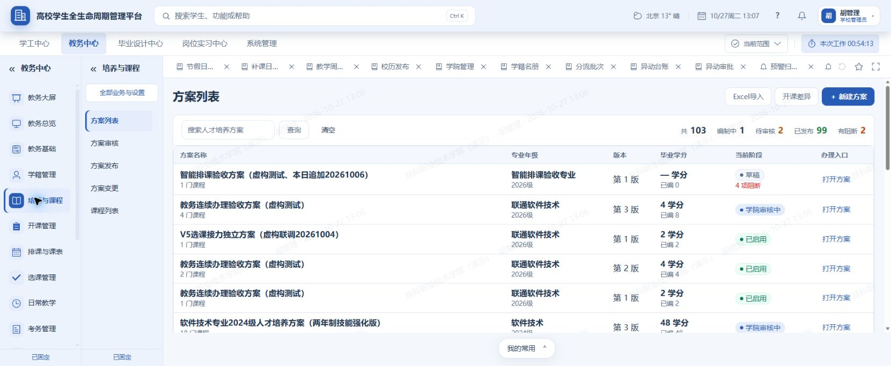
#### 02 方案编制
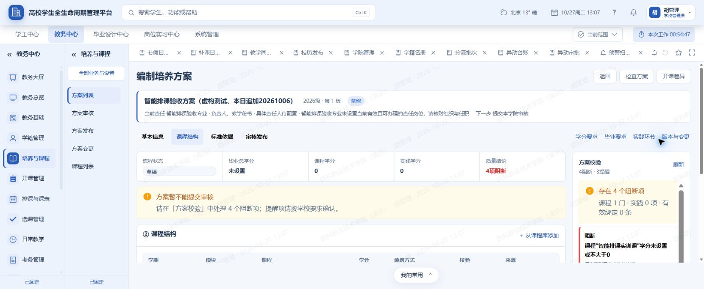
#### 03 学分要求
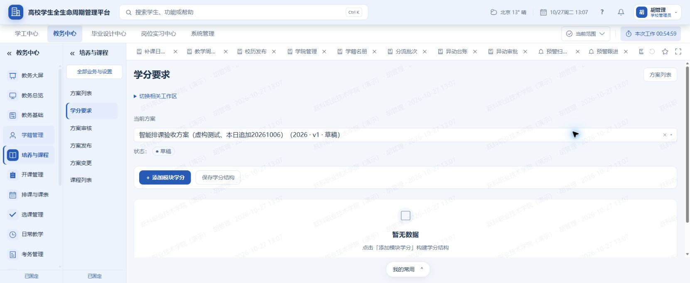
#### 04 方案审核
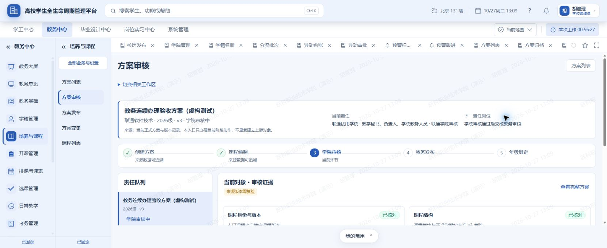
#### 05 方案发布
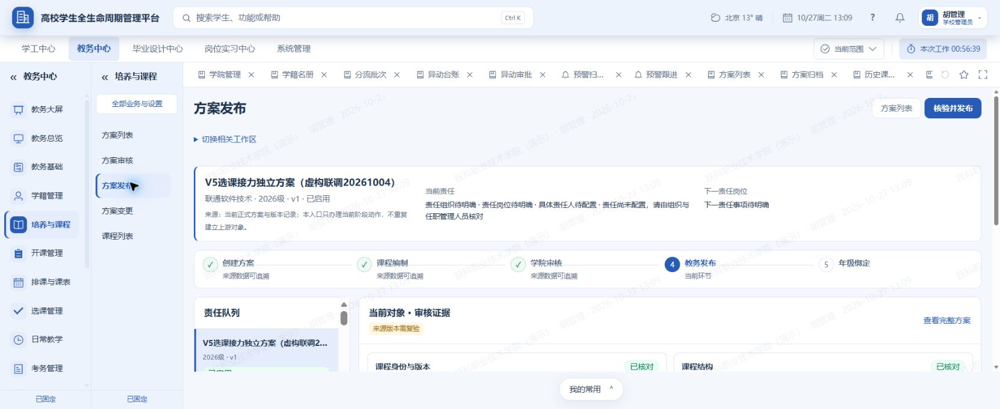
#### 06 发布实际为绑定
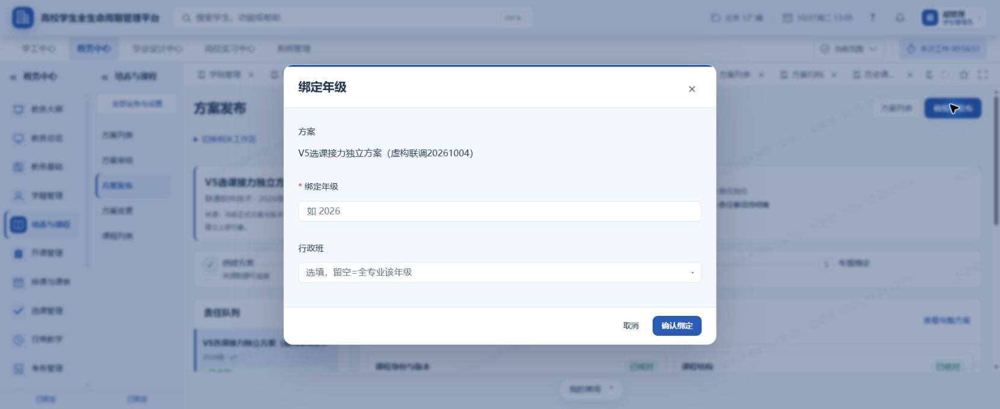
#### 07 方案变更
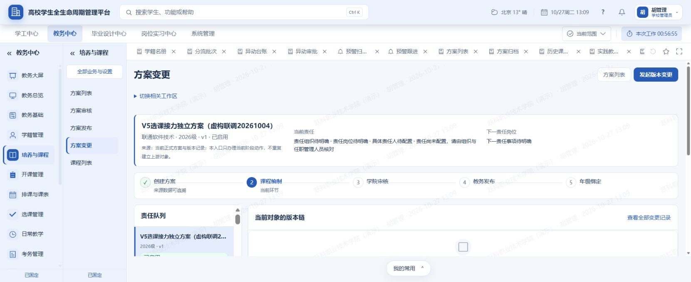
#### 08 课程列表
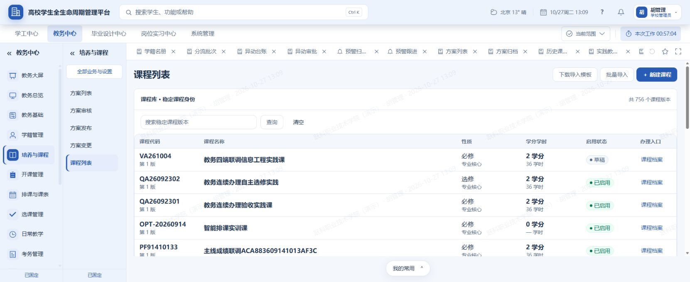
#### 09 课程档案
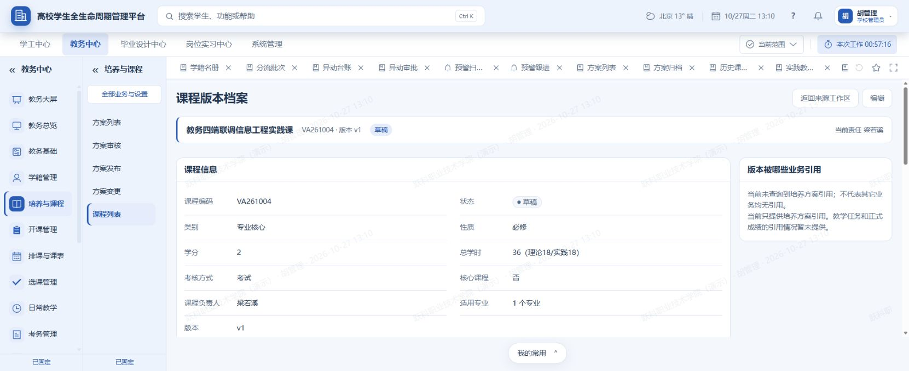
#### 10 课程编辑
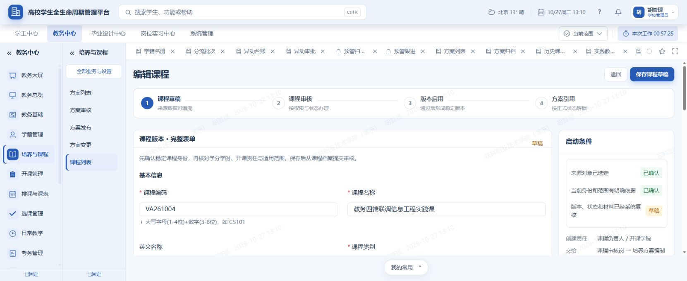
#### 11 未修改也提示丢失

#### 12 搜索无结果
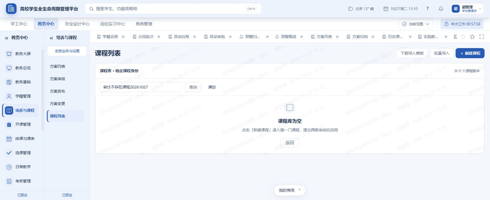
#### 13 完整业务目录
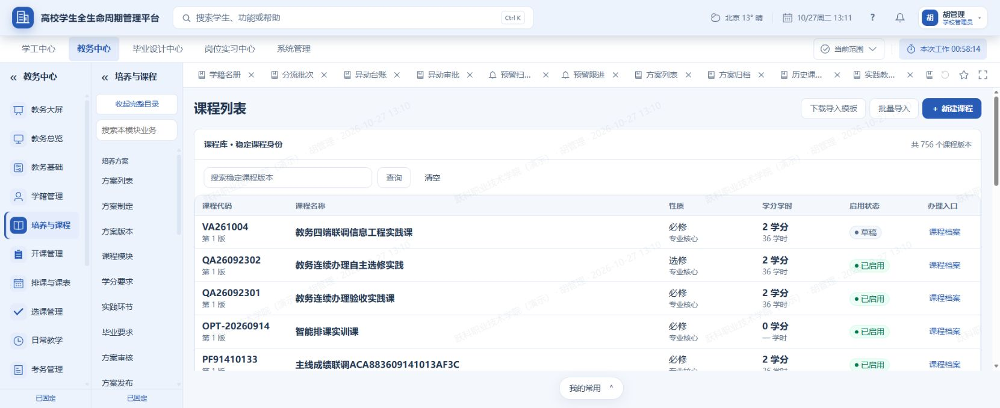

## 3. 推荐的入口设计

这是待实施的信息组织方案，不是本轮删除菜单或旧页面的授权。先完成对应能力与消费者迁移，再确认退役旧入口；历史、审核记录和文件保留。

| 日常入口 | 进入后看到什么 | 面向谁 |
| --- | --- | --- |
| 培养方案 | 方案列表；全部、编制中、待审核、已发布/启用等筛选；有问题独立筛选；历史版本可查 | 编制人员、审核人员、授权查看人员 |
| 课程库 | 课程列表；状态、类别、性质和关键词；新增与批量导入；课程档案内集中维护 | 课程维护人员、编制人员、授权教师 |
| 审核待办 | 方案/课程分区；只办理当前身份对应的实际审核节点；已办可回看 | 学院与教务审核岗位 |

“审核待办”聚合的是入口和队列，不合并课程与方案的业务状态机，不增减审核节点。若现有接口不能返回“我可办理”，先使用已核验的节点信息展示，不能凭角色名称猜测。

| 现有能力 | 推荐承接位置 |
| --- | --- |
| 方案列表、方案制定 | 培养方案列表及其“继续编制” |
| 方案版本、方案变更、计划变更、方案归档 | 方案详情“版本与记录”；历史版本只读；不混同教务档案归档 |
| 课程模块、学分要求 | 方案详情“课程与学分”，分别维护课程安排和模块目标 |
| 实践环节、实践教学计划 | 方案详情“实践与毕业要求”，区分实践课程和集中实践，不合并不同数据 |
| 毕业要求 | 方案详情“实践与毕业要求”，保持现有结构化条目 |
| 方案审核、计划审核的已有消费者 | 审核待办的方案分区；详情内可以查看相同审批记录 |
| 方案发布、适用年级/班级绑定 | 方案详情“审核与适用范围”；待设置范围可以从列表筛选直达 |
| 课程列表、新增课程 | 课程库及“新增课程” |
| 课程分类、课程性质、学分学时、考核方式、课程负责人 | 课程详情“基本信息”的现有字段分组；确有批量任务时保留列表筛选视图 |
| 课程大纲、课程材料 | 课程详情“教学材料”，按材料类型分组，保留文件检查、权限和历史 |
| 课程停用、历史课程 | 课程详情“使用情况与历史”，停用为受保护次级动作 |
| 学期开课计划、开课差异 | 正式承接仍在开课管理；从已生效方案带方案/版本进入，不在培养与课程重复创建教学任务 |

## 4. 具体页面怎么设计

### 4.1 培养方案列表

顶部保留“新建方案”和“批量导入”，导入模板放在导入面板内。状态数做可点击筛选，但“有问题”与各阶段交叉，不能把它们相加当总数。

筛选项：关键词、专业、年级、状态；学院筛选只在身份允许且有可信数据来源时提供。第一阶段保持现有全列表默认，不擅自改变默认业务范围。筛选写入可恢复的页面状态，详情返回保留页码、关键词和滚动位置。

列表列：方案名称与版本、专业年级、当前状态、待处理事项、责任岗位、主操作。学分显示为“毕业要求 140 / 已编课程 186”，不要把两个不同口径压成“毕业学分/已编”让人自行推断。是否符合要求仍由现有校验结果决定，不能仅比较两个数就判错。

主操作按可执行动作和状态决定：草稿“继续编制”、退回“按意见修改”、本人可审“审核”、审核中不可审“查看进度”、正式版本“查看方案”，设置适用范围和发起变更作为授权次级动作。有问题显示“需处理 4 项”，点击定位到问题，不只显示红数字。

同名不同版本不等于重复数据。后续可按服务端权威方案系列折叠历史；不得按名称相同或版本号最大就推定“当前生效”。同专业年级可能存在不同班级特例。

### 4.2 方案详情：选定一次，连续办理

页头固定：方案名、专业年级、版本、真实状态、当前责任；“返回方案列表”恢复原筛选。四个内容区：

1. **基本信息与依据**：名称、专业年级、毕业总学分、国家标准。依据只作为查看与校验，不自动生成业务规则。
2. **课程与学分**：按学期查看课程；模块目标学分与已编学分同屏；从课程库添加、调整开课学期/模块、查看具体课程版本。
3. **实践与毕业要求**：集中实践与毕业要求分别呈现，保持其各自字段、保存与校验。
4. **审核与适用范围**：校验清单、已有审核节点/意见、适用范围、版本历史入口。只有满足原条件、原身份的动作可执行。

右侧保留问题栏，缩为“需处理/建议完善”，点击直达具体字段或关联课程。小屏改为可展开的问题清单，不占固定半屏。每个编辑区有“保存本区”，底部主要动作是当前阶段的“提交审核”或“查看进度”；提交前展示尚未保存的区块，不静默丢弃输入或自动混合多个独立写入。

### 4.3 审核待办

布局：左侧可分页搜索的队列，右侧当前对象、关键差异与质量检查，下方审核意见和动作。先显示事项，再显示背景说明。用户无需进入完整方案才能发现学分有问题。

“系统检查通过”与“人工审核通过”分开。技术数据检查卡片不叫“已核对”来暗示审核人已读。当前管理员没有学院审核身份时继续显示明确原因，不为了方便放开审核。

### 4.4 适用范围与版本变更

页面文字应区分“已审核通过”“方案已发布/启用”“适用范围已设置”。顶部动作、弹窗标题、提交按钮统一为实际办理的动作，不新增无后端含义的“发布成功”。

范围表单显示：专业、方案版本、已有年级/班级范围、拟新增范围。年级可带入方案已有年级作为可修改候选，最终提交仍由用户明确核对。保留“专业年级通用”与“班级特例”；不改已有绑定覆盖规则。失败保留输入，冲突解释已由哪份正式方案覆盖。

变更前显示原正式版本、变更原因和将建立新草稿；创建成功后给“继续编制新版本”。旧版进度不得倒退。当前版本没有责任事项时不机械显示一长串“责任待配置”；只有服务端确认仍有待办且缺任职，才作为待解决问题。

### 4.5 课程列表与课程详情

课程名称置前，代码和版本放次行；使用“搜索课程名称或代码”。复用现有类别、性质、状态字段筛选。列表进入草稿直接给“继续编辑”，可审核对象给对应动作，其余“查看课程”。

详情分“基本信息、教学材料、使用情况与历史”。基本信息沿用当前已有分组，不另造表单。适用专业显示名称；多专业可展开。先修课程后续使用可搜索选择器，保存仍按现有课程身份合同，避免让人手工记代码。

草稿保存成功后明确“已保存草稿，可提交审核”，保留提交为单独动作。材料的上传、登记、检查中、可阅读、不可阅读应清楚区分，不绕过文件中心校验。引用信息明确仅覆盖已查询业务；停用保护不改。

未改动不弹离开确认；修改后才提示“留在本页/放弃修改”。保存失败仍保留输入。无搜索结果显示“没有符合条件的课程”，而全库确实为空才引导新增。

## 5. 优先级与可施工边界

| 次序 | 内容 | 完成判据 |
| --- | --- | --- |
| 第一批 | 修正发布/变更阶段；绑定动作统一命名；搜索空态；无修改离开提示 | 同一正式方案进入不同页面不改变其显示状态；空结果不声称空库；无编辑直接返回，有编辑受保护 |
| 第二批 | 列表筛选与动作；保留返回位置；压缩重复信息；课程中文文案 | 从列表直接识别待办；返回不重找；不改变数据范围与权限 |
| 第三批 | 同方案各维护区集中；课程材料入口集中；审核队列有搜索分页 | 同对象连续办理，保存失败不丢输入，深链接与刷新能还原对象 |
| 第四批 | 迁移原入口消费者、更新导航生成物与合同测试；经确认退役冗余入口 | 没有功能丢失、双入口或历史断链；旧页面删除单独确认 |

当前四个方案/列表相关文件已有未提交改动，本轮不覆盖、不提交。后续在原改动上逐处核对。

### 实施人员使用：已核查的代码依据

| 文件 | 本轮核查结果/改动方向 |
| --- | --- |
| `frontend/src/modules/academicAffairs/views/AaProgramListView.vue` | 列表从治理汇总取完整集合后前端过滤分页；所有行均打开详情。应由后端提供授权范围内筛选分页和对应统计，不能只增加前端过滤冒充完整优化。 |
| `frontend/src/modules/academicAffairs/views/AaProgramEditorView.vue` | 已有四步、校验点击定位、返回来源；跳转学分等工作区携带方案编号，应复用而非重造。 |
| `frontend/src/modules/academicAffairs/views/AaProgramConsoleView.vue` | 进度索引按所在页签固定；发布和变更与真实状态不一致。审核/发布/变更取首页固定上限，后续要确认返回总量并补分页。 |
| `frontend/src/modules/academicAffairs/api/academic-affairs.api.js` | 适用年级操作使用现有方案绑定接口；课程与方案各有审核接口，不合并状态机。 |
| `frontend/src/modules/academicAffairs/views/AaCourseListView.vue` | 已有类别/性质/状态筛选数据字段，但模板只显示关键词；空结果统一显示空库。 |
| `frontend/src/modules/academicAffairs/views/AaCourseDetailView.vue` | 已有材料阅读、引用范围说明和审核/停用动作；返回工作区已有能力，需接入列表筛选状态。 |
| `frontend/src/modules/academicAffairs/views/AaCourseFormView.vue` | 复用现有分组；无改动离开提示已真实复现，但离开拦截的准确根因仍须追踪所属公共守卫后再修。 |
| `backend/app/modules/academic_affairs/services/academic_affairs_program_governance_summary_service.py` | 当前汇总读取方案和关联明细集合，后续分页应同时保持质量结论和统计的一致性；本轮未做负载测试，不宣称已出现性能故障。 |
| `frontend/src/config/navPlan.js` 与教务导航配置 | 统一源头改动后重新生成导航相关合同；不手改生成物，不把字段入口隐藏当作功能已经整合。 |

## 6. 角色、边界与验收要求

编制者只编辑本人授权范围内可编辑版本；学院审核者仅办理对应学院和当前节点；教务岗位依现有权限审批及设置范围；教师仅查看其可访问的正式资料。学校管理员页面可见不证明所有学院角色可办。本轮没有切换账号做正反向权限验证。

保持：租户隔离、数据范围、原审核节点、课程版本引用、正式版本只读、冻结停用原因、历史审计、文件校验和班级特例规则。学分门槛、实践要求、审核人数与顺序不在本设计中自定。

后续验收至少覆盖：

1. 原已启用版本进入发布/变更页状态保持准确；新版本建立成功后才出现新的编制流程。
2. 同一方案跨课程/学分/实践/要求/审核区无需重选；刷新、返回后保留原对象和筛选。
3. 无改动离开不拦截，真实修改离开有确认；错误和版本冲突保留输入。
4. 搜索空结果、真实空库、接口失败、无权限分别显示；页数超过原 100/200 条上限仍可找到记录。
5. 用同一虚构业务对象，各正常岗位账号顺序办理草稿、退回重交、审批、范围绑定、开课引用；对越权操作做拒绝验证。数据库集成用隔离 MySQL（关系数据库），不直接改库推进状态。
6. 已存在范围或班级特例时不覆盖历史；建立新版本不改变已引用旧版的任务与成绩。
7. 实际电脑页面和 375/390/430 像素宽度检查；键盘焦点、弹窗返回焦点和放大阅读检查。

## 7. 证据限制与本轮交付

已完成：13 个页面/交互状态截图、真实只读导航与搜索、关键前端及汇总服务静态追踪、简化设计和施工顺序。

未完成：其余完整目录页逐页实测、导入文件操作、保存及审批绑定闭环、真实多角色权限、数据库持久化/并发、手机宽度和微信真机、屏幕阅读器及颜色对比度测量。截图可见辅助文字较小、首屏被摘要挤压和多滚动区，应作为易用性风险；不能据此声称无障碍合规或不合规。

本轮没有修改产品代码或数据库，没有提交、推送、合并、部署。推荐下一步先施工第一批四项已复现问题，再集中方案工作区，避免先改菜单而让真实办理入口丢失。

## 8. 2026-10-27 授权修改续工记录

用户随后明确要求“进行修改，根据审计结论”。以下为审计后的修改状态，不覆盖上文原始审计事实。

### 已实施

1. 方案审核、发布、变更页的进度按真实方案状态显示；正式版本不因进入变更页倒退。冻结、停用和未知状态不猜测所在步骤。
2. 绑定入口、弹窗、确认按钮统一使用“设置适用范围”语义，带入当前方案年级供核对；班级选择按当前绑定方案的专业、年级、正常班级过滤，保留专业年级通用与班级特例规则。
3. 课程表单保存加载基准，实际修改后才提示离开。公共工作区新增可选的明确表单状态，旧表单仍走原保护，保存中禁止离开；未放开任何业务写入权限。
4. 课程列表提供类别、性质、状态筛选，仍由既有后端接口分页过滤。搜索无结果不再称为空库；草稿可直接继续编辑，正式版本进入详情。关键词、筛选、页码通过地址恢复，详情/编辑带返回来源。
5. 方案列表的草稿显示“继续编制”、退回显示“按意见修改”、审核中显示“查看审核进度”，后者直达原方案审核区。学分两种口径分开说明，问题数可进入原方案。保留列表搜索和页码。
6. 学分、课程模块、实践、毕业要求工作区增加同一方案的连续导航，并支持返回原方案。原页面和旧入口没有删除，尚未完成四个内容区的同页整合。
7. 审核、发布、变更责任队列改为每页 20 条，提供翻页；指定对象不在当前页时精确读取该对象，无权读取或状态不符时显示错误，不擅自改开第一条。旧队列响应不能覆盖新页签。
8. 系统检查卡片与人工审核用语区分；前端不再仅凭课程学分合计高于毕业要求就额外制造阻断，继续展示后端正式校验的阻断项。这没有修改毕业门槛或校验规则。

直接涉及七个前端文件：`TeacherWorkspaceFrame.vue`、`AaCourseListView.vue`、`AaCourseFormView.vue`、`AaCourseDetailView.vue`、`AaProgramListView.vue`、`AaProgramEditorView.vue`、`AaProgramConsoleView.vue`。原文件已有的其他改动保持；没有提交或暂存。

### 验证证据与当前阻断

- 新增 `frontend/tests/academic-training-usability.test.mjs`，执行真实页面方法的替身行为测试；补充原列表单元格测试，使其调用实际导航方法，并继续验证对象身份和返回来源。
- 针对本次及直接消费者的一组 71 项回归通过。随后增加学分判定用例，并扩大到教务流程测试：共 106 项，105 项通过，1 项失败，未跳过。见 [回归日志](修改验证-回归.txt)。这些属于隔离/替身与组件检查，不是数据库或真实浏览器业务验收。
- 唯一失败位于 `academic-flow-v5-contract.test.mjs:233` 的教务总览导航用例：测试环境未提供 `safeBusinessMessage`，触发错误处理时报函数缺失。该页面不在本次修改范围；保留失败，不修改断言制造通过，也不声称扩大回归全绿。
- 七个受影响文件的静态代码检查通过；差异空白检查通过。
- 前端构建通过，见 [构建日志](修改验证-构建.txt)。其他页面仍有样式导入顺序及大文件分包告警，本次方案工作区新增样式的导入顺序已修正。构建通过不代表全部业务通过。
- 原审计所用的已登录标签页被另一项任务占用，浏览器工具拒绝同时接管。已另开“培养课程修改验证”标签页并请求用户登录；当前仍在登录页。因此**修改后的真实页面、375/390/430 像素布局、真实保存/审批/绑定与多角色权限均未验收**，01—13 截图只能证明修改前审计。

### 仍需完成

登录后首先验证：课程筛选与返回、未改动直接离开、修改后取消离开保留输入、方案状态与绑定候选范围、队列翻页和指定对象、同方案维护导航；再检查相关窄屏。

后续整合范围：方案四区同页维护、课程材料集中、专业名称展示、方案列表专业/年级/状态的后端分页与质量汇总、统一审核入口、迁移旧入口消费者及确认退役。当前方案列表仍沿用原汇总和前端分页，未将它宣传为已完成后端分页优化。课程详情适用专业仍依赖现有返回信息，未猜造专业名称。

本次无数据库写入、迁移、审批规则更改、旧页面删除、提交、推送或部署。现阶段为“代码已修改、工程检查已执行、真实页面验收等待登录”，不能宣称整套简化改造已完成。

## 9. 2026-10-28 续工：学分修改保护与验证状态更新

### 补录上一轮真实浏览器证据

2026-10-27 在用户登录后的独立页面已实际验证：课程草稿筛选；未修改直接返回；临时修改后取消离开保留输入，最后放弃临时输入；搜索无结果正确提示；已启用方案在发布及变更页保持已启用；适用范围带入年级；责任队列翻到第二页；同一方案在学分与毕业要求间连续切换。没有提交业务写入。

对应证据：

- [课程列表和筛选](验证01-课程筛选.png)
- [搜索无结果](验证02-搜索无结果.png)
- [已启用方案的真实阶段和队列分页](验证03-已启用状态.png)
- [适用范围表单](验证04-适用范围.png)
- [同方案连续导航](验证05-同方案连续导航.png)

精确手机尺寸当时未稳定生效，实际观察宽度为 488 像素，不计入 375/390/430 像素验收。后续恢复窗口时电脑操作工具因网址识别不足而停止，该轮遵守工具停止要求，没有换工具绕过。

### 本轮新增修改

当前学分维护先在本地数组编辑，最后统一保存。原来页内切换会先改工作区或方案，再请求路由，未保存数据可能在确认离开前就被重新加载覆盖。本轮针对同一根因修复：

1. 读取学分后保存基准，只有实际修改才启用“保存学分结构”，并显示待保存提示；弹窗中的实际输入也计入修改。
2. 方案选择和页内导航只发起路由请求，导航确认成功后的监听再切换对象和加载内容；取消离开时原对象和修改都保留。
3. 公共工作区对明确提供修改状态的表单，同时保护同路径下的页签/对象切换；其他未接入表单继续使用原行为。
4. 保存中禁用重复提交、添加、编辑、删除和方案选择；保存失败用独立错误提示保留原表格及全部修改，不显示会覆盖输入的重新加载入口。
5. 保存成功只将本次已发送快照标为已保存；身份、对象变化后的迟到回执不能确认新对象。旧学分读取不能覆盖新方案。
6. 真实浏览器刷新前也提示未保存学分；未知方案地址不继续展示旧方案。成功切换后关闭旧学分弹窗。

没有调整学分规则、审核顺序、数据范围或后端接口，没有删除页面或新增依赖。

### 本轮工程与环境结果

- 第一组 46 项相关回归通过。扩大检查共 98 项，97 项通过、1 项失败；失败仍为上一轮记录的教务总览测试环境缺少 `safeBusinessMessage`，没有删除或跳过该断言。详见 [本轮回归日志](续工20261028-回归.txt)。
- 本轮修改文件静态代码检查、差异空白检查通过；前端构建通过，仍有仓库既有的分包等告警。详见 [本轮构建日志](续工20261028-构建.txt)。
- 当前原沙箱核验：`student_lifecycle_runtime_20260902`、`sandbox-school`，503 张表，迁移头 `20261005_aa_task_source_handoff` 与当前代码一致；未迁移、未重建。初次探测未连接成功，随后确认原容器可连接并通过项目只读核验。
- 使用现有 `scripts/dev/start-sandbox.ps1 -Service pc -NoBrowser` 启动本机管理端 5173、后端 8000，以及脚本既定的消息/归档后台任务；短信开关关闭，微信订阅适配层仍要求实际能力与订阅授权，不改外发配置。没有启动其他客户端、修改密码或放宽权限。
- 新建独立内置浏览器页面，使用现有沙箱账号记录尝试正常登录一次；页面返回账号、学校编码或密码不正确，学校编码已确认为 `sandbox-school`。没有反复试错、执行账号恢复脚本或重置密码；已请求用户登录或给出有效记录位置。

本轮新增学分保护的证据是方法/组件回归与构建，真实浏览器验证仍等待有效登录；上一轮通过的桌面导航不代替新增保护或真实保存验收。四区同页整合、材料集中、专业名称展示、方案列表后端分页、统一审核入口和旧入口消费者迁移仍未完成。

## 10. 2026-10-28 审计收口：全功能覆盖与剩余问题

### 10.1 本次结论

用户本轮要求“审计做完”，因此本轮补齐覆盖表与问题证据，不继续改产品代码。不做新的提交、发布、迁移或业务写入。

本轮重新检查浏览器清单，没有本系统的已登录页面；上一轮现有账号记录登录失败的条件尚未解决。当前能完成的是：已获得真实截图的主路径审计、剩余功能的代码审计、隔离复现及整改设计。不能据此宣布剩余页面实测、跨角色办理或手机验收通过。

当前代码基点为 `a407592bd`，工作区存在多项未提交改动；以下结论以实际工作区文件为准，不声称对应纯净提交。

### 10.2 全部功能覆盖表

以此前学校管理员“全部业务与设置”实际显示的 24 个条目为主表。导航源还包含其他身份/模块的教学计划关联条目，另列在衔接范围；不将源配置条目数冒充当前账号可见页面数。列表、详情、编辑和弹窗属于不同状态，不能相互代替验收。

| 序号 | 功能 | 已取得证据 | 审计结论与后续要求 |
| --- | --- | --- | --- |
| 1 | 方案列表 | 真实截图 01；修改后实际打开；当前源码 | 阶段动作与返回位置已改善；仍采用全量治理摘要加前端分页，专业年级状态的服务端筛选未完成。 |
| 2 | 方案制定 | 当前源码 `loadAuthoring`；草稿详情真实截图 02 | 旧制定列表固定取首页 100 条，不能保证找到所有草稿；应由列表“继续编制”承接，删除入口前核验消费者。 |
| 3 | 方案版本 | 当前源码 `loadVersions` | 固定取首页 200 条；缺少对象内完整版本链入口的一致体验，需保留旧版只读及新旧版本关系。 |
| 4 | 课程模块 | 编制器真实截图 02；当前模块表单代码 | 编制器与工作区都维护课程；应集中到同方案课程结构，保持课程具体版本与编班方式。 |
| 5 | 学分要求 | 真实截图 03、验证05；本轮修改隔离测试 | 已新增未保存保护与失败恢复；真实保存、刷新和跨页确认还需登录复测。 |
| 6 | 实践环节 | 当前表单、保存和删除代码 | 名称/周数有校验，仍需验证重复提交、失败保留和切换对象后的响应归属；不能只因有保存按钮就算完成。 |
| 7 | 毕业要求 | 修改后同方案切换实测；当前条目表单代码 | 仍使用现有类别和内容，不新增毕业政策；保存、退回重交及正式引用未实测。 |
| 8 | 方案审核 | 真实截图 04；审核权限方法测试 | 当前学校管理员被限制在学院审核节点之外，保护应保留；正常学院/教务账号闭环未完成。 |
| 9 | 方案发布 | 真实截图 05、06；修改后验证03、04及翻页 | 状态和“设置适用范围”命名已修正；没有真正确认绑定，不宣称生效范围写入通过。 |
| 10 | 方案变更 | 真实截图 07；修改后阶段实测 | 旧版本不再倒退为编制；新版本建立、冻结/恢复/停用及历史引用均未实际执行。 |
| 11 | 方案归档 | 当前源码 `loadArchive` | 旧列表固定取首页 100 条；本页是历史方案追溯，不应与教务档案移交混为一个业务。 |
| 12 | 课程列表 | 真实截图 08、验证01、02及筛选返回实测 | 类别/性质/状态筛选、具体动作和空结果提示已改善，现有接口分页；手机尺寸尚未达标验证。 |
| 13 | 新增课程 | 共享新建/编辑表单代码；编辑真实截图 10 | 新建和编辑共用表单，但新建成功、失败恢复及回执仍须分别验收；未创建新课程。 |
| 14 | 课程分类 | 当前源码；连续保存隔离复现 | 保存方法缺少重入拦截，两次调用发出两次请求；全库拉取与整条课程提交也需整改。 |
| 15 | 课程性质 | 与分类共用当前保存方法 | 同一根因，不另造修复；需区分修改正式版本形成新草稿与修改草稿。 |
| 16 | 学分学时 | 当前表单及 `submitCreditForm` | 字段维护存在，仍需实际核验总学时校验、冲突和新版本回执；不要把课程学分设置与方案模块目标混为一项。 |
| 17 | 课程大纲 | 当前材料表单；材料迟到响应隔离复现 | 与课程材料共用实现，存在结果错挂窗口问题；大纲是材料类型，不应要求换一个课程对象重做。 |
| 18 | 考核方式 | 与分类共用当前保存方法 | 应在课程基本信息维护，保留考试/考查；不与成绩构成权重混同。 |
| 19 | 课程负责人 | 当前选择器、提交及显示模板 | 缺姓名时仍回退到内部教师编号；应明确未取得姓名并保留重查，不要求业务人员识别编号。 |
| 20 | 课程材料 | 当前读写及附件代码；材料迟到响应隔离复现 | 优先解决切对象后的材料串显、读失败独立状态和异步上传归属，再整合入口。未上传、下载或作废真实材料。 |
| 21 | 课程停用 | 当前前端与后端代码；详情截图 09 | 详情已有引用提示和后端保护；控制台动作需更清楚呈现影响与当前对象，不得绕过引用阻断。未实际停用。 |
| 22 | 历史课程 | 当前 `archiveRows` 与全库读取代码 | 当前已有“在途草稿不取代正式版本”的判定，应保留；全库读完再分页仍有规模成本，不能退回固定首页截断。 |
| 23 | 实践教学计划 | 当前 `loadPracticePlan` 与 `isPracticeModule` | 按模块自由文本中的“实践/实训/实习”筛选，不是完整实践计划的权威分类；需说明口径并核对学校分类，不能宣称覆盖所有实践教学。 |
| 24 | 计划变更 | 当前 `loadPlanChange` 与变更入口 | 与方案版本流程重叠，固定首页 200 条；应统一回方案对象内变更，保留原因和历史链。 |

补充审计范围：

- **方案/课程详情与编辑**：已有真实截图和首批修复；课程材料、适用专业名称和四区集中办理尚未整合完成。
- **方案与课程批量导入**：当前 `AaAuthoritativeImportDrawer.vue` 已有预检、版本化确认、防重复确认、失败回读和抽屉归属检查。应复用；未上传文件或执行导入。方案定义与适用范围分阶段的既有规则不自行取消。
- **开课差异与下游教学任务**：当前 `AaOpeningPlanDiffView.vue` 有学期、专业、年级筛选和带来源返回的方案入口，并用请求序号丢弃旧响应；实际开课引用、差异处理后的重新核对未执行。
- **教学计划关联入口**：年级/专业计划复用培养方案，计划审核/发布复用方案阶段；学期开课与执行进度归开课管理，计划归档归教务归档。本轮只核对入口归属，不扩成其他二级模块审计完成。

### 10.3 新补齐的优先整改项

| 编号 | 优先级 | 具体问题、影响和证据 | 推荐处理与验收 |
| --- | --- | --- | --- |
| 续审01 | 高 | 课程材料先请求甲、再切乙，甲迟到后直接写当前窗口。隔离复现结果为“选中乙、显示甲材料”。`AaCourseConsoleView.vue:496`。这是前端对象串显证据，不是跨租户越权实测。 | 读取、上传、保存回执均校验课程、材料类型、请求序号及身份；关闭或切换后丢弃旧结果。用同样延迟顺序验证乙窗口始终只显示乙。 |
| 续审02 | 高 | 分类保存方法没有保存中提前返回；连续调用两次实际发出两次替身请求。性质和考核共用该方法。`AaCourseConsoleView.vue:436`。后端重复结果未执行，不声称已产生重复数据。 | 方法层防重入并锁定提交对象，异常收尾释放状态；正式版本变更还要检查后端幂等/并发保护。连续点击只发一次，拒绝或断网后可重试。 |
| 续审03 | 中 | 方案制定/归档固定首页 100 条，版本/计划变更/选择器固定 200 条；新责任队列分页只修了审核、发布、变更三个工作区。`AaProgramConsoleView.vue:723、758、763、768、861`。 | 剩余列表和选择器接服务端分页/搜索；明确总数及找不到对象原因。用超过原上限的隔离数据验证最后一页可达。 |
| 续审04 | 中 | 课程工作区逐页取完所有课程，再前端过滤与分页。`AaCourseConsoleView.vue:388`。无固定截断是优点，但只看一页也要读全库；未测量真实慢速，不能编造耗时。 | 将筛选和版本关系判断放到有授权范围的服务端分页接口；不以删循环、仅取首页来“优化”。 |
| 续审05 | 中 | 分类/性质/学时/负责人从列表快照拼出整条课程更新；已启用课程后端生成新草稿，但控制台仅提示已保存并重读列表。`AaCourseConsoleView.vue:419`；后端 `academic_affairs_course_service.py:update_course`。 | 告知“已建立新版本草稿”并直达回执中的新对象；并发覆盖属于待验证风险，检查版本条件后再定修复，不把推测称作已发生丢失。 |
| 续审06 | 中 | 实践教学计划按自由文本关键词派生，名称为“课程设计”等不含关键词时可能漏出；这是当前分类实现，不是学校认可的完整口径。`course-program.js:isPracticeModule`。 | 先明确该页只是筛选视图；若要完整实践计划，使用经确认的结构化分类和关联，不由助手自行定学分或实践政策。 |
| 续审07 | 中 | 材料读失败仅临时提示，窗口仍可能为空；负责人姓名缺失时展示内部编号；部分旧维护表单未接统一的未保存保护。 | 区分加载失败与暂无材料，提供重试并保留对象；中文解释未知信息；逐个直接消费者验证输入与离开保护。 |
| 续审08 | 中 | 菜单、对象编辑和字段工作区同时承担相近职责；现已增加连续导航，但四区同页维护和材料集中未完成。 | 先完善唯一对象工作区及深链返回，再迁消费者；旧页面删除按项目规则另确认，历史和附件不删除。 |

两项隔离复现均执行了实际页面方法，只替换网络请求为内存数据，没有真实网络或数据库写入。可复核文件：[复现脚本](剩余问题隔离复现.mjs)、[本次输出](剩余问题隔离复现结果.json)。从工程根目录运行该脚本即可复现；输出不是业务验收通过标记。

### 10.4 收口与实施顺序

1. **先处理可靠性**：材料对象串显、防重复保存、异常输入保留和旧响应丢弃，保留所有后端授权与校验。
2. **再处理找事与连续办理**：剩余分页、对象内课程/学分/实践/毕业要求、材料与版本回执统一返回。
3. **最后整理菜单**：形成“培养方案、课程库、审核待办”的日常入口；完成消费者迁移及授权确认后退役重复入口。
4. **逐项真实验收**：正常账号登录、同对象多角色接力、真实保存回读与刷新、权限拒绝、冲突和窄屏。没有实际执行的格子持续保留“未验证”。

本次审计报告已覆盖当前模块全部 24 项目录能力和导入、详情、开课衔接，并明确证据等级。**报告覆盖完成不等于所有真实页面审计完成，更不等于整改或交付验收完成。** 剩余真实页面续审仍需有效登录；本轮没有重新尝试失效密码或修改账号。

## 11. 2026-10-28 剩余问题整改及保存点

用户授权按审计问题修改，随后要求“保存好代码”。本批改动已写入当前工作区，没有提交、推送或部署，不回退其他任务的既有改动。

本批已写入：

- 课程材料读取绑定窗口、课程、请求序号和身份；旧读取、上传与保存回执不能写入另一课程窗口。读取失败显示可重试错误，不伪装暂无材料；作废确认绑定原课程并防重复调用。
- 分类、性质、考核、学时和负责人统一走防重复保存入口，失败保留输入，保存前重新读取课程最新字段；已生成新版本时显示确切回执及“打开已保存课程”。没有据此宣称并发数据库更新验收通过。
- 课程工作区改为当前页服务端查询；后端补考核方式、负责人是否指定、可停用状态及历史版本筛选。历史判断只认更高的已启用/已停用正式版本，在途草稿不取代正式版本。两个现有课程路由声明同步参数，原租户与状态条件保留。
- 旧方案制定、版本、计划变更和归档列表补服务端翻页；方案选择器按名称、专业、年级检索，补后端关键词参数与两个现有路由声明。归档服务内部仍有全量关系计算，不能把本次前端分页接线说成所有汇总查询已优化。
- 实践教学计划明确提示现有关键词筛选口径，不自行改变学校实践分类政策；负责人姓名缺失不再显示内部教师编号。

已执行：45 项前端相关回归通过；2 项后端查询构造隔离检查通过；后端四个修改文件语法编译通过；前端两个修改页面静态检查通过；前端构建通过（46.52 秒，仍有既有大文件分包等告警）。查询构造检查没有连接数据库，不能代替 MySQL（关系数据库）集成验收。

当前保存点日志：`.codex-temp/training-final-save-tests.txt`、`.codex-temp/training-final-save-build.txt`。本批尚未执行后端新增筛选的真实数据库集成、正常登录后的页面回归、多角色保存、手机尺寸验收。四区同页整合、完整材料集中入口、全部旧表单未保存保护以及旧入口消费者迁移仍需后续完成；本记录不将它们标为完成。
