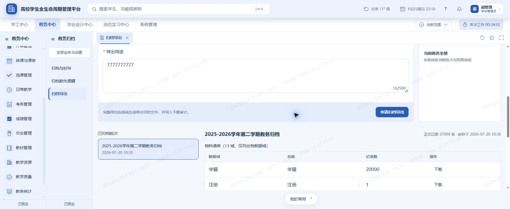
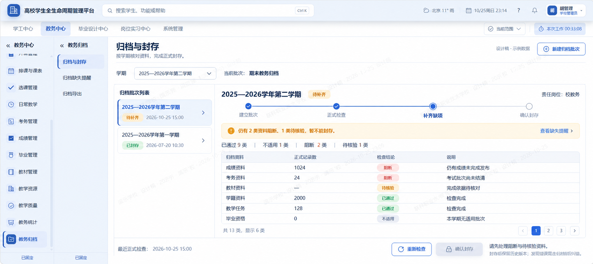
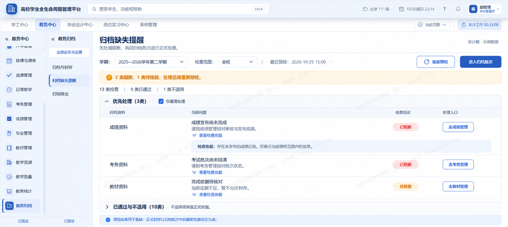
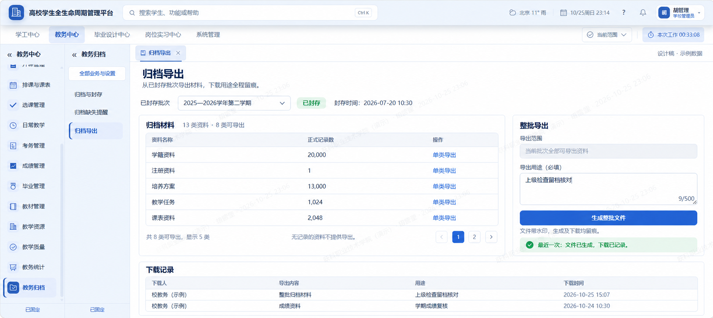

# 教务归档三个菜单：审计与显示内容设计

日期：2026-10-25。状态：设计已获采用，前端代码已保存；登录后的视觉验收待完成。

本记录承接现有《08-教务15模块-流程与页面设计-并行施工计划》第15模块。仅保存本工作区附件；未修改业务代码、规则、数据库或正式导航，未提交、推送、部署。

## 1. 结论

保留“归档与封存、归档缺失提醒、归档导出”三个菜单，各自解决一个明确问题：能不能封存、哪里还缺、怎样取出已封存材料。保持现有蓝白色、一级与二级导航及角色权限，不另建档案系统。

| 菜单 | 主要使用场景 | 首屏必须出现 | 主动作 | 后续去向 |
| --- | --- | --- | --- | --- |
| 归档与封存 | 校教务组织学期正式归档；学院查看进度 | 学期与批次、正式状态、检查结论、阻断与待核验数量、当前责任岗位 | 按状态显示完整性检查或确认封存 | 有问题到缺失提醒；已封存可到导出，纠错保留在本页 |
| 归档缺失提醒 | 提前查缺，或归档失败后定位来源 | 所选学期、授权范围、实时预检时间、问题摘要、中文状态、处理入口 | 去来源业务处理、重新预检 | 回归档批次重新执行正式检查 |
| 归档导出 | 查阅、核对、导出已封存材料 | 已封存批次、封存时间、资料清单、记录数、用途与下载回执 | 单类导出、生成整批文件 | 查看下载记录；需要纠错返回归档与封存 |

## 2. 证据与边界

### 实际界面观察

本轮读取用户已登录的本地浏览器页面 `/admin/academic-affairs/archive/export`，保存了下图。页面显示已封存批次、材料清单、用途表单、下载记录和已有成功提示。本轮没有点击申请导出或下载，也没有核验之前生成的文件内容。

尝试切换“归档与封存”时，页面明确提示离开会丢失当前表单内容。已点击取消，保留用户输入。新开的独立审计标签需要重新登录，已关闭。因此另外两个菜单仅完成当前源码审阅，没有取得本轮实时截图，也没有声称三页完整实操审计通过。

| 顺序 | 检查步骤 | 观察结论与健康情况 |
| --- | --- | --- |
| 1 | 归档与封存入口与页面结构 | 代码已有批次、正式检查、封存及受控纠错；信息层级偏重。未完成实际显示和交互验证 |
| 2 | 归档缺失提醒的结果展示 | 代码有实时预检、四种结果、证据展开和来源跳转；大量资料卡片增加扫描成本。未完成实际显示和交互验证 |
| 3 | 已封存批次导出页 | 实际页面存在表单占位大、材料位置靠后、重复列、内部下载类型直出等问题；保留输入的离开保护实际触发并取消 |

### 当前实现依据

- `frontend/src/config/navPlan.js`：当前菜单入口。
- `frontend/src/modules/academicAffairs/views/AaArchiveConsoleView.vue`：正式批次、检查、封存、学院范围及纠错入口。
- `frontend/src/modules/academicAffairs/views/ArchivePrecheckView.vue`：预检结果、问题摘要、证据和来源业务跳转。
- `frontend/src/modules/academicAffairs/views/ArchiveExportView.vue`：已封存批次、单类/整批导出、用途校验、下载记录回读。
- `backend/app/modules/academic_affairs/routers/archive_core_router.py`：公开批次与预检接口，转交统一服务。
- `backend/app/modules/academic_affairs/services/academic_affairs_archive_service.py`：十三类检查及阻断、待处理、不适用和通过结果语义。

部分旧施工卡和接口摘要仍写九类；本轮按当前统一服务与页面中的十三类设计，不能把旧注释当成现状。

## 3. 主要问题及对应改法

| 优先级 | 问题 | 依据 | 改法 |
| --- | --- | --- | --- |
| 高 | 选择材料与填写用途的顺序不清，大片用途输入将清单推后 | 实际截图、导出页模板 | 批次置顶；材料清单靠左、紧凑用途表单靠右；下载记录在下方 |
| 高 | 下载类型直接显示内部枚举，下载人显示内部账号标识 | 本轮浏览器可访问结构、下载记录列配置 | 类型转换为“整批归档材料/单类材料”；姓名需来自授权展示字段，无法解析显示“操作人员信息待核实”，不得编造 |
| 中 | “数据域”与“名称”两列重复 | 实际截图、导出页列配置 | 合并为“资料名称”，保留记录数与单类导出动作 |
| 中 | 批次信息重复，范围说明占独立大面板且与真实交互不一致 | 导出页模板及浏览器结构 | 一个批次选择器贯穿全页；范围用一句只读说明，不出现虚构的已选记录批量导出 |
| 中 | “13域，仅列出有数据域”与实际只显示有记录的8类容易混淆 | 浏览器结构、过滤函数 | 分别说明“检查13类、其中8类有记录可导出”，数量均取真实响应 |
| 中 | 预检将问题与已通过资料都做成大卡片 | 缺失提醒源码 | 问题行优先、证据行展开；通过与不适用可折叠，但仍分别保留状态 |
| 中 | 阶段轨道与责任说明过多，导出页面重复展示封存及纠错流程 | 三页模板 | 封存页保留紧凑阶段；导出页仅展示所选批次的真实状态 |
| 待验证 | 导出批次使用可点击列表项，模板未见与封存页同等键盘支持 | 两页模板对比 | 实施时使用现有可键盘操作的选择控件；检验焦点、读屏名称和状态播报 |

## 4. 各页内容与状态设计

### 归档与封存

- 顶部：标题、简短任务说明、新建批次入口；沿用一学期一批次的现有约束。
- 主区：批次列表与所选批次详情；列表显示学期、中文状态，不用内部编号承担识别任务。
- 详情：正式检查时间、已通过/阻断/待核验/不适用数量，以及资料名称、记录数、正式结论、中文原因。
- 操作随真实状态变化：未检查执行完整性检查；有阻断或待核验则说明不可封存；满足条件且具备权限才能确认封存。
- 已封存状态：显示封存信息，保留当前受控纠错工作区和版本记录；本设计图展示的是待补齐状态，不能用这一张图删掉纠错功能。
- 学院视图沿用现有限制：学校进度只读，本院问题转到实时预检；不能获得学校全部材料或封存权限。

### 归档缺失提醒

- 顶部固定学期、授权范围、预检时间与重新预检动作；不要求先建批次。
- 首屏优先展示阻断和待核验资料，列为资料名称、问题摘要、检查结论、来源处理入口。
- 检查证据按需展开；原始规则码只在默认折叠的“实施人员使用”内显示。
- 有明确来源路由且具有相应权限才展示可用办理动作；学校统筹项按现有规则提示等待校教务核验。
- 完成源业务后回到同学期预检；预检通过不等于正式封存已完成，仍需到批次执行正式检查。
- 沿用现有责任来源；本轮不设计新分派、催办、截止日期或审批节点。

### 归档导出

- 先选已封存批次，再看可导出材料；只出现一个当前批次标题。
- 清单采用“资料名称、正式记录数、单类导出”，不提供当前后端未支持的任意多选组合。
- 整批用途表单限制为紧凑区域，保留当前至少五字、最多五百字和失败保留输入机制；单类导出继续通过用途确认抽屉办理。
- 下方下载记录采用中文下载人、导出内容、用途、时间；有待核实状态时不能显示成功。
- 生成中防重复；失败显示原因；结果不明确时提示回读原批次记录，保留现有不重复提交保护。
- 已封存批次无资料、清单读取失败、记录读取失败、学院无学校材料权限分别显示，不统一伪装为空数据。
- 不增加历史文件永久可下载或文件保留期限承诺。

## 5. 效果图的使用限制

三张图是同一套方案的三个菜单，不是三套互斥方案。均为人工智能生成的静态设计示意，图中数字、结论、时间与人员称谓不构成实际业务事实。

生成图有少量壳层和细节偏差，实施时以此说明及真实公共组件为准：

- 第一、二张图省略了现有页签栏；第一张还省略“全部业务与设置”。实际实施必须保留这些已有入口，只调整页面内容区域。
- 第二张把检查范围画成下拉外观；实际只能展示可信权限上下文所确定的范围，不能让用户任意切换到全校。
- 第一张示例批次日期不能作学期日历依据，实际一律使用真实学期与封存时间。
- 第三张用途示例的计数应由控件自动计算，图内计数不作验收值。
- “待核验”是对依据不足状态的中文表述建议，不新增可放行状态；图内成功提示仅说明位置，只有真实生成且回读确认后才能出现。
- 水印、身份和页签使用真实公共壳层，不把生成图片中的内容硬编码进产品。

## 6. 后续施工与验收安排

本轮只到设计评审。后续若采用本方案，先完成三个视图的局部布局与中文展示，复用现有表格、选择器、状态标签、抽屉和错误组件；暂不更改后端业务规则、数据结构、权限和导航。

涉及范围为上述三个视图及其直接展示适配、相关行为测试；只有下载人展示字段确实不足时，才单独审查下载记录接口的最小字段补足。不能为了展示姓名扩大数据返回范围。

实施验收至少包含：

1. 同一学期从预检、来源处理返回、正式批次到导出，保持上下文。
2. 封存页分别显示未检查、有阻断、待核验、可封存、已封存及纠错状态；原有不可普通解冻保护继续有效。
3. 学院与学校正常角色分别核验范围及动作，不能用管理员画面代替权限验收。
4. 单类与整批导出分别核验用途、重复点击、失败保留输入、结果待核实与下载记录；业务接口返回成功不代替文件和审计验证。
5. 长批次名、空数据、加载失败、键盘操作及375/390/430像素宽度的重排。窄屏允许表格局部滚动，不能遮住主要动作。

本轮未执行上述业务验收、数据库测试、移动端验证或无障碍完整验证。页面代码未修改，因此未运行编译和回归测试。

## 7. 用户确认后的前端实施记录

用户随后授权按三张图实施前端，并要求保存后在5173查看。以上第1至6节保留设计阶段记录，本节为实施阶段最新状态。

已保存三页改动：

- 归档与封存：批次列表与详情左右布局；学期筛选保留来源参数、清理旧批次定位；正式结论与四态数量集中展示，动作放在检查资料之后；纠错工作区原样保留。
- 归档缺失提醒：优先处理表格取代问题卡片网格；证据按需展开，已通过与不适用资料折叠；学院范围和学校统筹提示保留。
- 归档导出：已封存批次下拉选择；资料清单与用途表单并列；重复列与范围说明大面板移除；下载动作和用途转成中文显示，无法解析的内部账号标识显示“操作人员信息待核实”。
- 单类导出打开抽屉保留已经填写的用途；切换批次清除旧成功提示。没有更改后端接口、封存许可、学院限制、不可逆保护和结果回读机制。
- 保留现有导航、页签、水印与公共组件；不把效果图中的示例数据写入页面。不增加依赖。

验证记录：

- 114项归档及相关前端检查通过，未跳过；包含新增加的中文下载记录、用途保留、旧成功提示清除、学期切换保护。
- 三个视图的代码规范检查通过。
- 前端构建通过；现有大文件分包和混合导入警告仍存在，未扩大范围调整构建配置。
- 已直接请求5173服务的三个实际视图模块，均返回成功并包含本轮新版内容，证明现有服务已加载当前工作区文件。该证据不等于页面显示和业务验收。
- 扩大检查共117项，其中116项通过、1项失败；失败为系统管理后台任务页的“授权依据摘要”旧文案断言，涉及其他会话已修改的文件，本轮没有改该文件或断言。完整结果见同目录“前端检查.txt”。

实际显示验证阻断：原先已登录的浏览器已关闭；已打开应用内5173登录页并请求用户完成登录。未读取、重置或复制登录凭据，也未修改登录安全策略。登录后的三页截图比较、实际交互、375/390/430像素显示及控制台错误检查尚未完成，详见“design-qa.md”。

本轮改动仅保存在工作区，未暂存、提交、推送或部署；未重启现有服务、未写数据库、未执行正式封存或导出。
