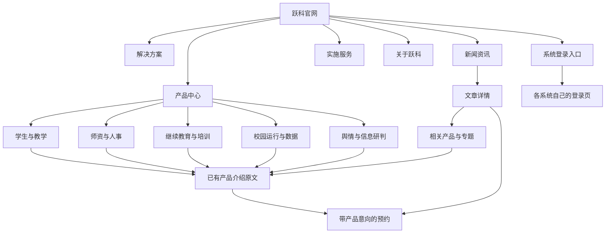
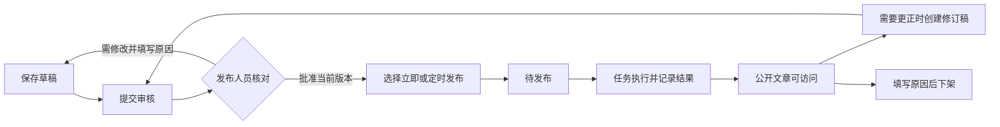

# 跃科官网多产品与新闻运营 PRD（产品需求文档）及整改方案

版本：1.1｜需求基线日期：2026-10-07｜当前状态：2026-10-11 五项体验整改已完成，最新交付记录见第 12 节。

第 1 至 11 节保留当时的系统盘点、网站结构、新闻运营需求和整改基线，历史“本轮”描述以相应日期为准。第 12 节记录当前实施与验证结果；本地交付不代表生产已切换或搜索已经收录。

## 1. 先确定网站要承担什么

将官网建设为**统一介绍跃科各系统、持续发布专业内容、承接产品咨询的企业网站**。客户按自己的工作需要找到系统；运营人员持续写文章、审核和发布；今后增加系统，只增加产品资料和入口，不反复重做首页、导航和新闻分类。

用户进一步明确的首要目标：**客户一看官网，就感到这家公司靠谱、专业。** 设计应帮助客户逐步确认公司身份、真实产品、业务理解、交付过程与服务责任。视觉、内容和实际访问都应支持这一判断。

网站继续沿用用户确认的深蓝校园主视觉，以及“服务学生成长，成就教师发展”的品牌主张。**现有系统介绍原文不变**，整改重点放在产品组织、页面阅读、跨页导航、新闻运营、搜索访问和维护边界。

### 1.1 已确认的要求

| 已确认事项 | 执行含义 |
| --- | --- |
| 以用户截图红框中的新版官网为基础 | 保留品牌、校园主视觉及已有真实素材，不拿旧网站重新套用 |
| 现有系统介绍不变 | 保留产品标题、介绍正文、能力描述、业务说明、图片说明和现有常见问题；不因分类改写成泛化宣传文案 |
| 官网与学生系统分开 | 独立源码范围、构建、配置、数据库、账号、新闻任务及发布；官网不能依赖学校登录 |
| 新闻后台归官网自己 | 新闻与学校通知分开，不读取学生或教师业务数据来生成公开文章 |
| 后续还会增加系统 | 采用统一产品目录和复用页面模板；不为每个系统增加一个顶部菜单 |
| 新闻来源采用原创＋有授权的转载 | 原创、转载分别记录来源与责任；有来源链接不等于有转载授权 |

### 1.2 本方案新增的设计决定

采用“五个业务领域＋一个产品中心”；网站顶部保留五个主要栏目；新闻以文章为管理单位；批量导入作为辅助功能；文章通过相关产品和业务专题连接到咨询入口。以上是本次设计建议，不代表已有页面或后台已经实现。

首版不建设跨系统统一登录，不合并各系统数据库，不把官网做成学校业务工作台，不接入新的付费内容平台或搜索集群。现有系统仍各自运行和升级。

## 2. 现有系统盘点与产品归属

本次依据应用中的已保存项目和可读取的本地工程核对到 **9 个系统／项目记录**。这里的“存在工程”不等于“全部正式上线”或“全部可销售交付”。安装包、源码副本、运行目录、学校定制项目也不能重复计数。以下归类用于官网信息组织，不重写系统介绍。

| 现有系统／项目 | 建议所属领域 | 官网中如何呈现 | 本次核验边界 |
| --- | --- | --- | --- |
| 职校学生全生命周期系统 | 学生与教学 | 总体方案入口，承接教务、学工、毕业设计、岗位实习等现有内容 | 当前仓库及官网相关配置存在；本轮未重验全业务 |
| 岗位实习管理平台 | 学生与教学 | 保留已有岗位实习详情；在产品目录独立可找，同时标明与学生全生命周期方案的关系 | 独立抽离工程存在；不能把分拆目标当作已完成独立生产验收 |
| 网络安全实训平台 | 学生与教学 | 独立产品条目，使用该工程已经确认的介绍和素材 | 正式开发骨架、前后端及已确认原型存在；不据此宣称生产验收通过 |
| 高校人事管理与教师发展系统 | 师资与人事 | 保留现有高校人事详情页、介绍及预约意向 | 已核对正式源码入口；其他磁盘中的运行副本不另算一个产品 |
| 一站式非学历教育智慧前台 | 继续教育与培训 | 单独条目，与教培系统区分服务对象和办理范围 | 当前完整工程存在；工程说明仍记录学校实际对接与验收缺口 |
| 教培多机构管理系统 | 继续教育与培训 | 单独条目，承接原教培系统介绍 | 已核对教培工程，不能因目录版本名就宣称真实支付等外部渠道已接通 |
| 高校数据治理系统 | 校园运行与数据 | 产品名称与品牌沿用原材料；“澜青数治”不擅自改名 | 已核对本地产品包及功能说明，包内自述为首版验证范围；本轮未复验 |
| 民族职业技术学院后勤管理系统／跃科后勤维修系统 | 校园运行与数据 | 先作为待核实的产品／行业方案条目；学校名称不能自动变成公开客户案例 | 同时存在整合资源包与源码包，包名和说明修订号还有差异；没有据此认定学校验收 |
| 舆情系统／跃科多源网络舆情监测平台 | 舆情与信息研判 | 一个产品入口，可在内部介绍高校、消防、政企等适用场景 | 已核对运行工程说明；数据来源覆盖和持续采集效果需按实际环境验证 |

### 2.1 必须避免的重复计算

- 教务、学工、毕业设计是当前学生产品体系内已存在的官网介绍入口。可以独立展示、独立咨询，但本盘点不凭页面数把它们算成新增独立工程。
- 岗位实习既有学生体系内的业务来源，又有独立工程。对外保持一个清楚的产品身份；关联整体方案，不复制两篇几乎相同的产品介绍来争同一个搜索词。
- 源码目录、运行目录、压缩包及历史版本统一归到同一个系统记录；版本仅供内部维护。
- “学生周期管理平台”等对话或工作项目名称不能单独作为一个新产品。
- 后勤学校名称、客户标志、实施效果和采购材料，只有公开授权与事实充分时才进入案例。未齐备时该记录保留在内部目录，不显示空白详情或“建设中”销售页。

### 2.2 对外展示范围

现有五个产品详情入口先完整保留：高校人事、教务、学工、毕业设计、岗位实习。学生全生命周期继续保留总体方案入口。

其余系统逐项接入已确认的原介绍、截图、服务对象与可提供的演示方式。没有已确认介绍的，登记在内部待补资料清单，不能由编辑从工程说明中自动拼出产品承诺。最终展示范围以资料核对结果为准，不能为了凑齐九个产品而发布空内容。

## 3. 当前问题与整改依据

### 3.1 2026-10-07 公开地址抽查

以下为本轮从本机进行公开请求得到的响应事实，未登录服务器、未修改线上配置。它说明公开访问合同存在问题，不等于完整浏览器、所有地区网络或搜索引擎抓取结果。

| 抽查项 | 本轮观察 | 影响与整改要求 |
| --- | --- | --- |
| `https://www.hnyueke.com/` | 成功返回；原始页面标题为“跃科｜服务学生成长，成就教师发展” | 对得上用户确认的新官网品牌 |
| 上述首页的标准地址声明 | 指向 `https://hnyueke.com/` | 网站告诉搜索引擎优先认另一个地址，须与实际官网归属一致 |
| `https://hnyueke.com/` | 成功返回；原始页面标题为“高校学生全生命周期管理平台”，与带 `www` 首页不同 | 两个主机的初始页面归属不一致，须逐路径核对官网与学生入口，不能直接全域跳转 |
| `https://www.hnyueke.com/news` | 返回未找到，状态码 404 | 新闻公开入口不能承接运营与搜索访问 |
| `https://www.hnyueke.com/news/sitemap.xml` | 返回未找到，状态码 404 | 新闻地图不可用 |
| `https://www.hnyueke.com/products/renshi` | 返回未找到，状态码 404 | 本地已有的人事详情未由该线上地址正常提供 |
| `https://www.hnyueke.com/robots.txt` | 允许抓取，列出的两个地图使用不带 `www` 的主机名 | 抓取指引与期望官网主机需统一 |
| `https://www.hnyueke.com/sitemap.xml` | 返回地图，抽查其中首页、产品等地址为不带 `www` 的地址 | 须核对每一条地图地址的真实内容与状态 |
| `https://www.hnyueke.com/contact` | 本轮请求发生连接错误，未取得可用响应 | 暂不判定为页面故障，实施前复核 |

**当前能确认的是地址和页面交付不一致，不能确认“未收录”的唯一根因，也不能从这些请求得出收录数量。** 百度、必应、谷歌管理平台的归属验证、抓取记录和索引报告，本轮均未访问。

### 3.2 本地源码与运营缺口

| 问题 | 现有能力 | 本次整改 |
| --- | --- | --- |
| 官网仍围绕两条主线，系统增加后缺少统一位置 | 本地已存在学生、人事、若干方案及 22 个静态公开页的配置 | 产品中心按业务领域组织，保留详情正文，将导航、关联与咨询意向统一引用产品目录 |
| 多处维护产品名称和入口容易失步 | 产品配置、页面配置、首页展厅及手机导航分别存在 | 收敛目录元数据，介绍正文仍使用原内容；一个产品只保留一个正式介绍地址 |
| 后台首先看到资源包，不方便长期管理单篇文章 | 已有直接撰写、保存草稿、导入、审核、排期、暂停、下架、台账 | 日常入口改为文章、审核、发布计划；资源包放到批量导入 |
| 分类混合了业务领域与内容类型 | 现有栏目包含教务、学工、实习、人事、政策、科技、公司等 | 保留旧栏目身份，增加关联产品与内容类型两个维度，避免破坏旧文章 |
| 文章与产品咨询没有稳定的关联管理 | 有公开文章、搜索、分页、地图及来源展示 | 增加人工维护的相关文章、关联产品、咨询来源；不自动拼广告 |
| 发布后的更正缺少独立待审版本 | 已有发布中的稿件不能直接覆盖的保护 | 保留保护；增加修订稿，审核后替换公开版本，旧版及审核记录可追溯 |
| 本地抽离不等于线上已切换 | `website/` 已有独立前后端、新闻库模型、运行与迁移候选 | 继续复用，补实际数据库验证、入口分流、迁移及恢复验证；不再复制一套后台 |

## 4. 网站信息架构

### 4.1 顶部导航

**产品中心｜解决方案｜新闻资讯｜实施服务｜关于跃科**

标志点击返回首页；右侧为“系统登录”和“预约演示”。登录是已有客户入口，预约是新客户主动作。手机主导航使用同一组栏目，底部咨询入口不能与页面按钮叠加成多套悬浮条。

产品中心展开业务领域和产品名称；解决方案保留目前已有内容；新闻栏目可按产品和话题继续阅读。产品数量从九个增加到更多时，顶部栏目不跟着变长。

### 4.2 核心访问路径

| 访问者 | 进入原因 | 理想路径 | 成功终点 |
| --- | --- | --- | --- |
| 学校部门负责人 | 已知要找哪个系统 | 首页／搜索 → 产品中心 → 产品介绍 | 找到原介绍、适用场景与预约入口 |
| 学校信息化负责人 | 需要多系统配合 | 解决方案 → 相关系统 → 实施服务 | 看清各系统边界、对接与实施范围；不误以为所有系统已天然打通 |
| 新闻读者 | 搜索具体业务问题 | 文章 → 同主题内容／相关产品 → 咨询 | 问题得到解答，按意愿进一步了解产品 |
| 已有客户 | 要进入系统办事 | 系统登录 → 对应系统 | 进入已核验的登录地址，不进入新闻后台 |
| 编辑与发布人员 | 写文章、审核、定时发布 | 官网后台 → 草稿／待审核／发布计划 | 文章按审核版本发布，公开回读一致 |

## 5. 页面设计与内容保留规则

### 5.1 首页：品牌明确，产品可找，新闻有入口

| 页面顺序 | 展示内容 | 交互与保留要求 |
| --- | --- | --- |
| 顶部导航 | 固定主要栏目、登录、预约 | 使用真实链接；键盘、手机菜单可用 |
| 品牌首屏 | 原校园图、原品牌主张及原介绍 | 不重写已确认系统文案；两个动作保留为“查看产品”“预约演示” |
| 产品全景 | 五个业务领域，显示已具备公开资料的系统 | 默认可见核心入口；一个领域筛选＋产品名称即可找系统，不能只放轮播 |
| 重点产品 | 保留学生、人事的原介绍与现有重点位置 | 两条主线继续突出，但不再是所有产品的唯一入口 |
| 业务场景与产品体验 | 复用已确认场景、真实截图和现有展厅 | 首屏只选少量代表图；完整图库按需展开，图片可放大并返回原位置 |
| 实施服务 | 原有服务流程与已有可公开材料 | 无证据的客户数量、院校标志、效果数据不补写 |
| 新闻精选 | 3～6 篇已发布、有实际阅读价值的文章 | 人工精选优先，时间与栏目清楚；无内容则收起，不放假文章 |
| 咨询与页脚 | 预约、公司信息、支持、备案与隐私入口 | 联系方式与主体按现有核验资料使用 |

### 5.2 产品中心与详情

产品中心采用“业务领域筛选＋产品列表”。每项包括名称、已有原摘要、适用对象、查看介绍和咨询入口。名称与摘要来自同一资料源；目录卡片不另写一套夸大卖点。没有适合卡片的原摘要时可暂只显示名称与所属领域，新增摘要经单独确认后再用。

详情页允许调整目录、间距、图片区、锚点、移动排版、相关文章及预约位置。**不删减、替换、扩大原介绍含义**。现有正文不能为了塞进统一模板而被压缩成几个空泛卖点；不同产品可保留自己的内容章节。

现有五个详情地址继续使用；学生全生命周期等既有方案地址继续使用。新产品通过同类模板增加。详情页增加的“所属方案”“相关阅读”属于导航关系，不混入原介绍正文。

若审计发现原介绍与现状矛盾，先登记“待负责人核对”，不静默改文案，也不直接把可疑内容复制到新推广位置。由负责人明确内容调整后另行执行。

### 5.3 新闻首页

页面顺序：栏目标题和搜索 → 编辑精选 → 栏目筛选／关联产品筛选 → 文章列表 → 分页。电脑端可有窄侧栏展示专题与相关产品；手机端按顺序排列，不能压缩正文或遮挡内容。

- 列表每页建议 12 篇，复用当前服务端分页；显示标题、摘要、栏目、发布时间、原创／转载标识及有意义的配图。
- 搜索复用当前接口；区分“无搜索结果”和“读取失败”，保留搜索词、栏目、产品与页码。
- “热门”只有真实统计支撑才能使用；没有数据时叫“编辑精选”，不伪造阅读量、热榜或点赞。
- 每篇文章有稳定独立地址。不能只有首页弹窗正文，不能无限滚动到无法独立访问后面的文章。
- 栏目、产品、专题是三类浏览关系，不为每种组合自动生成大量可收录页面。

### 5.4 文章详情

顺序：面包屑 → 标题 → 摘要 → 作者／编辑责任、发布及实质更新时间、来源类型 → 正文与目录 → 来源说明 → 相关文章 → 相关产品／预约。

正文以阅读为主，电脑端建议约 720～800 像素阅读宽度，正文建议 16～18 像素、舒适行距；手机正文保持清晰，不用超小字展示出处。长文目录使用真实小标题。图片、表格和长链接不得造成横向页面溢出。

原创文章写清作者或真实编辑部门；转载展示原作者、原发布方、原文链接及适用的授权说明；内部授权凭证不公开。政策解读明确政策名称、发布单位、时间、适用对象，区分原文与本方解读。实质修改后保留原始发布时间，显示更新时间；不把每天刷新时间伪装成新文章。

相关产品最多展示少量真实相关项，内容中涉及多个系统时可多选。没有直接相关产品时不强行插入预约广告。阅读正文、查看原文不要求提交手机号。

### 5.5 登录与咨询

“系统登录”只展示已核验可公开的入口。一个系统存在不同学校地址时，使用已有客户支持流程或已明确的学校选择，不猜测地址，不把演示环境或内部后台公开出去。

预约页复用现有学校／单位、手机号、姓名等字段与校验。来自产品页或文章的预约携带产品意向及来源文章标识；用户仍可修改意向。手机号不得放进地址参数或访问分析事件。失败保留输入；成功文案按服务端真实结果显示，不把“通知未发送”写成“已通知销售”。

2026-10-11 用户确认：咨询资料仅官网超级管理员查看，自登记起保存 90 天。采用官网独立加密资料与跟进记录；列表电话脱敏、详情查看留痕、修改校验版本，跟进不续期；到期停止访问并批次清理。普通编辑／发布人员、学校超级管理员及学校令牌不能代替官网超级管理员。登记、短信转交、不可用三种结果按实际配置显示；登记前说明用途与期限并明确确认。正式启用须核对独立账号、私有密钥、迁移备份与清理服务，验收环境只使用合成资料。

### 5.6 客户信任与专业形象专项

采用稳重、清楚的教育信息化企业风格：深蓝品牌区、浅色阅读区、统一的中文字体与间距、少量高质量图片、清晰的产品层级。保留现有校园主图和产品介绍，调整其展示秩序。动效用于帮助理解，正文、联系方式和产品入口应及时出现。

| 客户要确认的事 | 网站需要给出的依据 | 位置与资料要求 |
| --- | --- | --- |
| 你是谁、主要做什么 | 公司全称、服务领域、清楚的产品目录 | 首页形成公司层面的入口；公司资料来自可核验材料，不能只让人以为进入某一个学生系统 |
| 产品是否真实 | 原产品介绍、清晰界面、具体办理流程与角色 | 产品页及展厅；截图说明对应产品和业务，原型、演示与正式产品素材各按事实标注 |
| 是否懂学校业务 | 具体业务问题、责任交接、实施准备与专业文章 | 现有业务说明及新闻；避免用同一段空泛宣传套在所有产品上 |
| 能否持续交付 | 需求确认、配置、数据准备、联调、培训、验收、维护的责任与成果 | 实施服务页；沿用已确认服务范围，响应时间和保障承诺需有真实履约依据 |
| 其他客户是否认可 | 获准公开的项目过程、客户评价、案例或证明 | 资料充分时建立案例；学校标志、名称、人物和成效须具备公开依据，未齐备则不展示 |
| 出问题找谁 | 清楚的咨询、支持、公司联系方式与主体信息 | 页脚、关于页、预约及技术支持；联系方式可用，表单结果与实际处理一致 |

“关于跃科”从单一产品介绍扩展为公司介绍框架，承接公司定位、团队职责、可公开资质、服务方式和联系信息。该调整属于公司页面设计，现有系统介绍仍保留原文。团队人数、成立年限、服务院校数量、认证和交付成效均先核验；没有材料时不填占位数字或虚构资质。

新闻首页优先展示与公司业务有关、能够体现经验的文章。行业转载用于补充阅读；原创实务、真实产品更新和可公开实施经验负责体现公司的专业判断。文章密度、标题尺度、配图和更新时间应像一个持续维护的企业内容中心。

新增专业形象验收：首页短时间内能看懂公司服务方向；一分钟内能找到所需产品、实施方式和联系入口；各页品牌及导航一致；公开入口、图片和表单无明显错误。内部评审后再邀请不了解项目的人试读，记录其能否判断“做什么、产品依据是什么、怎样联系”。尚未进行真实客户试读时不得宣称客户信任已经验证。

## 6. 新闻运营方案

### 6.1 内容类型与选题组织

内容来源采用用户已确认的“原创＋有授权转载”。**来源类型、文章栏目、关联产品分开管理**，不能把一篇“原创人事政策解读”只能硬塞到一个含义混乱的分类里。

| 运营内容 | 对读者的作用 | 推荐选题示例，均为待写选题 |
| --- | --- | --- |
| 业务实务 | 帮学校解决一个具体工作问题 | 实习材料退回后如何避免学生重复提交；人事信息变更如何保留审批记录 |
| 政策解读 | 解释政策对学校工作的实际影响 | 根据已核实的新政策整理适用对象、办理要求与材料清单；不预编政策结论 |
| 产品动态 | 说明已实际发布的变化与使用方法 | 已上线功能的办理说明；不能把规划功能写成已上线 |
| 实施经验 | 帮客户理解准备、迁移、培训与验收 | 学校上线前需要准备哪些基础资料；材料只用获准公开或脱敏内容 |
| 行业资讯转载 | 补充相关行业信息 | 有授权的教育信息化、教师发展、继续教育等资讯，保留来源与原意 |
| 公司动态 | 建立真实企业信任 | 已发生且可公开的活动、交付与服务新闻 |

初始建议连续四周每周安排 3 篇原创实务／解读、2 篇有授权转载，作为编辑产能试运行，不是最低发稿指标或搜索收录承诺。未达到质量门槛就延期。四周后按阅读、咨询和编辑负担调整；不采用“每隔几分钟发一篇就能获得排名”的目标。

每个主要产品先建立一组常见问题选题和一篇有完整解释价值的专题导读，随后逐步补充。专题页只有实际形成一组有用内容时再发布，不先建大量空专题。

### 6.2 发布前的必要检查

1. 文章有明确读者和要回答的问题，标题与正文一致。
2. 事实、产品能力、日期和政策出处可核对；未实际发布的能力不写成已发布。
3. 原创来源与参考资料清楚；转载授权范围包含拟使用的正文和图片。仅引用或摘要按实际用途处理，不能将“附链接”视为全文复制许可。
4. 配图可用且有说明，不出现真实学生、教师或客户的个人敏感资料。
5. 栏目、相关产品、摘要、文章地址、作者和时间完整；正文中没有内部代码、测试凭据或私有链接。
6. 电脑和手机预览可读，正文、图片和链接正确；校验失败说明具体问题并保留草稿。

谷歌公开指导强调内容对目标读者的实际价值，以及原创信息、清晰来源和可信责任主体。本方案据此把“回答真实业务问题”作为选题依据，不以数量代替内容质量。[来源：谷歌实用内容指导](https://developers.google.com/search/docs/fundamentals/creating-helpful-content)

批量产生主要用于操纵排名、且没有增加价值的内容存在搜索垃圾内容风险。人工智能可辅助整理结构和草稿，发布人员仍要核实事实、来源和授权；不自动抓取整篇文章后批量改写发布。[来源：谷歌搜索垃圾内容政策](https://developers.google.com/search/docs/essentials/spam-policies)

## 7. 官网自己的运营后台

### 7.1 首版后台导航

**运营概览｜文章管理｜待审核｜发布计划｜素材与来源｜操作记录**

“批量导入”放在文章管理内。产品目录首版仍由维护人员通过统一资料配置维护，不要求为本轮新增产品编辑器。负责人可以提出新增系统，维护人员按同一份清单接入；新闻编辑日常发布不需要改代码。

| 页面 | 首屏回答什么 | 核心动作和状态 |
| --- | --- | --- |
| 运营概览 | 现在有哪些稿件或发布任务需要处理 | 待审核、被退回、近期排期、发布异常；统计不可用时明确提示 |
| 文章管理 | 找到某篇文章，知道它在哪一步 | 标题搜索、栏目／产品／状态筛选，撰写、继续编辑、预览、查看记录；保持筛选和页码 |
| 编辑工作区 | 写什么，哪些资料还缺，能否提交审核 | 大正文编辑区；摘要、栏目、产品、来源与配图；保存草稿、预览、提交审核；不完整可保存 |
| 待审核 | 审的是哪一版，来源是否充分 | 对照正文与来源，批准、说明原因退回；修改后原批准失效 |
| 发布计划 | 哪篇何时发布，是否异常 | 按日期列表，定时／立即发布、暂停、取消待发布、失败处理；首版不必另做拖拽日历 |
| 素材与来源 | 图片属于哪些文章，转载依据在哪里 | 复用现有图片和引用关系，补充来源说明与授权信息；仍被文章使用的素材不允许误删 |
| 操作记录 | 谁在什么时候做过什么 | 审核、发布、撤下、修订、排期和失败可查；可导出现有表格台账，防止表格公式注入 |

### 7.2 编辑与发布故事

面向运营显示“草稿、待审核、已退回、待发布、已发布、已下架”等中文状态；技术校验不通过与任务执行失败单独解释。上述是目标业务状态，不要求将所有显示标签直接新增为数据库枚举；现有资源包、文章和调度状态须先映射，缺少的业务状态再补。

必须实现的操作约束：

- 编辑人员不能批准、发布或下架；发布人员可审核与发布。首版复用现有编辑／发布两类权限，后台服务独立校验，不能只隐藏按钮。账号维护仍走既有受控机制。
- 如果同一个人同时承担编辑和发布，页面必须保留审核步骤与记录；不声称已实现两人分离审批。
- 每次批准绑定具体内容版本。标题、正文、来源、配图、产品关联等影响公开内容的修改均使原批准失效。
- 并发编辑冲突不能直接覆盖；保留本人的未提交文字，提示回读最新稿件。新增文章与重复发布必须防止重复产生记录。
- 新文章未发布时公开地址不可读；草稿图片和授权凭证不得通过公开地址访问。
- 已发布文章更正时，原公开版本继续提供。修订稿审核通过后，在一次一致的更新中切换正文、图片关系、摘要与地图更新时间；地址及首次发布时间不变，留存历史记录。
- 下架需要原因；下架后正文、搜索结果和地图一起撤回，图片的公开资格按仍在发布的引用重新判断。恢复发布需检查当前版本及授权仍有效，不删除审计。
- 任务失败显示具体原因和可执行动作。浏览器关闭不能影响排期；任务重启、重复执行不能重复发稿。无数据库或发布任务离线时，不显示“正常运行”。

### 7.3 批量导入与排期

保留已有压缩资源包导入、去重、文件校验、预览和发布队列。导入完成进入待处理，不代表已批准。编辑可查看总数、合格数、重复数和需要修正数，逐篇定位问题。

批量审批必须明确本次选择的文章及版本，不能一键批准没有查看或校验失败的内容。现有整包版本保护不能因按文章展示而被绕过：同一包变化后，旧的审批请求必须被拒绝。

现有每隔 1／3／5／10 分钟连续发布的方式不再作为默认运营入口。首版提供明确的发布时间与每日计划视图；技术间隔仅为批量任务的受控设置，不承诺任何搜索收益。导入格式中的指令或“已审核”字样不能直接触发批准。

### 7.4 需要补齐的资料字段

| 对象 | 沿用已有信息 | 本次新增或收敛 |
| --- | --- | --- |
| 产品目录 | 产品名称、现有详情地址、原介绍、截图 | 稳定产品标识、业务领域、父级／关联方案、展示顺序、是否公开、咨询意向、资料责任人 |
| 文章 | 标题、摘要、正文、栏目、地址、来源、配图、发布时间、调度及审计 | 关联产品、原创／转载来源类型、真实作者／编辑责任、授权依据、审核退回说明、公开版本和修订版本关系 |
| 素材 | 图片内容、媒体标识、文章引用 | 用途说明、替代文字、来源／授权记录；内部凭证不得公开 |
| 运营分析 | 尚不能把现有短信转发当成线索台账 | 来源文章与产品的非敏感访问事件；需要线索跟进时再加最小台账及访问权限 |

来源类型与原有“摘要、原创、产品动态”等字段不是同一维度，不直接用一个新值覆盖旧含义。旧内容先保留，再按审核逐条补信息；无法证明转载授权的旧稿，不自动重新推广或批量发布。

## 8. 新闻引流与搜索整改

### 8.1 先交付可访问的页面

推荐以 `https://www.hnyueke.com` 作为官网标准主机。实施前必须核查不带 `www` 的地址上是否仍承载学生登录、接口、附件或其他业务，再决定精确分流。**禁止为统一官网地址而直接把整个学生域名全部跳转走。** 学生系统最终入口使用已核验的独立地址，不在此文凭空指定一个新生产域名。

官网首页、产品、方案、新闻、咨询、图片和地图统一归属官网。不存在的地址返回真实未找到状态，不能一律返回首页成功响应。现有公开地址尽量保留；确实更名或移动的公开内容逐条建立永久跳转映射，不能让全部旧文章都跳首页。学校内部旧入口与公开营销地址分别处理。

### 8.2 搜索技术要求

| 项目 | 验收要求 |
| --- | --- |
| 正文可抓取 | 初始响应包含与用户实际看到一致的标题、正文和链接，不能向抓取方提供另一套旧介绍 |
| 页面身份 | 每页有对应标题、摘要、唯一主标题及正确标准地址；保留产品原介绍，不为搜索塞词 |
| 新闻可发现 | 首页、新闻列表、分页、栏目及相关链接能到达已发布文章；无需登录或脚本点击后才出现唯一正文 |
| 站点地图 | 只列公开有效标准地址；产品地图与现有新闻分片地图复用并正确关联；下架稿及时移除 |
| 时间与结构化信息 | 发布、更新时间真实；沿用已有文章结构化信息，作者和发布方与页面可见内容一致 |
| 抓取控制 | 官网公开页允许抓取；管理页、预览、站内搜索结果不参与收录；禁止收录声明不能代替登录保护 |
| 分页与筛选 | 普通文章分页能逐页访问，各页标准地址反映内容；随机搜索词与任意筛选组合不制造无限索引页 |
| 图片与手机阅读 | 图片尺寸合适、正文图按需加载，封面和必要首屏不延迟；有替代说明，无横向溢出或遮挡 |
| 旧新版本一致 | 页面源文、浏览器显示、静态资源、导航、新闻服务属于同一发布候选；缓存更新后不得混用旧入口 |

现有新闻地图已经按约 1000 篇分片，不重造地图服务。地图使用标准绝对地址、真实的实质更新时间；单地图需遵守引擎规定的容量限制。提交地图只是发现线索，不保证收录或排名。[来源：谷歌站点地图官方说明](https://developers.google.com/search/docs/crawling-indexing/sitemaps/build-sitemap)

### 8.3 上线后的站长工作

顺序为：官网与系统归属确认 → 页面与地图验证 → 各搜索管理平台验证网站归属 → 提交地图 → 抽查代表地址 → 根据抓取与索引报告修复 → 持续更新内容。

百度、必应、谷歌分别记录结果。账号权限、支持的提交方式及配额以届时实际平台为准；本轮未核验百度平台正文说明，不引用历史配额当作当前承诺。需要负责人本人完成的验证才交给负责人，其余配置与核验由实施人员承担。

结果必须分为“页面可访问、允许抓取、地图可用、已提交、搜索已发现、已收录、产生搜索访问、产生有效咨询”。每一步附日期和证据；不能用手工搜索一次没有结果来断定全站未收录，也不能把网站构建成功写成搜索已收录。

### 8.4 内容到咨询的可观察路径

统计文章访问、相关产品点击、预约开始、服务端确认的预约结果。关联文章标识和产品标识即可，不采集输入中的手机号、姓名或正文内容到分析日志。

每周复盘哪些业务问题被阅读，哪些文章带来产品查看，哪些咨询确实相关。搜索访问量、收录量、有效咨询量的基线目前均未知；上线接通真实统计后建立基线，不能先编一个增长百分比。第三方统计工具如需新增，应先确定数据范围与隐私说明，不默认接入。

## 9. 独立维护与未来增加系统

### 9.1 工程边界

官网继续使用当前 `website/` 独立工程，不更换前端框架，不复制第二个新闻后台。公开介绍、新闻、后台、咨询归官网；学校通知、学生业务、人事业务等归各系统。系统间只通过已核验的链接提供入口，公开站点不共享业务登录凭据。

将官网变为独立代码仓库是后续维护建议：先形成完整来源清单、保留版本历史与已授权资料，再单独提交和发布。当前整体工作区还含岗位实习等任务，不能把所在分支整体当官网版本推送。仓库迁移、提交、推送和生产部署分别执行授权及核验，不以本次文档写作代替这些步骤。

### 9.2 新增一个系统的固定流程

1. 登记名称、所属领域、与已有产品关系、资料责任人，以及需要保留的已确认介绍来源。
2. 核对真实截图、可公开范围、适用对象、演示方式和能力事实；区分原型、演示与真实产品界面。
3. 分配稳定产品标识及一个详情地址；同一个系统的源码副本和行业版本不随意新增身份。
4. 复用现有详情模板与原介绍；产品目录、导航、新闻关联选项、预约意向从同一目录读取。
5. 完成电脑／手机、深链刷新、来源与咨询关联检查，再随官网版本发布。
6. 发布后核对地图与入口，并为该系统逐步补充有价值的新闻选题。

首版用一份受版本控制的产品目录资料实现上述扩展，维护人员可以直接协助接入；不要求负责人手改代码。只有当非研发编辑需要经常自行上架产品时，再建设后台产品编辑与预览。届时仍应保留批准版本、构建候选和正式发布的区别，不能界面显示“已保存”就当作官网已上线。

### 9.3 数据量增加时怎样维护

- 文章查询继续使用数据库过滤和分页，公开页只读已发布内容。首版复用现有搜索，不先部署独立搜索集群。
- 验收用隔离数据分别覆盖数千、上万篇文章的列表、检索、地图和排期；这只是容量测试档位，不能预先声称现有配置已支持某并发量。
- 现有新闻图片保存在独立官网数据库内；先做图片体积控制、引用检查及含媒体的备份恢复验证，不把当前能力说成已使用对象存储。容量或备份时间出现实际瓶颈后再评估迁移。
- 每周检查发布失败、无效图片、断链、来源和咨询异常；每月复查内容时效、备份恢复证据及访问情况。文章过时可修订或明确适用时间，不按数量自动删除。

### 9.4 专业软件与技术路线选择

2026-10-07 核对了以下工具的官方说明。设计软件负责把视觉与交互做好，内容工具负责让运营人员稳定维护产品与新闻，两者可以配合。更换软件不能自动修复域名归属、内容真实性或实际交付缺口。

| 工具 | 适合承担的责任 | 对本项目的判断 |
| --- | --- | --- |
| Figma（界面设计与原型工具） | 统一首页、产品、新闻、公司页及手机设计，形成可评审原型与组件规范 | 专业视觉设计的优先工具；不要求负责人自己学会操作。[官方说明](https://www.figma.com/web-design/) |
| WordPress（网站内容管理系统） | 企业官网、新闻、媒体、角色、草稿、定时发布和修订记录 | 长期新闻运营的重点候选，可自主部署；产品目录可定制。严格转载授权台账、复杂审批及发布后修订流程仍需核对或扩展。软件本体无许可费用，定制、服务器和维护另有成本。[官方说明](https://wordpress.org/about/features/) |
| Strapi（独立内容后台工具） | 用独立后台管理结构化产品和新闻，供现有网站读取 | 适合保留现有前端并更换内容后台的路线；需要开发对接，具体审批、排期和版本功能核对所用版本及套餐。[官方说明](https://docs.strapi.io/cms/intro) |
| Webflow（可视化建站平台） | 可视化设计、建站和托管内容 | 可以做专业网站，但导出代码不包含完整内容管理、搜索与表单处理能力；与自主部署要求比较后再决定。[官方导出限制](https://help.webflow.com/hc/en-us/articles/33961386739347-How-do-I-export-my-Webflow-site-code) |
| Framer（可视化建站与托管平台） | 设计和发布视觉表现丰富的网站 | 当前官方不提供可自主托管的网站代码导出，因此不作为本项目自主部署路线的首选。[官方说明](https://www.framer.com/help/articles/can-i-export-my-website-to-html-and-self-host-it/) |

现阶段建议：先按本方案完成统一的专业视觉设计，并将当前独立官网作为保留候选；内容工具以 WordPress 为成熟运营对照，比较一篇真实稿件的撰写、审核、定时发布、修订和媒体管理，再决定沿用现有后台或迁移。只有能减少后续维护负担、保持已有介绍和地址、满足编辑故事的方案才采用。当前未选定更换技术栈，未安装新系统或购买套餐。

若采用 WordPress，需迁移已发布内容、图片、地址与审核记录，并重建相同的品牌展示或对接现有前端；不能直接把现有代码放入主题就认为迁移完成。若采用 Strapi，同样需要内容模型与前端对接。最终正式发布只保留一个新闻管理与发布来源。

## 10. 整改清单与施工顺序

优先级：“必须先做”涉及访问、数据或权限；“首版交付”完成本次网站结构与新闻故事；“运营增强”在前两者稳定后进行。以下均是待实施需求，不是已完成勾选表。

| 编号 | 优先级 | 整改事项 | 完成证据 |
| --- | --- | --- | --- |
| W01 | 必须先做 | 核对两个主机、官网与学校路由、运行版本和新闻任务归属 | 一份精确路由清单、候选分流配置、回退方案；生产变更另行执行 |
| W02 | 必须先做 | 冻结现有介绍及素材引用，归并系统目录 | 逐页内容基线与前后对照；无未说明的介绍改写或页面丢失 |
| W03 | 首版交付 | 产品中心、五领域、全站导航及预约意向统一 | 已有产品可找；新增产品样本无需复制导航逻辑；现有深链正常 |
| W04 | 首版交付 | 首页按本方案组织产品、体验、服务、新闻，完善公司信任依据 | 原校园品牌保持；公司定位、真实产品及联系入口明确；电脑及 375／390／430 像素手机无遮挡 |
| W05 | 首版交付 | 新闻列表、文章阅读、相关产品与来源完善 | 真实已发布文章可检索、分页、阅读并进入对应产品 |
| W06 | 首版交付 | 后台文章入口、审核、发布计划 | 正常账号完成草稿、退回、重提、审核、排期及公开回读 |
| W07 | 首版交付 | 来源／授权、修订版本及媒体边界 | 无授权转载被阻止发布；修订不提前替换线上正文；私有资料不可公开 |
| W08 | 必须先做／首版交付 | 独立库、新闻迁移、任务唯一执行与恢复 | 内容／图片／地址／时间核对；迁入队列暂停；恢复后不重复发布 |
| W09 | 首版交付 | 官网主机、状态码、地图、抓取与旧新资源一致 | 公开路由逐条检查，学校登录回归，地图链接有效；来源页与渲染一致 |
| W10 | 运营增强 | 站长平台、访问来源与有效咨询复盘 | 真实提交回执、索引／抓取记录、无敏感信息的访问分析 |
| W11 | 运营增强 | 专题、定期更新及最小咨询跟进台账 | 有真实内容才发布专题；线索保存和通知结果分开记录 |
| W12 | 触发后再做 | 后台产品编辑、更大规模搜索或媒体迁移 | 非研发上架需求、查询性能或容量瓶颈达到实际触发条件后单独验收 |

### 阶段一：整理边界与内容基线

完成 W01、W02 的本地核验与候选设计，形成产品目录；核对待公开的其他系统资料。域名和数据库仅检查，不能因排在第一阶段就直接改生产。线上问题的修复候选可以优先准备，与后续页面设计并行推进但保持一个受控版本。

### 阶段二：官网展示整改

完成 W03、W04、W05，复用现有产品原介绍。交付可浏览的本地网站和新旧内容对照，先验证“找系统、读介绍、看新闻、带意向预约”。这一步不能冒称新闻后台与生产全部完成。

### 阶段三：新闻运营闭环

完成 W06、W07、W08 的本地实现和独立数据库验收。用真实测试角色走完整编辑故事，验证关闭浏览器后的排期、失败恢复和稿件修订；不是只完成后台外观。

### 阶段四：发布候选与搜索接入

整合 W09，打包官网候选，核验备份与兼容回退，再按独立生产授权切换；执行学校入口回归。页面稳定后做 W10，并启动四周内容运营试运行。实际搜索收录和咨询效果继续按真实数据记录，不能列为代码发布当天保证完成的事项。

本方案不报未经运行环境和工作量评估的固定工期。执行中由实施人员处理普通技术问题，负责人只需要决定新增宣传承诺、对外资料授权和生产切换等实际业务事项。

## 11. 验收清单

| 验收故事 | 必须看到的结果 | 不能替代它的证据 |
| --- | --- | --- |
| 现有介绍不变 | 五个现有产品及相关方案的正文、图片说明、能力含义与基线一致；结构差异单独列出 | 构建成功、页面看起来相似 |
| 找到一个系统 | 从首页经产品中心可在两次主要选择内打开已有详情；返回保留筛选 | 只有静态卡片截图 |
| 增加一个产品 | 使用隔离候选资料登记后，目录、咨询意向和新闻关联选项同步；不增加顶部主菜单 | 手工复制多处产品名称 |
| 阅读到咨询 | 搜索／分页进入真实文章，查看来源和相关产品，预约保留来源；失败可重试且不重复提交 | 模拟成功通知或未调用真实服务的提示 |
| 编辑并发布 | 编辑保存不完整草稿 → 补全 → 发布人员退回 → 重提 → 批准排期 → 关闭浏览器 → 准点后公开回读 | 直接改数据库状态、单纯健康检查 |
| 修订与下架 | 修订待审期间旧文仍在；批准后同地址切换；下架后列表、地图与图片资格一致 | 只在后台改中文状态 |
| 权限与冲突 | 编辑不能发布；匿名不能读草稿和凭证；过期会话拒绝；并发修改保留输入并拒绝覆盖 | 前端按钮隐藏、超管代替全部角色 |
| 迁移与恢复 | 原地址、正文、图片、来源、时间和审计保持；队列只执行一次；恢复后读写一致 | 文件复制完成、数据库表数相同 |
| 搜索基础 | 主机与标准地址一致，正文初始可读，地图有效，真实错误状态，管理页不公开 | 将站点地图生成等同于已收录 |
| 手机与可访问性 | 375／390／430 像素及电脑检查；键盘操作、焦点、图片说明、长标题、错误恢复可用 | 仅一次宽屏截图 |

未连接的短信、微信分享宿主、真实学校业务和搜索平台实测分别列为未验证；不能以网页通过替代它们。新闻数据库验收使用官网自己的隔离测试环境，不向学校日常库写入测试文章。

## 12. 本轮交付与后续决策

2026-10-11 产品资料续工：六套本地工程的业务原文与十张画面已整理，并补入五领域目录、六详情、预约意向及新闻关联。原文、原图来源与校验值见 `website/materials/20261011/`；缺失公司资料单独列出。29 个公开页面可本机查看，没有切换线上版本；原型与样例图不作为真实客户和完整生产验收。

2026-10-11 体验整改补充：按用户确认的五项优先级，已统一官网与新闻公共外观、整理空领域、加入手机实际大图缩放、调整教务首图与五产品章节导航。原产品介绍和图片说明源文件逐字节保留。最新本地入口、验收及候选包见 `website/README.md`，设计复核见 `website/design-qa.md`；未执行提交、推送或生产切换。

2026-10-08 本地首版交付：W01 至 W09 的本地施工与隔离验收完成，未提交、推送、合并或部署。旧生产路由、真实学校环境与搜索平台仍未切换。附录的旧提交与早期线上观察属于规划基线，不能代替当前候选验收。当前主分支基线为 `d852d56b10e13dd6e9c5c5312484fcd34238b4f3`，官网仍是本地未提交候选。

| 单元 | 当前本地结果及证据 | 外部边界 |
| --- | --- | --- |
| W01 | 官网／学校注册与资源解除；精确分流候选语法和 50 条本机路径通过，学校路径仍属学校 | 学校替身仅证明分流；真实服务器版本、学校上游和证书待生产核验 |
| W02 | 原介绍、图库说明四份文件按换行归一后文本一致；原五套产品和生命周期配置深度相等 | 六项资料不足项目未公开，不能套用概念图中的假介绍 |
| W03 | 五领域、统一目录、导航／预约／新闻关联；隔离新增产品样本自动衔接通过 | 新产品还需真实详情、截图及确认的公开范围 |
| W04 | 深蓝校园品牌保留；23 公开页四种实际宽度共 92 次通过，四屏和放大键盘／焦点实测 | 未虚构案例、数量或资质；微信真机未验 |
| W05 | 新闻列表与正文四宽另 8 次；已发布新闻、来源、关联实习产品、带意向预约真实回读 | 测试文章已下架；真实内容运营未启动 |
| W06 | 正常编辑／发布账号完成草稿→补齐→退回→重提→精确批准→排期→关浏览器→任务发布；日期筛选、台账下载通过 | 本机账号只用于隔离验收，正式运营账号另行准备 |
| W07 | 未授权转载拒绝、授权到期失败、私有修订图片保护、版本冲突及原地址／首发时间保留；修订、下架、恢复已实际办理 | 使用依据由真实资料负责，程序校验不等于法律授权 |
| W08 | 旧六表与新七表均只读源、空目标、指纹校验、失败撤销、队列暂停及明确恢复通过；不复制学校账号 | 未改真实旧库；切换前需真实备份及唯一发布任务核验 |
| W09 | 143 素材、23 初始正文、真实 404、标准地址、地图和禁止公开后台；10001 篇发布／分页／地图分片通过；独立候选包校验 | 搜索所有权与实际收录未验；生产切换须另授权 |

最新独立 MySQL 60 项、前端 6 项通过；学校共享消费者的相关检查与临时构建通过，未据此宣称学校全业务验收。实际浏览器、原内容对照、网关及测试证据位于 `.codex-artifacts/website-company-20261007/`；稳定截图和设计问题闭环见 `website/design-qa.md`。交付包及启动／迁移／恢复说明见 `website/README.md`。

后续必要资料及授权：六项待公开系统原介绍、截图与公开范围；真实新闻和配图使用依据；正式独立后台账号及短信／微信服务；生产路由、版本、备份、兼容回退及部署授权；搜索站长平台权限。W10 至 W12 及搜索集群、媒体迁移、可视化产品编辑器继续延后，没有提前扩建。

### 12.1 后续施工任务台账（2026-10-11）

本轮用户授权“列任务干活”。先完成新闻编辑体验和内容准备，沿用独立官网工程与当前审批规则。以下是施工次序；等待资料的项目不阻断可独立完成的工作。

| 任务 | 交付及验收终点 | 当前状态／前提 |
| --- | --- | --- |
| N01 写稿操作 | 小标题、重点、列表、引用工具；易找到的保存、配图和预览入口；失败保留输入 | 已完成本地施工；真实两窗口版本冲突保留输入，电脑及三种手机编辑布局验证 |
| N02 封面与预览 | 从本稿配图选择封面，变更重新审核；电脑／手机预览；旧版本、其他稿件图片和匿名操作拒绝 | 已完成本地施工；独立 MySQL 正反向检查通过，后台正常保存、配图、封面及预览回读通过 |
| N03 首批内容 | 三篇原创内部草稿、四周选题建议；依据现有产品原介绍，不新增承诺；保留署名、来源和配图授权的审核项 | 三稿已正常保存，四周八个选题已整理；正式署名、核验来源与使用依据待确认，未发布或排期 |
| N04 公司与产品资料 | 公司及交付真实资料清单、六项系统原介绍与截图待补清单 | 六套业务原文、十张画面与六详情已在本机补齐；原资料保持，来源与公开范围记录完备。公司真实材料及学校标志正式公开范围仍待补 |
| N05 正式接收与上线 | 真实预约收件、独立账号、备份回退、精确分流、搜索平台验证与回读 | 需正式账号、服务和独立生产授权 |
| N07 搜索与生成式搜索 | 首份正文、共用实体与可见问答、原资料阅读导览、真实分享图、准确更新时间、关联已发布资讯 | 已完成本地施工与 29 页构建；线上提交、实际收录及引用未验证 |
| N08 咨询受理 | 官网超级管理员专用、90 天加密登记、脱敏列表、详情查看记录、跟进冲突保护与到期清理 | 已接入正常本地 5210 官网并启动清理进程；原新闻备份恢复与逐表保全、原账号现场拒绝和实际预约回读通过。学生系统未改；服务器配置及正式发布仍待核验和授权 |
| N06 运营复盘 | 有真实访问后，复盘文章、产品阅读及有效咨询；指标口径明确 | 上线且有真实数据后实施，不先扩建统计平台 |

本轮 10 项前端、8 项独立 MySQL 新闻流程、27 项内容安全与渲染检查通过，构建仍为 143 原素材、23 公开页面。原产品介绍五份源文件逐字节不变。三稿文件、选题与资料缺口位于 `website/content-drafts/20261011/`，后台也已正常保存三稿；没有编造作者、客户、资质、效果数字或服务承诺。运行入口与最新候选见 `website/README.md`，实测范围与限制见 `website/design-qa.md`。

## 附录：核验来源与实施定位

实施人员使用：来源路径、代码基线及复用位置

### A. 本轮基线

- 工作区：`C:/Users/10850/Desktop/职校学生全生命周期系统`。
- 分支：`feat/internship-standalone-yiyang-v1`。
- 当前提交：`426c732233446cbda53dde5609ee8179875de702`。
- `website/` 当前为未跟踪目录；提交号不能单独证明官网内容已进入版本历史。该工作区还有其他任务改动。
- 本轮核验日期：2026-10-07。公开响应仅为本机读请求，未核对服务器配置、登录后台索引报告或进行完整线上浏览器验收。
- 本方案依据：用户本次明确决定、当前源码与本地项目入口、公开地址响应、文内引用的搜索引擎官方资料。系统说明中的历史测试仅作资料定位，未在本轮重新执行。

### B. 系统资料来源

| 系统 | 本轮读取的本地来源 |
| --- | --- |
| 学生系统与官网 | `README.md`、`website/README.md`、官网产品和方案配置 |
| 岗位实习 | `D:/岗位实习/products/internship-platform/README.md` |
| 网络安全实训 | `D:/网络安全实训平台/跃科网络空间安全实训平台_正式开发开工骨架/README.md` |
| 高校人事 | `F:/高校人事系统/00_请从这里开始.md`；`F:/高校人事系统/01_项目源码/高校人事系统主程序/README.md` |
| 非学历教育 | `D:/一站式非学历教育智慧前台/Yueke_NonDegree_R11_Restricted_Server_Demo/README_START_HERE.md` |
| 教培 | `C:/Users/10850/Documents/ChatGPT/教培saas系统/YuekeTraining-SaaS-Windows56-Security11/README.md` |
| 数据治理 | `C:/Users/10850/Desktop/高校数据治理系统/澜青数治-LanQing-DataGov-v1.0.0/lanqing/README.md` |
| 后勤 | `D:/民族职业技术学院后勤管理系统/跃科后勤_V4整合开发资源包/00_README.md`；`D:/民族职业技术学院后勤管理系统/RC12_A4_D盘同步包_20260930/跃科_后勤维修系统_RC12_A4_逐页优化收口完整源码_20260930/README.md` |
| 舆情 | `D:/舆情软件/README.md` |

上述资料不得整体搬入官网公开目录；说明文件可能包含内部部署、测试环境或其他不适合公开的内容。提取产品介绍时只取已确认、可公开的原文和素材。

### C. 直接相关代码

| 责任 | 当前路径与复用方式 |
| --- | --- |
| 产品原文 | `website/frontend/src/config/officialProducts.js`、`officialWebsiteStory.js`；保留内容，提取目录元数据须审查所有消费者 |
| 公开地址、标题与摘要 | `website/frontend/src/config/officialSalesPages.js`；先保留现有公开地址，再统一生成目录与地图 |
| 用户确认的首页与展厅 | `website/frontend/src/components/official-site/showcase/approved-home.html`、`content.js`；保留品牌和现有素材，改布局不等于改介绍 |
| 官网后台 | `website/frontend/src/views/manage/ManageView.vue`、`NewsView.vue`；现有登录与编辑／发布权限继续使用 |
| 新闻数据 | `website/backend/website_app/news/models.py`；已有资源包、文章、媒体、引用、调度、审计，不新增另一套平行新闻库 |
| 草稿和审核保护 | `website/backend/website_app/news/editor.py`、`service.py`、`package.py`；保留版本冲突、审核摘要、来源校验、导入限制和去重 |
| 新闻公开输出 | `website/backend/website_app/news/routes.py`、`render.py`；复用服务端正文、分页搜索、地图分片、订阅及结构化信息 |
| 新闻迁移 | `website/backend/website_app/news/transfer.py`；复用源库只读、空目标及队列暂停机制，实际恢复仍须验证 |
| 独立边界 | `scripts/maintenance/check-website-boundary.py`、官网打包及部署目录；只修改目标系统 |

产品目录首版保持代码内单一事实源，派生导航、咨询选项与新闻关联目录；不要一面新增数据库产品表，一面继续手工维护多份名称。后台按文章操作时必须保留资源包层的版本约束。已发布修订确需持久化版本时，经现有迁移流程增加官网专属结构，不改学校表或手工覆盖生产库。

### D. 现有介绍相关文件的本轮指纹

以下是本轮写方案前记录的 SHA-256（文件完整性校验值），用于确认本轮未改介绍源文件。它不是永久禁止文件调整；后续结构重排可能改变文件指纹，仍须对原文内容和素材引用进行专门对照。

| 文件，均相对官网前端目录 | 校验值 |
| --- | --- |
| `src/config/officialProducts.js` | `3C19F4C294C36CE78A58C3BB0BEDC6B11B6E2239F57A39596FF526E7A8928A01` |
| `src/config/officialSalesPages.js` | `C2C7F272CF63863202AFE2A3F2550685560CF3319E7301726844019CF5931724` |
| `src/config/officialWebsiteStory.js` | `C31C27B20034B04F5154742467BC92E809DA779E167C8E6061F2D1EF3E49DEFC` |
| `src/components/official-site/showcase/content.js` | `030D93556594B8392CA760FB10AB5AB422106E7AE08B58FA832A1918FBBB5B94` |
| `src/components/official-site/showcase/approved-home.html` | `5B325C7CE07D2EE1E9B0DDE5A1DB1439C7632DDD965376D995EC9DEC26857F36` |

